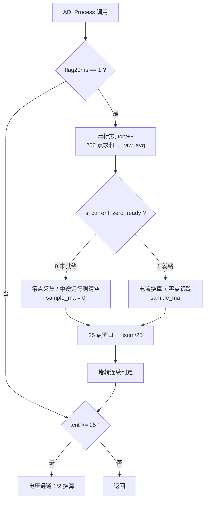

# ADC1_Read_filter() 代码解读

> **源码位置**：`qibiji/HARDWARE/ADC/adc.c` L263–L517
> **配套文件**：`adc.h`、`HARDWARE/DC_MOTOR/dc_motor.c`、`HARDWARE/TIMER/timer.c`、`HARDWARE/GPRS/event_pub.c`、`HARDWARE/REG/reg.c`
> **文档性质**：代码解读笔记，**未修改任何源码**。行号基于 2026-11-04 的工作副本。

---

## 0. 一句话总览

`ADC1_Read_filter()` 是一个由 20ms 节拍驱动的**状态机**：绝大多数状态保存在函数级 `static` 变量里，每次调用只推进一小步。它把 DMA 里的 ADC 原始码值换算成电流，同时承担四件事——开机零点标定、零点温漂跟踪、25 点滑动平均、堵转保护，另外每 500ms 顺带处理两个电压通道。

函数里**故意放了两套时间尺度**：`sample_ma` 是 20ms 单次值，给保护用（要快）；`armReg.motor_curr` 是 500ms 滑动平均，给上报和显示用（要稳）。理解这一点，就理解了整个函数的结构。

---

## 1. 调用上下文与硬件链路

```
main loop → AD_Process()  (adc.c L149)
          → ADC1_Read_filter()  (adc.c L263)
```

- **节拍来源**：`timer.c` L4 定义 `flag20ms`，L233 `if ((cnt % 4) == 0) flag20ms = 1;`。TIM2 每 5ms 进一次中断（`sys_ms += 5`），每 4 次置一次 20ms 标志。函数消费后立即清零。
- **主循环调用频率远高于 20ms**，所以绝大多数调用会跳过整个快路径，只走到函数末尾检查 `tcnt`。
- **硬件链路**：`ADC1_Channel_10`（PC0，电流采样）→ 0.05Ω 采样电阻 → GAIN=2 放大 → ADC1 12 位右对齐 → DMA1 循环搬运到 `AD_Value[N][M]`。ADC1 同时扫描 3 个通道（10/12/13），`[count][0]` 是电流，`[1]`/`[2]` 是太阳能电压、电池电压。
- **安全联锁**：`dc_motor.c` L105–L118，只要 `ADC_CurrentIsReady()` 返回 0，`Dcmotor_Process()` 就强制电机停止并 `return`。这保证零点一定能采到，也保证零点不准时保护不会失效。

---

## 2. 量纲链：ADC 码值怎么变成电流

| 阶段 | 变量 | 单位 | 计算 |
|---|---|---|---|
| ① | `AD_Value[count][0]` | LSB (0–4095) | DMA 循环缓冲当前快照 |
| ② | `raw_avg` | LSB | `sum / N`，`N = 256` 点平均 |
| ③ | `sample_ma` | **mA** | `(raw_avg − zero_avg) × ADC2CURT`，`raw_avg < zero_avg` 时取 0 |
| ④ | `armReg.motor_curr` | **mA** | `isum / 25`，25 点滑动平均（500ms） |
| ⑤ | 上报值 | A | `property_report.c` L34 `motor_curr / 1000.0f` |

**换算系数推导**（`adc.h` L15）：

```
ADC2CURT = 3.3 / (4.096 × SAMPLING_RES × GAIN)
         = 3.3 / (4.096 × 0.05 × 2)
         = 3.3 / 0.4096
         ≈ 8.0566 mA / LSB
```

即 1 个 ADC 码值 ≈ 8.06 mA。默认堵转阈值 3500 mA ≈ 434 LSB（`reg.c` L32）。

---

## 3. 变量总表

### 3.1 自动变量（每次调用重建）

| 变量 | 类型 | 含义 |
|---|---|---|
| `sum` | `u32` | 通用累加器，一身两用：先累加 256 个电流样本求 `raw_avg`，清零后在慢路径累加电压通道值。`u32` 必要：256×4095 ≈ 105 万 |
| `i` | `u8` | 通道下标，只在慢路径遍历 `i = 1..2` |
| `count` | `u16` | DMA 缓冲区下标，遍历 `0..255` |
| `raw_avg` | `u16` | 本轮电流通道原始均值（`sum / N`），单位 LSB |
| `sample_ma` | `u16` | 本轮瞬时电流，**单位 mA**；名字里的 `ma` 即 mA。同时喂给滑动窗口和堵转判定，局部初值已为 0 |

### 3.2 函数级 `static` 变量（跨 20ms 调用保持）

**零点标定组**

| 变量 | 类型 | 含义 |
|---|---|---|
| `zero_sum` | `u32` | 开机零点采集的累加和，16 个 `raw_avg` 之和（最大 16×4095 = 65,520） |
| `zero_sample_count` | `u8` | 已采零点样本数，0..16 |
| `zero_avg` | `u16` | **电流零点基线**（LSB），`= (zero_sum + 8) / 16`。整条电流链路的基准 |
| `current_stop_since` | `u32` | 电机**最后一次处于运行态**的时刻（`sys_ms` 快照，ms）。运行时每 20ms 刷新，停下后冻结 |
| `zero_track_tick` | `u32` | 上次零点微调的时刻（`sys_ms`，ms），控制两次跟踪至少间隔 1000ms |

**滑动窗口组**

| 变量 | 类型 | 含义 |
|---|---|---|
| `val[25]` | `u16[25]` | 环形缓冲，存最近 25 个 `sample_ma`（mA）；静态区零初始化 |
| `isum` | `u32` | 窗口内 25 个值的滚动和，避免每次重新求和 |
| `cnt` | `u8` | 已填充样本数 0..25；满 25 后才输出 `armReg.motor_curr` |
| `index` | `u8` | 环形写指针 0..24，每次 +1 并回绕 |

**节拍与保护组**

| 变量 | 类型 | 含义 |
|---|---|---|
| `tcnt` | `u8` | 慢路径节拍计数，每 20ms +1，到 25（500ms）清零并处理电压通道 |
| `stall_detect_count` | `u8` | 堵转连续超限计数，到 10（200ms）触发停机；电流正常或电机停止即清零 |
| `debug_tick` | `u32` | 调试打印节拍，`ADC_CURRENT_DEBUG = 0` 时不编译 |

### 3.3 引用的外部变量

**输入**

| 变量 | 含义 |
|---|---|
| `flag20ms` | `extern u8`，TIM2 置位的 20ms 节拍，函数消费后清零——快路径总开关 |
| `AD_Value[N][M]` | `u16[256][3]`，DMA 循环缓冲 |
| `sys_moter_state` | 全局电机状态，`MOTOR_STOP = 0x03`（`main.h` L10） |
| `sys_ms` | `volatile u32`，TIM2 每 5ms +5；约 49.7 天回绕，代码统一用 `(u32)(a − b)` 处理 |
| `s_current_zero_ready` | 文件级 `static u8`（adc.c L26），零点就绪标志，置 1 后**不复位**；经 `ADC_CurrentIsReady()`（L519）暴露 |
| `armReg.motor_warning_curr_upper` | 堵转阈值，默认 3500 mA，EEPROM 可配，LCD 上称"堵转电流" |
| `REFER[M]` | `{1580, 0, 0}`，电压通道参考偏移（见 §9 的遗留说明） |

**输出**

| 变量 | 含义 |
|---|---|
| `armReg.motor_curr` | 500ms 滑动平均电流（mA），GPRS 上报与 LCD 显示读它 |
| `g_adc_val[0]` | 同步成 `armReg.motor_curr`，**只在满窗分支写** |
| `g_adc_val[1..2]` | 电压通道换算结果 |

### 3.4 编译期常量（`adc.c` L12–L16、`adc.h`）

| 宏 | 值 | 作用 |
|---|---|---|
| `N` / `M` | 256 / 3 | 每通道 DMA 样本数 / 通道数；`adc.h` L6 注释写"128次"已过时 |
| `ADC2CURT` | ≈8.0566 | mA 每 LSB |
| `ADC_CURRENT_ZERO_SAMPLE_COUNT` | 16 | 零点样本数 → 320ms |
| `ADC_CURRENT_AVG_WINDOW` | 25 | 滑动窗口长度 → 500ms（**代码里除法与比较硬编码 25，改宏不生效**） |
| `ADC_CURRENT_ZERO_STABLE_MS` | 1000 | 停止后需稳定多久才允许零点跟踪 |
| `ADC_CURRENT_ZERO_TRACK_MS` | 1000 | 两次零点跟踪的最小间隔 |
| `ADC_CURRENT_DEBUG` | 0 | 调试打印开关 |

---

## 4. 逐分支执行流程



文字版顺序（与上图的节点一一对应）：

1. **节拍门禁**（L283）`if (flag20ms)`，进入即 `flag20ms = 0; tcnt++;`。步骤 1–5 全在这个块内。
2. **采样求均值**（L288–L293）`sum` 累加 `AD_Value[count][0]` 共 256 点 → `raw_avg = sum / N` → `sum = 0` 为慢路径腾位置。DMA 是循环模式+连续转换，取的是缓冲区当前快照，不是严格同步的一批，但 256 点平均已足够平滑。
3. **零点分支**（L296–L318）`ready = 0` 时：静止则累加 16 次、中途运行则清空重来；`sample_ma = 0`、`stall_detect_count = 0`。
4. **电流换算与跟踪**（L319–L348）`ready = 1` 时：`raw_avg >= zero_avg` 才换算，否则 `sample_ma = 0`。这是**单边整流**（不产生负电流）；代价是零点偏低时静止会出现"幽灵电流"。同分支内做零点跟踪（§6）。
5. **窗口 + 堵转**（L350–L403）先推进环形窗口，再判堵转；堵转只在 `sys_moter_state != MOTOR_STOP` 时生效。
6. **电压慢路径**（L501–L516）**在 `if(flag20ms)` 块之外**，靠 `tcnt` 静态值门控（§9）。

> **关键**：步骤 3 和 4 互斥，但**最后都汇入步骤 5**。零点期 `sample_ma = 0` 照样被写进滑动窗口 —— 这是 §11 问题 1 的根源。

---

## 5. 开机零点采集（L296–L318）

```c
if (!s_current_zero_ready) {
    if (sys_moter_state == MOTOR_STOP) {
        zero_sum += raw_avg;
        zero_sample_count++;
        if (zero_sample_count >= 16) {
            zero_avg = (u16)((zero_sum + 8) / 16);   // 四舍五入
            s_current_zero_ready = 1;
            current_stop_since = sys_ms;
            zero_track_tick    = sys_ms;
        }
    } else {
        zero_sum = 0;            // 中途开始运行，放弃本轮
        zero_sample_count = 0;
    }
    sample_ma = 0;
    stall_detect_count = 0;
}
```

- 连续 16 个 20ms 节拍 = **320ms**，电机静止时采 `raw_avg` 均值作为基线。
- `(zero_sum + 8) / 16` 是带四舍五入的整除；`zero_sum` 用 `u32` 保证 65,520 不溢出。
- 就绪瞬间同时设置两个时间戳，为后续跟踪建立时间基准。
- `Dcmotor_Process()` 的联锁使"上电就运行导致零点永远采不到"的死锁不成立。
- `sample_ma = 0` 与 `stall_detect_count = 0` 是防御性的（前者局部变量本就为 0，后者在 L400 还会再清一次）。

---

## 6. 零点跟踪与温漂补偿（L330–L347）

### 6.1 三段门控

```c
if (sys_moter_state != MOTOR_STOP) {
    current_stop_since = sys_ms;   // 两个时间戳都被刷新
    zero_track_tick    = sys_ms;
} else if ((u32)(sys_ms - current_stop_since) >= 1000u &&
           (u32)(sys_ms - zero_track_tick)    >= 1000u) {
    // 允许跟踪
}
```

| 阶段 | 行为 |
|---|---|
| 电机运行 | 两个时间戳每 20ms 刷新，语义是"最后一次看到运行"，不是"停止开始" |
| 停止 0–1000ms | 稳定期，禁止跟踪。避开绕组续流、继电器释放、机械惯性发电 |
| 静止 ≥1000ms | 允许跟踪，且距上次跟踪 ≥1000ms（速率门控） |

`(u32)(a − b)` 是无符号减法，在 `sys_ms` 回绕后仍能给出正确差值。

### 6.2 两级限速

```
candidate = (15 × zero_avg + raw_avg + 8) / 16     // 一阶 IIR，α = 1/16
candidate = clamp(candidate, zero_avg − 1, zero_avg + 1)   // 硬限幅
zero_avg = candidate;  zero_track_tick = sys_ms;
```

- IIR 等价于 `zero_avg + (raw_avg − zero_avg)/16`，`+8` 是 `/16` 的四舍五入。
- `(u32)` 强转必要：4095×15 + 4095 + 8 = 65,528，距 `u16` 上限 65,535 只差 7。
- **硬限幅才是真正的限速**：IIR 想一步跳 50 LSB 也只准走 ±1 LSB。配合 1000ms 间隔，实际速度 **1 LSB/s ≈ 8.06 mA/s**。
- 下溢保护写得很巧：判断用 `(u16)(candidate + 1u) < zero_avg` 而非 `candidate < zero_avg - 1u`。后者在 `zero_avg = 0` 时 `u16` 回绕成 65535；前者 `candidate + 1 >= 1 > 0` 恒假，不会触发 `zero_avg - 1u`。

### 6.3 为什么必须"静止"

运行时 `raw_avg` 含负载电流，拿它更新基线会把 `zero_avg` 抬高，于是 `sample_ma = raw_avg − zero_avg` 变小、堵转阈值被变相抬高 → **漏报**。这是最危险的失效方向，所以设计上宁可保守。

温漂来自 0.05Ω 采样电阻、运放输入失调、VREF；经 GAIN=2 和 12 位 ADC（≈0.8 mV/LSB）折算通常是每小时几个 LSB，1 LSB/s 绰绰有余。

### 6.4 代价

`s_current_zero_ready` 置 1 后永不复位、没有重标定入口；开机第一个 20ms tick 就采零点、没有上电稳定延时。一旦初始偏差大，只能按 1 LSB/s 慢慢磨 —— 偏 100 LSB（≈806 mA）需连续静止约 100 秒。

---

## 7. 25 点滑动窗口（L350–L378）

```c
if (cnt < 25) {                       // 填充期：只填不输出
    val[index] = sample_ma;
    isum += sample_ma;
    cnt++;
} else {                              // 满窗：减旧、加新、输出
    isum -= val[index];               // 减掉即将被覆盖的旧值
    val[index] = sample_ma;
    isum += sample_ma;
    armReg.motor_curr = isum / 25;
    g_adc_val[0] = armReg.motor_curr;
}
index++;
if (index >= 25) index = 0;
```

- **滚动和不变量**：`isum` 恒等于 `val[0..24]` 之和。"减旧、加新"维持等式，每 tick 只需 2 次加减即可拿到平均，不必重新累加 25 次；在 Cortex-M3 上是实打实的 O(1) 优化。
- `index++` 与回绕在**两个分支之外共用**，所以 `index` 是环形写指针，`cnt` 只是"是否已满"的标志（增到 25 后不再变化，不参与寻址）。
- **类型安全**：`isum` 用 `u32` 必要（25×65535 = 1,638,375）；实际 `sample_ma` 上限约 4095×8.06 ≈ 33,000 mA，25 个约 82.5 万，余量充足。`val[]` 是 `static` 未显式初始化，C 保证静态区零初始化。
- `isum -= val[index]` 依赖不变量成立：正常时 `isum` 必然 ≥ 其中任一元素，但代码没有防御性检查，一旦下溢，`u32` 回绕会让 `isum/25` 输出荒谬大值。
- `isum / 25` 直接整数截断，没做 `(isum + 12) / 25` 四舍五入，误差 < 1 mA。
- **输出时机**：`armReg.motor_curr` 与 `g_adc_val[0]` 只在满窗分支写，填充期保持旧值（上电为 0）。

---

## 8. 堵转检测（L382–L403）

**堵转（stall / locked-rotor）**：电机已通电输出转矩，但转子被卡住或负载扭矩超过最大扭矩，转速降到 0。与"过载"不同——过载是还在转、只是变慢。

直流电机等效关系 `U = E + I·R`，`E = k·ω` 是反电动势：

- 正常转动：`ω` 建立，`E` 接近 `U`，`I = (U − E)/R` 被反电动势压得很小。
- 堵转：`ω = 0` → `E = 0` → `I = U/R`，只剩绕组电阻（零点几欧）限流，电流可达额定值 5–10 倍，`P = I²R` 快速升温，会烧绝缘、烧驱动 MOS/继电器、拉垮电源、冲击减速箱。

**闸门上的典型场景**：门体被异物/结冰卡住、导轨变形、限位开关失效（到顶到底还在硬推）、机械卡死、人为阻挡。这些情况"到位信号"永远不会来，所以必须有独立于行程开关的保护。

**本项目的判据**：

1. 用已有的 0.05Ω 采样电阻 + GAIN=2 测电流，比加编码器便宜、也不怕测速传感器失效。
2. `sample_ma > armReg.motor_warning_curr_upper`（默认 3500 mA）。
3. **连续 10 个 20ms 节拍（≈200ms）**都超才动作 —— 避开启动浪涌（同样几倍电流但只持续几十 ms）和瞬时干扰；电流正常或电机停止立即清零计数。
4. 触发后 `EventPostMotorStall(sample_ma)` 把当时电流随事件上报，再 `dcmotor_request_stop(MOTOR_STOP_REASON_STALL)` 停机。停止原因枚举（`event_pub.h` L22–L28）里 `STALL` 与 `TARGET_REACH`、`LIMIT_OPEN`、`LIMIT_CLOSE`、`MANUAL`、`EMERGENCY_STOP` 并列，云端可区分正常到位与异常堵停。
5. 前提是 `ADC_CurrentIsReady()` 为真，否则电机根本不许启动 —— **零点没标好，电流读数就不准，整套保护等于没有**。

> 判据用的是 `sample_ma`（20ms 单次值），**不是** `armReg.motor_curr`（500ms 平均）。后者用于上报更平滑，但拿来做保护会滞后半秒，堵转时电机已白白硬顶 500ms。

---

## 9. 电压慢路径（L501–L516）

```c
if (tcnt >= 25) {                     // 在 if(flag20ms) 块之外
    tcnt = 0;
    for (i = 1; i < M; i++) {
        for (count = 0; count < N; count++)
            if (AD_Value[count][i] >= REFER[i])
                sum += AD_Value[count][i] - REFER[i];
        g_adc_val[i] = ((sum * 363) >> 20) + 3;   // +3 为分压电路偏移标定
        sum = 0;
    }
}
```

- `tcnt` 只在 20ms 块内 +1，所以这里是 25 × 20ms = **500ms** 一次。虽然检查在块外、每次主循环调用都会执行，但代价只是一次比较。
- `sum`、`count`、`i` 在快/慢路径复用，两边都手动清零，不冲突。
- `REFER = {1580, 0, 0}`：`REFER[1]/[2]` 为 0 而 `AD_Value` 是无符号 `u16`，所以 `if (AD_Value >= REFER)` 对电压通道恒真、等于没过滤；`REFER[0] = 1580` 是旧版电流基线，慢路径 `i` 从 1 起根本用不到。**整条 REFER 是历史遗留**。
- `sum * 363` 最大 1,048,320 × 363 ≈ 3.8 亿 < `2^32`，不溢出，但余量只剩约 11 倍。

---

## 10. 上电时间线（20ms 节拍）

| 时刻 | 零点状态 | `armReg.motor_curr` | 堵转保护 |
|---|---|---|---|
| 0–320ms | 采 16 次零点，`ready = 0`；电机被 `Dcmotor_Process()` 强制停机 | 恒为 0（填充期） | 禁用 |
| 320ms | `zero_avg` 就绪，两个时间戳置 `sys_ms` | 开始填充有效样本 | **生效**（用 `sample_ma`） |
| ≈520ms | 零点已就绪 | 满窗，`isum/25` 开始输出，但窗口里仍有零点期的 0 | 生效 |
| ≈820ms | 等待稳定期 | 窗口刷新完，读数才准确 | 生效 |
| 1320ms 起 | 静止满 1000ms，允许零点跟踪 | 正常 | 生效 |

零点跟踪最早发生在 320 + 1000 = **1320ms**，且要求这 1000ms 内电机一直静止（运行时时间戳会被刷新）。

---

## 11. 阅读笔记：观察到的问题（仅记录，未改代码）

按严重度排列：

1. **零点期的 0 混进 25 点滑动窗口**（L316 + L350–L378）
   FIFO 推进在零点 `if/else` 之外，`sample_ma = 0` 的 16 个样本也写进 `val[]`。满窗后仍有十几个 0，`isum/25` 被系统性压低，上报和 LCD 电流偏低，要再跑 25 个 tick（500ms）窗口才刷干净。堵转检测用 `sample_ma` 不受影响。
   *建议*：在 `!ready` 分支或就绪瞬间一并重置 `cnt = 0; index = 0; isum = 0;`。

2. **没有上电稳定期，而后续纠偏极慢**（L295 + L335–L347）
   第一个 20ms tick 就开采，运放偏置/电源可能未稳；跟踪只有 1 LSB/s 且要求连续静止 ≥1000ms，初始偏差大时要按百秒计才能纠正，期间可能误触发或漏报堵转。
   *建议*：上电延时 100–200ms 再采，或丢弃前 2–4 个样本。

3. **只有"瞬间静止"判断，没有"连续静止"门槛**（L298）
   判据是采样那一刻 `sys_moter_state == MOTOR_STOP`。若远程指令/中断在两次采样之间短暂起停又落下，带电流的样本会混进基线 → 基线偏高 → 电流被低估 → **堵转漏报**。
   *建议*：复用 `current_stop_since` 加静止时长条件。

4. **宏与注释脱节**
   `ADC_CURRENT_AVG_WINDOW` 定义了 25，但 `cnt < 25`、`index >= 25`、`isum/25` 全是字面量；L387 注释"连续1次检测到超限才停止（约300ms）"与 `stall_detect_count >= 10`（10×20ms = 200ms）不符，是旧版残留。

5. **`s_current_zero_ready` 置 1 后永不复位**
   没有重新标定入口，温漂只能靠慢速跟踪。属于设计取舍，但需知晓。

**正确性已核对的部分**：`zero_sum`/`isum` 的 `u32` 宽度、`(sum + 8)/16` 四舍五入、`(u32)(a − b)` 的回绕处理、零点跟踪的 `u16` 下溢保护、就绪瞬间两个时间戳的自洽性、与 `Dcmotor_Process()` 的联锁，均无问题。

---

## 12. 三个最容易混淆的点

1. **`tcnt` ≠ `cnt`**：前者管"多久算一次电压"（500ms 慢路径），后者管"电流窗口填了几个"。
2. **三个电流量不同**：`raw_avg`(LSB) → `sample_ma`(mA, 单次) → `armReg.motor_curr`(mA, 500ms 平均)。堵转看 `sample_ma`，上报看 `motor_curr`。
3. **两个时间戳都在电机运行时被刷新**，所以它们不是"停止开始时刻"，而是"最后一次看到运行"的时刻；停下后靠差值累计静止时长。

---

*本文由代码静态阅读整理，未做上板验证；涉及硬件标定常数（`363`、`+3`、`REFER`）的部分以实测为准。*
