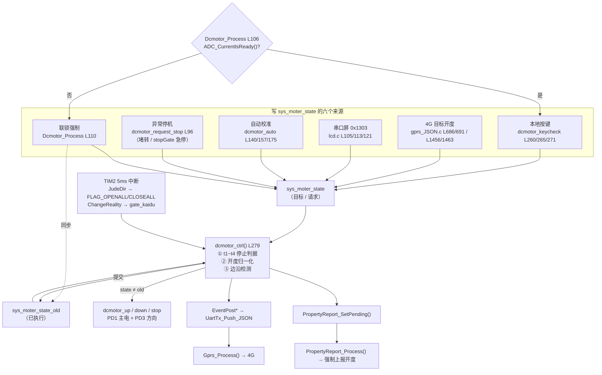

# Dcmotor_Process() 代码解读

> **源码位置**：`qibiji/HARDWARE/DC_MOTOR/dc_motor.c` L1–L366
> **配套文件**：`dc_motor.h`、`USER/main.c`、`USER/main.h`、`HARDWARE/SWITCH/switch.c`、`HARDWARE/GPRS/event_pub.c/.h`、`HARDWARE/GPRS/property_report.c`、`HARDWARE/GPRS/gprs_JSON.c`、`HARDWARE/ADC/adc.c`、`HARDWARE/REG/reg.h`、`HARDWARE/TIMER/timer.c`
> **文档性质**：代码解读笔记，**未修改任何源码**。行号基于 2026-11-04 的工作副本。
> **姊妹文档**：`docs/ADC1_Read_filter_explained.md`（电流采样与堵转判定的上游）

---

## 0. 一句话总览

`Dcmotor_Process()` 是电机控制子系统的**主循环入口**，它本身只有 24 行，作用是把"当前该往哪转"翻译成"继电器该怎么动"。

整套设计的核心不是函数，而是一个**约定**：

> `sys_motor_state` 是**请求**（谁都可以写），`sys_motor_state_old` 是**已执行**，两者不等才真正驱动 GPIO、上报事件。

所以按键、4G、串口屏、限位、自动校准、堵转保护这六个来源互不协商，都只管往 `sys_moter_state` 里写；`dcmotor_ctrl()` 在下一轮统一做边沿检测、裁决停止原因、落继电器动作。**这是一个无锁、无队列、单写多读语义下的裸机状态机。**

外加一条硬联锁：**电流零点没标定好，电机根本不许动**（L105–L118）。

---

## 1. 调用上下文

### 1.1 主循环位置（`main.c` L58–L84）

```c
while (1)
{
    IWDG_Feed();                  // 喂狗（3180ms）
    sbf20_poll();                 // 蓝牙
    if (uart3_at_sequence_main_loop_tick()) continue;
    KEY_Process();                // KEY      → 产生 KeyNum
    AD_Process();                 // 采集      → 含堵转判定，可能改写 sys_moter_state
    Dcmotor_Process();            // 电机      ← 本文主角
    Lcd_Process();                // 液晶显示
    PropertyReport_Process();     // 处理属性上报置位
    Gprs_Process();               // 4G 发送队列
    Eeprom_Wpara();               // 写 EEPROM
    manage485();                  // RS485
}
```

要点：

- **没有节拍门控**，`Dcmotor_Process()` 每个主循环都执行一遍（裸机超循环，无 RTOS）。真正的节奏由内部 `flag300ms` 位和状态边沿决定。
- **顺序有因果**：`AD_Process()` 在前，若判定堵转就在这轮内部调用 `dcmotor_request_stop()` 立刻断继电器；随后的 `Dcmotor_Process()` 检测到状态边沿，补发 `motor_stop` 事件；`PropertyReport_Process()` 再强制上报开度；`Gprs_Process()` 最后才把队列里的 JSON 发出去。**同一轮循环内完成"断电 → 记录 → 上报"。**
- **初始化**：`main.c` L40 `dcmotor_init()` 配置 GPIOD 并置继电器为全关；L54 `TIM2_Int_Init(7199, 50)` 起 5ms tick。

### 1.2 节拍来源（`timer.c`）

| 标志 | 置位条件 | 消费者 |
|---|---|---|
| `flag10ms` | `cnt % 2 == 0` | `JudeCount()` / `JudeLocked()` |
| `flag20ms` | `cnt % 4 == 0` | `ADC1_Read_filter()` |
| `flag300ms` | `cnt % 60 == 0` → `= 0x03` | **bit0** → `Lcd_Process()`（`Dispaly.c` L206）<br>**bit1** → `dcmotor_auto()`（`dc_motor.c` L130） |
| `flag500ms` | `cnt % 100 == 0` | `JudeKaidu()` |
| `flag1s` | `cnt % 200 == 0` | `manage485()` / LCD / `dcmotor_ctrl()` L362（已空置） |

`flag300ms` 用**一个字节的不同位服务两个消费者**：显示侧消费后 `&= 0xfe`，自动校准侧消费后 `&= 0xfd`，互不干扰。这是个容易看漏的小设计。

---

## 2. 状态量总表

### 2.1 状态枚举（`main.h` L8–L11）

| 宏 | 值 | 含义 |
|---|---|---|
| `MOTOR_UP` | `0x01` | 上升 / 开闸 |
| `MOTOR_DOWN` | `0x02` | 下降 / 关闸 |
| `MOTOR_STOP` | `0x03` | 停止（**初值**，`dc_motor.c` L14–L15 均为 3） |
| `MOTOR_RESET` | `0x04` | 复位（回落到下限位基准） |

注意 `MOTOR_STOP` 不是 0，而是 3；`main.h` 里那句注释把状态写反了（"0x01:升 0x02:降"尚可，但中文部分是 GBK 编码，用 UTF-8 打开会乱码，不影响编译）。

### 2.2 `dc_motor.c` 文件级变量（L14–L21）

| 变量 | 类型 | 含义 |
|---|---|---|
| `sys_moter_state` | `u8` | **目标状态**（请求）。六个来源共同写入，全局可读 |
| `sys_moter_state_old` | `u8` | **上次已执行状态**。仅 `dcmotor_ctrl()` L359 和联锁 L111 更新，用于边沿检测 |
| `sys_local_remote` | `u8` | 本地/远程标志，初值 1，本项目内**未见实际读写**（遗留） |
| `sys_moter_dir` | `u8` | **实际方向**，由 `dcmotor_up/down()` L62/L76 写入；`JudeDir()`（switch.c L181/L210）靠它判断"正在离开限位"，从而清 `FLAG_OPENALL/CLOSEALL` 并重置圈数 |
| `pending_stop_reason` | `static MotorStopReason` | **待上报的停止原因**。由 `dcmotor_request_stop()` 写入，`dcmotor_ctrl()` STOP 分支消费后清回 `UNKNOWN` |
| `openflag` / `closeflag` | `u8` | 定义后**全文未使用**（遗留） |
| `FLAG_OPENALL` / `FLAG_CLOSEALL` | `u8` | 全开 / 全关限位标志，**定义在本文件**，由 `switch.c: JudeDir()` L193/L220 置位、L184/L213 清零 |

### 2.3 外部依赖（`dc_motor.c` L23–L27）

| 变量 | 来源 | 用途 |
|---|---|---|
| `armReg` | `reg.h` / `reg.c` | 全局寄存器结构体，见下表 |
| `PageSta` | LCD | `0` = 默认参数页，只有此页响应本地按键 |
| `kaival` | 遗留 | 声明后未使用 |
| `rxparagate` | 4G | 远程下发的目标开度 |
| `remoteflag` | 4G | **远程命令生效标志**。`dcmotor_ctrl()` 的 t3/t4 目标到达判据依赖它；`dcmotor_stop()` L89 会清零 |
| `autoFlag` | `Dispaly.c` L15 / L562 | 自动校准行程标志，为 1 时禁止按键动作、禁止事件与属性上报 |
| `KeyNum` | `key.c` L40 | 按键扫描结果，`KEY_UP=1 / KEY_DOWN=2 / KEY_ENTER=3` |
| `flag300ms` / `flag1s` | `timer.c` L4 | 节拍标志 |
| `FLAG_A` / `FLAG_B` | `switch.c` L23 | 编码器脉冲状态，`dcmotor_up/down()` 启动时清零 |

### 2.4 `armReg` 中相关字段（`reg.h` L20–L61）

| 字段 | 含义 | 谁写 |
|---|---|---|
| `motor_on_off` | 电机开关状态（另一套"是否停机"的判据） | `dcmotor_keycheck()`、`dcmotor_stop()` L88、`dcmotor_auto()`、`initReg()` L199 |
| `gate_kaidu` | **当前开度 0–100** | `ChangeReality()`（switch.c L127）= `Num_count*100/gate_maxturns`；限位时 `dcmotor_ctrl()` L313/L315 归一化为 0/100 |
| `range_target` | **目标开度** | 4G `SettingValue()`（gprs_JSON.c L682/L1450）、LCD（lcd.c L106/L114 写 300 或 0） |
| `gate_maxturns` | 全行程螺纹圈数，自动校准结果 | `JudeDir()` switch.c L199 |
| `motor_curr` | 电机电流（mA，500ms 平均） | `ADC1_Read_filter()` |
| `motor_warning_curr_upper` | 堵转阈值，默认 **3500 mA**，存 EEPROM 0x0004 | `reg.c` L32/L111 |

### 2.5 停止原因枚举（`event_pub.h` L20–L29）

| 枚举 | 上报字符串 | 触发者 |
|---|---|---|
| `MOTOR_STOP_REASON_UNKNOWN` | `unknown` | 默认值 / `EVT_MOTOR_STOP` 旧路径 |
| `MOTOR_STOP_REASON_TARGET_REACH` | `target_reach` | 远程目标到达（t3/t4 或限位恰好等于 0/100 目标） |
| `MOTOR_STOP_REASON_LIMIT_OPEN` | `limit_open` | 上限位（t2） |
| `MOTOR_STOP_REASON_LIMIT_CLOSE` | `limit_close` | 下限位（t1） |
| `MOTOR_STOP_REASON_MANUAL` | `manual` | 兜底：本地停止键、LCD 停止、其他非上述情况 |
| `MOTOR_STOP_REASON_STALL` | `stall` | **堵转**（adc.c L391） |
| `MOTOR_STOP_REASON_EMERGENCY_STOP` | `emergency_stop` | **远程急停** `stopGate` 服务（gprs_JSON.c L557） |

---

## 3. 硬件层：继电器动作时序

`dc_motor.h` L9–L15：

```c
#define RLY_1H_ON   GPIO_SetBits(GPIOD, GPIO_Pin_1)   // 主电继电器
#define RLY_1H_OFF  GPIO_ResetBits(GPIOD, GPIO_Pin_1)
#define RLY_2H_ON   GPIO_SetBits(GPIOD, GPIO_Pin_3)   // 方向继电器
#define RLY_2H_OFF  GPIO_ResetBits(GPIOD, GPIO_Pin_3)
#define V01_CTRL    PDout(4)                          // 485 侧限位开关控制
#define V02_CTRL    PDout(5)
```

`dcmotor_init()`（L30–L51）把 PD1/PD3 配成推挽输出 50MHz，PD4/PD5 同样输出；上电先 `RLY_1H_OFF; RLY_2H_OFF;` 保证继电器全断，再把 `V01_CTRL = V02_CTRL = 1`。

三个动作函数：

| 函数 | 行号 | 动作序列 |
|---|---|---|
| `dcmotor_up()` | L54–L65 | `RLY_2H_ON` → `delay_ms(5)` → `RLY_1H_ON`；清 `FLAG_A/B`，`sys_moter_dir = MOTOR_UP`，`KeyLed_Ctl(0x01)` |
| `dcmotor_down()` | L68–L79 | `RLY_2H_OFF` → `delay_ms(5)` → `RLY_1H_ON`；清 `FLAG_A/B`，`sys_moter_dir = MOTOR_DOWN`，`KeyLed_Ctl(0x02)` |
| `dcmotor_stop()` | L82–L91 | 仅 `RLY_1H_OFF`；`KeyLed_Ctl(0x00)`；`armReg.motor_on_off = MOTOR_STOP`；`remoteflag = 0` |

**从代码反推的硬件结构**：`RLY_1H` 是主电源/使能继电器，`RLY_2H` 是换向继电器（ON = 升，OFF = 降）。

两个值得记住的细节：

1. **先定方向、延时 5ms、再上主电**。换向继电器触点需要弹跳稳定时间，若主电已通再切方向，等于带载拉弧，会烧触点甚至瞬间短路。这个 `delay_ms(5)` 是硬件保护，不是随手加的。
2. **停止只断主电，不动方向继电器**。减少一次机械动作，也避免停机瞬间的方向抖动。所以 `sys_moter_dir` 在停机后仍保留最后一次方向 —— 这正是 `JudeDir()` 判断"离开限位"所需要的。
3. `dcmotor_stop()` 里 `remoteflag = 0` 很关键：它让 `dcmotor_ctrl()` 的 t3/t4 目标到达判据在停机后失效，避免残留远程目标在下一次启动时造成误判。

> `dcmotor_stop()` 中 `sys_moter_dir = MOTOR_STOP` 被注释掉了（L87），是有意为之，理由同上。

---

## 4. `Dcmotor_Process()` 逐行解读（L101–L124）

```c
void Dcmotor_Process()
{
    static u8 current_blocked = 0;                       // L103 边沿/去重标志

    /* 电流零点完成前禁止电机运行 */
    if (!ADC_CurrentIsReady())                           // L106
    {
        if (!current_blocked || sys_moter_state != MOTOR_STOP)   // L108
        {
            sys_moter_state     = MOTOR_STOP;            // L110
            sys_moter_state_old = MOTOR_STOP;            // L111
            armReg.motor_on_off = MOTOR_STOP;            // L112
            remoteflag = 0;                              // L113
            dcmotor_stop();                              // L114 立即断继电器
        }
        current_blocked = 1;                             // L116
        return;                                          // L117 跳过全部三个子函数
    }
    current_blocked = 0;                                 // L119

    dcmotor_keycheck();   // L121 本地按键
    dcmotor_ctrl();       // L122 状态裁决 + 继电器 + 事件
    dcmotor_auto();       // L123 自动校准行程
}
```

### 4.1 联锁为什么必须存在

`ADC_CurrentIsReady()`（`adc.c` L519–L522）只是返回 `s_current_zero_ready`。而 `zero_avg` 要开机后连续 16 个 20ms 静止节拍（320ms）才标定完成。

在它完成之前：

- 电流读数 `sample_ma` 恒为 0（零点分支强制），**堵转保护完全失效**；
- 若允许电机启动，零点永远采不到（采集中途运行就清空重来）—— 但更糟的是"允许启动"本身会让保护形同虚设。

所以这里做的是**双向保证**：既保证零点一定能采到（电机被强制静止），也保证零点不准时电机不会带电运行。

### 4.2 五个强制动作的含义

| 动作 | 目的 |
|---|---|
| `sys_moter_state = MOTOR_STOP` | 覆盖所有来源（按键/4G/LCD）在本轮写入的启动请求 |
| `sys_moter_state_old = MOTOR_STOP` | **同步 old**，避免零点就绪那一轮补发一条假的 `motor_stop` 事件 |
| `armReg.motor_on_off = MOTOR_STOP` | 让 `dcmotor_keycheck()` 的停机判据一致 |
| `remoteflag = 0` | 丢弃尚未执行的远程目标 |
| `dcmotor_stop()` | 物理断继电器，不只是改软件状态 |

`current_blocked` 的作用：状态已是 STOP 且本轮无人试图启动时，跳过这 5 个重复的写操作（尤其避免每轮都去动 GPIO）。条件是 `!current_blocked || sys_moter_state != MOTOR_STOP`，即"首次进入"或"有人试图启动"时都会再执行一次强制。

### 4.3 三个子函数的顺序

`keycheck → ctrl → auto`：

- 按键先把 `sys_moter_state` 写成目标；
- `ctrl()` 立即在同一轮做边沿检测并驱动继电器（**响应无额外延迟**）；
- `auto()` 最后，在校准模式下可以覆盖 `sys_moter_state`，但要等下一轮 `ctrl()` 才生效。

---

## 5. `dcmotor_ctrl()` 三段式（L279–L366）

这是整个电机子系统最核心的函数。它分三段：**判定停止 → 归一化 → 边沿执行**。

### 5.1 第一段：四个停止条件（L286–L307）

```c
bool t1 = false, t2 = false, t3 = false, t4 = false;
MotorStopReason stop_reason;

t1 = FLAG_CLOSEALL == 1 && (sys_moter_state == MOTOR_DOWN || sys_moter_state == MOTOR_RESET); // 下限位
t2 = FLAG_OPENALL  == 1 && (sys_moter_state == MOTOR_UP   || sys_moter_state == MOTOR_RESET); // 上限位
t3 = sys_moter_state == MOTOR_UP   && armReg.gate_kaidu >= armReg.range_target && remoteflag; // 上升到达目标
t4 = sys_moter_state == MOTOR_DOWN && armReg.gate_kaidu <= armReg.range_target
                                   && armReg.range_target != 0 && remoteflag;                 // 下降到达目标
```

| 条件 | 含义 | 备注 |
|---|---|---|
| `t1` | 到下限位，且正在下降/复位 | 物理保护，**不看 `remoteflag`** |
| `t2` | 到上限位，且正在上升/复位 | 物理保护 |
| `t3` | 远程开闸到达目标开度 | 只在 `remoteflag=1`（远程命令）时生效 |
| `t4` | 远程关闸到达目标开度 | 额外排除 `range_target == 0`，避免目标为 0 时开度一为 0 就立刻停；这种情况交给 t1 下限位 |

**限位标志从哪来**：`switch.c: JudeDir()` 由 TIM2 每 5ms 调用（timer.c L225），读取 `UP_LIMIT` / `DN_LIMIT` 接近开关（**低电平有效**）：到位时置 `FLAG_OPENALL/CLOSEALL = 1`，离开时清零并把 `Num_count` 归 0 或置为 `gate_maxturns`。所以 t1/t2 是中断侧刷新的硬件事实，不是主循环推算的。

**开度从哪来**：`switch.c: ChangeReality()`（L94–L135）在编码器脉冲（`CODE1/CODE2` 低电平）到来时按方向增减 `Num_count`，再算 `gate_kaidu = Num_count * 100 / gate_maxturns`，并 `PropertyReport_SetPending()`。

### 5.2 停止原因裁决（L296–L307）

```c
stop_reason = pending_stop_reason;                     // ① 外部显式指定优先
if (stop_reason == MOTOR_STOP_REASON_UNKNOWN)
{
    if (t3 || t4 || (remoteflag && ((t1 && armReg.range_target == 0)
                                 || (t2 && armReg.range_target >= 100))))
        stop_reason = MOTOR_STOP_REASON_TARGET_REACH;  // ② 远程命令恰好要求全关/全开，撞限位也算"到达目标"
    else if (t1)  stop_reason = MOTOR_STOP_REASON_LIMIT_CLOSE;
    else if (t2)  stop_reason = MOTOR_STOP_REASON_LIMIT_OPEN;
    else          stop_reason = MOTOR_STOP_REASON_MANUAL;  // ③ 兜底
}
```

优先级：`pending_stop_reason`（堵转/急停） > 目标到达 > 限位 > 手动。这个顺序保证了**异常停机不会被误标成正常到位**。

注意 `stop_reason` 是**局部变量，每轮重算，但只在状态跳到 STOP 的那一轮被消费**（L346）。没有跳变时算出来的值直接丢弃。

### 5.3 第二段：开度归一化（L309–L317）

```c
if (t1 || t2 || t3 || t4)
{
    if (t1)      armReg.gate_kaidu = 0;      // 下限位 → 强制 0
    else if (t2) armReg.gate_kaidu = 100;    // 上限位 → 强制 100
    sys_moter_state = MOTOR_STOP;
}
```

编码器累计开度可能因为丢脉冲停在 97 或 3。物理限位是绝对基准，所以到位时直接把开度写成边界值 —— 保证停机后 `EventPostMotorStop()` 和 `PropertyReport_Force()` 上报的是精确的 0/100，而不是 97/3。

**补充（本轮对话）：`gate_kaidu` 平时从哪来、为什么是 0~100。** 除了到限位时这里的强制归一化，运行中的开度由 `HARDWARE/SWITCH/switch.c` 的 `ChangeReality()` 每来一个转数脉冲算一次：`armReg.gate_kaidu = Num_count * 100 / gate_maxturns`。`Num_count` 是已走圈数、`gate_maxturns` 是全行程总圈数（默认 80，自动校准时由上限位确定）；`*100` 不是补偿系数，只是把 0~1 的比例写成 **0~100 的百分数**——LCD 直接 `%d` 显示、云端下发的 `SettingValue()` 目标值、属性上报的 `Opening` 字段全是这个量纲。必须**先乘后除**，否则整数除法 `40/80 = 0`，除全开那一帧外开度永远是 0。`t1` / `t2` 即 `FLAG_CLOSEALL` / `FLAG_OPENALL`，由 `JudeDir()` 每 5ms 锁存，并在每次到/离物理端点时把 `Num_count` 强制归零或对齐满量程，用来清掉丢步累积误差。实现见 `HARDWARE/SWITCH/switch.c` 的 `JudeCount()` / `ChangeReality()` / `JudeDir()` / `JudeKaidu()`，其中 `JudeLocked()` 是空壳。

### 5.4 第三段：边沿执行（L320–L360）

```c
if (sys_moter_state_old != sys_moter_state)
{
    switch (sys_moter_state) { ... }
    sys_moter_state_old = sys_moter_state;    // L359 提交
}
```

三个 `static` 标志 `event_motor_up_posted / down_posted / stop_posted`（L281–L283）用于**防止同一状态被重复上报**：

| 目标状态 | 动作 |
|---|---|
| `MOTOR_UP` | 首次 → `EventPost(EVT_MOTOR_START_UP)`；置 `up_posted=1`、清 `stop_posted`；`dcmotor_up()` |
| `MOTOR_DOWN` | 首次 → `EventPost(EVT_MOTOR_START_DOWN)`；置 `down_posted=1`、清 `stop_posted`；`dcmotor_down()` |
| `MOTOR_STOP` | 清 `up/down_posted`；首次 → `event_motor_stop_posted=1`、`EventPostMotorStop(stop_reason, gate_kaidu)`、`pending_stop_reason = UNKNOWN`、`PropertyReport_SetPending()`；`dcmotor_stop()` |
| `MOTOR_RESET` | 直接 `dcmotor_down()`（向基准位回落），**不发事件、不停机** |

`PropertyReport_SetPending()` 只置一个标志位（`property_report.c` L144–L147），真正的 JSON 构建推迟到主循环 `PropertyReport_Process()`（L149–L162）—— 注释写明是为了"避免 `enquiry_para_to_json` 在中断中执行导致栈溢出"。

### 5.5 末尾的空壳（L362–L365）

```c
if (sys_moter_state != MOTOR_STOP && flag1s == 1) { /* gprs_send_datas(PUBLISH,0); */ }
```

分支体已被注释空，只剩条件判断。周期上报已由 `PropertyReport_Process()` 接管，这里属于旧版残留，可以视为死代码。

---

## 6. 停止原因与事件上报链路

### 6.1 两条上报路径

```
【路径 A：正常/限位/目标停机】
 dcmotor_ctrl() L346
   └→ EventPostMotorStop(reason, opening)        event_pub.c L108
        ├→ MotorStopReasonText(reason)            L87   → "target_reach"/"limit_open"/"stall"/...
        ├→ snprintf: "reason":"xxx","opening":N
        └→ replyEven("motor_stop", para, "")     L37
             └→ UartTx_Push_JSON(...)            L71  → 发送队列 → Gprs_Process()

【路径 B：堵转】
 ADC1_Read_filter() adc.c L390  → EventPostMotorStall(sample_ma)
                                   └→ "motor_stall" 事件，参数 motor_current
 adc.c L391                     → dcmotor_request_stop(MOTOR_STOP_REASON_STALL)
                                   └→ pending_stop_reason = STALL
                                   └→ state = STOP + dcmotor_stop() 立即断电
 同轮 Dcmotor_Process() → dcmotor_ctrl() STOP 分支
                                   └→ EventPostMotorStop(STALL, gate_kaidu)
```

**一次堵转云端会收到两条事件**：先 `motor_stall`（带触发电流值），再 `motor_stop`（`reason=stall`、带停机开度）。这是刻意分工，不是重复。

### 6.2 事件门控

`EventPostMotorStall()` L78、`EventPostMotorStop()` L112、`EventPost()` L125 三者都有同一道门：

```c
if (!gprs_is_ready() || autoFlag == 1) return 0;
```

- **4G 未就绪** → 事件直接丢弃，不缓存、不重发。所以离线期间的启动/停机事件会永久丢失，只有属性上报（连接恢复后）能反映当前状态。
- **`autoFlag == 1`（自动校准中）** → 不上报，避免校准过程产生的大量状态跳变刷屏。

### 6.3 `dcmotor_request_stop()` 的双保险（L93–L98）

```c
void dcmotor_request_stop(MotorStopReason reason)
{
    pending_stop_reason = reason;     // 记录原因，等 ctrl() 上报
    sys_moter_state = MOTOR_STOP;     // 改请求，制造边沿
    dcmotor_stop();                   // 立即物理断电，不等主循环
}
```

它**故意不更新 `sys_moter_state_old`**，这样下一轮 `dcmotor_ctrl()` 必然检测到边沿、进入 STOP 分支补发事件。而 `dcmotor_stop()` 已经先断了电，所以即使主循环被其他任务卡住，继电器也已经安全。代价是 STOP 分支里会再调一次 `dcmotor_stop()`（重复写 GPIO，无害）。

调用点只有两处：`adc.c` L391（堵转）、`gprs_JSON.c` L557（远程 `stopGate` 急停）。

---

## 7. `dcmotor_keycheck()`：本地按键（L254–L276）

```c
if (PageSta == 0)   // 只在默认参数页响应
{
    if (KeyNum == KEY_UP   && armReg.motor_on_off == MOTOR_STOP
                           && FLAG_OPENALL != 1 && autoFlag == 0)
        { sys_moter_state = MOTOR_UP;   armReg.motor_on_off = MOTOR_UP; }
    else if (KeyNum == KEY_DOWN && armReg.motor_on_off == MOTOR_STOP
                                && FLAG_CLOSEALL != 1 && autoFlag == 0)
        { sys_moter_state = MOTOR_DOWN; armReg.motor_on_off = MOTOR_DOWN; }

    if (KeyNum == KEY_ENTER)   // 停止键，无条件
        { sys_moter_state = MOTOR_STOP; armReg.motor_on_off = MOTOR_STOP; autoFlag = 0; }
}
```

四重门控：`PageSta == 0`（页面）、`motor_on_off == STOP`（当前停机）、`限位未到`（方向保护）、`autoFlag == 0`（校准中不响应）。`KEY_ENTER` 是唯一的无条件动作，且顺带退出自动校准 —— 这是校准过程的**软件急停**。

按键只写状态，不碰 GPIO；实际动作由紧随其后的 `dcmotor_ctrl()` 完成。

---

## 8. `dcmotor_auto()`：自动校准行程（L125–L195）

`autoFlag` 由 LCD 菜单置 1（`Dispaly.c` L562），目的是**走一遍全行程，测出 `gate_maxturns`（螺纹总圈数）**，之后开度才能由 `Num_count * 100 / gate_maxturns` 换算。

节拍：`(flag300ms & 0x02) == 0` 时直接 return；消费后 `flag300ms &= 0xfd` 清 bit1。即**每 300ms 推进一步**。

| step | 动作 | 跳转条件 |
|---|---|---|
| 0 | 若未到下限位 → `state = DOWN` | 无条件 → step 1 |
| 1 | 等待下限位 | `FLAG_CLOSEALL == 1` 连续 **10 次**（≈3s）→ step 2 |
| 2 | `state = UP` | 无条件 → step 3 |
| 3 | 等待上限位 | `FLAG_OPENALL == 1` 连续 10 次（≈3s）→ step 4（注释"存储圈数"是空的，实际写在 `switch.c` L197–L203） |
| 4 | `state = DOWN` | 无条件 → step 5 |
| 5 | 等待下限位 | 到位 → `step = 0; autoFlag = 0`，校准结束 |
| `autoFlag == 0` | — | `step = 0` 复位（`cnt` 不清，见下） |

几个细节：

- `cnt >= 10` 不是"延时 3 秒"，而是**限位信号必须连续保持 10 个 300ms 节拍**的去抖确认；信号中途消失 `cnt` 不累加也不清零。
- 圈数的实际存储发生在 `JudeDir()`（`switch.c` L197–L203）：`if (autoFlag) { armReg.gate_maxturns = Num_count; Witeflag = 1; EepromAddr = 0x0004; }`，由 `Eeprom_Wpara()` 落盘。**注意 `EepromAddr = 0x0004` 与 `reg.h` 中 `GATE_MOTOR_MAXCURR_WORD_IDX = 2`（字节 0x0004，电流阈值）地址冲突**，需结合 `Eeprom_Wpara()` 的实际写入逻辑核对，静态阅读无法确定是否真的写错。
- `dcmotor_auto_stop()`（L197–L251）是另一版校准流程（上升→到位→下降→到位），step 编号为 `0,1,4,5`（跳过 2/3，明显从 `dcmotor_auto()` 裁剪而来）。**全项目只有定义、没有任何调用点**，且未出现在 `dc_motor.h` 声明中 —— 死代码/备用实现。

---

## 9. `sys_moter_state` 的多写者与完整数据流



**读图要点**：六个写者互不协商，全部落到一个字节；`dcmotor_ctrl()` 是唯一的收敛点。硬件限位和开度从中断侧旁路输入，不经过状态寄存器。

---

## 10. 与 ADC 电流保护的闭环

这条链把本文件和姊妹文档串起来：

| 步骤 | 位置 | 动作 |
|---|---|---|
| ① 上电 | `adc.c` L296–L309 | 电机被 `Dcmotor_Process()` 强制静止，16 个 20ms 采出 `zero_avg` |
| ② 就绪 | `adc.c` L519 | `ADC_CurrentIsReady()` 返回 1，联锁解除 |
| ③ 运行 | `adc.c` L321–L328 | `sample_ma = (raw_avg − zero_avg) × 8.06` mA |
| ④ 判定 | `adc.c` L382–L392 | 连续 10 个 20ms（200ms）`> 3500mA` → 堵转 |
| ⑤ 上报+断电 | `adc.c` L390–L391 | `EventPostMotorStall(sample_ma)` → `dcmotor_request_stop(STALL)` |
| ⑥ 补发停机 | `dc_motor.c` L340–L350 | 同轮 `dcmotor_ctrl()` 边沿 → `motor_stop(reason=stall, opening)` + 属性置位 |
| ⑦ 发送 | `main.c` L80–L81 | `PropertyReport_Process()` / `Gprs_Process()` |

关键设计：**保护判据用 `sample_ma`（20ms 单次值），不用 `armReg.motor_curr`（500ms 平均）**。后者虽平滑，但会让电机多硬顶半秒。

---

## 11. 代码审查发现（仅记录，未修改）

按影响程度排列。以下均为静态阅读结论，**未改动任何源码**。

| # | 位置 | 问题 | 影响 |
|---|---|---|---|
| 1 | `dc_motor.c` L296 / L347 | **`pending_stop_reason` 可能残留**。`dcmotor_request_stop()` 若在 `sys_moter_state` 已是 STOP 时被调用（急停命令重复下发、或停机后仍触发堵转判定），`old == state == STOP`，`dcmotor_ctrl()` 不进 switch，`pending_stop_reason` 不会被清回 `UNKNOWN`。 | 下一次正常停机会被错误标成 `stall` / `emergency_stop`，云端收到误报警。建议 `dcmotor_request_stop()` 里判断"已停机则直接上报并清零"，或在 `ctrl()` 中兜底清理。 |
| 2 | `dc_motor.c` L325–L339 | **UP → DOWN 直接切换会漏报 START 事件**。UP 分支置 `up_posted=1`；DOWN 分支只置 `down_posted=1`、清 `stop_posted`，**没清 `up_posted`**。此后 DOWN→UP 时 `if (!event_motor_up_posted)` 为假。 | 远程目标突变导致反向运行时，第二次上升不上报 `motor_start_up`。同理 DOWN 分支也没被 STOP 之外的路径清理。三个标志应在任一状态切换时统一重置，或干脆只用一个"上次已上报状态"变量。 |
| 3 | `dc_motor.c` L258/L263 vs `lcd.c` L100–L124、`gprs_JSON.c` L686 | **两套"是否停机"判据不同步**。`dcmotor_keycheck()` 用 `armReg.motor_on_off`，但 LCD 串口和 4G `SettingValue()` 只写 `sys_moter_state`（4G 还写 `remoteflag`），**不写 `motor_on_off`**；`dcmotor_stop()` 才把它改回 STOP。 | 远程启动期间 `motor_on_off` 仍为 STOP，本地按键可能重复触发；或反之，状态已停但 `motor_on_off` 非 STOP 导致按键被拒。建议统一以 `sys_moter_state` 为唯一判据。 |
| 4 | `dc_motor.c` L306 | **`MANUAL` 兜底过宽**。任何非 t1~t4、非 pending 的 STOP（本地键、LCD 停止、`Dcmotor_Process()` 联锁强制停机）都被标成 `manual`。 | 云端无法区分"人按了停止"和"系统因零点未就绪强制停机"。后者其实是值得告警的异常。 |
| 5 | `dc_motor.c` L285 | TODO 注释已过时："应该考虑增加除限位以外的其他停止条件，如堵转（计时）、过流等" —— 堵转/过流保护早已落在 `adc.c` L382–L392。 | 误导后续维护者，可能重复实现。 |
| 6 | `dc_motor.c` L197–L251 | `dcmotor_auto_stop()` **无调用点、无头文件声明**，step 编号跳过 2/3。 | 死代码，占用 Flash（约几十字节）。 |
| 7 | `dc_motor.c` L362–L365 | `flag1s` 分支体已注释空。 | 死代码；`flag1s` 是全局共享标志，`manage485()` 里会清零，此处不清零是正确做法，但条件判断本身已无意义。 |
| 8 | `dc_motor.c` L20 | `openflag` / `closeflag` 定义后全文未使用；`sys_local_remote`（L16）初值 1 后无读写。 | 遗留变量。 |
| 9 | `switch.c` L202 | 自动校准写 `EepromAddr = 0x0004`，而 `reg.h` L80 把字节 `0x0004` 定义为电流上限 `GATE_MOTOR_MAXCURR_WORD_IDX`。 | **地址疑似冲突**，需结合 `Eeprom_Wpara()` 实际写入分支核对；静态阅读不能断定写错，但值得实测验证。 |
| 10 | `lcd.c` L106 / L114 | LCD 上升时写 `armReg.range_target = 300`（>100），下降写 0。 | `300` 是魔法数；因 `remoteflag` 未置位，t3 不生效，LCD 上升实际只靠上限位停。若某处意外置位 `remoteflag`，`gate_kaidu >= 300` 永不成立 → 只能靠限位保护。 |

---

## 12. 三个最容易混的点

1. **`sys_moter_state` ≠ `sys_moter_state_old`**。前者是"想去哪"，谁都能写；后者是"上次执行到哪"，只有 `dcmotor_ctrl()` 和联锁更新。**继电器只在两者不等时才动作** —— 这就是为什么停止键、限位、4G 命令可以随便写状态而不会造成 GPIO 抖动。
2. **`sys_moter_state` ≠ `armReg.motor_on_off`**。前者是电机控制的真实状态源，后者是给 LCD/按键看的镜像寄存器，两者由不同代码路径维护，可能不同步（见 §11 #3）。`dcmotor_stop()` 只改后者、不改前者 —— 因为前者往往已经被调用方改好了。
3. **`FLAG_OPENALL/CLOSEALL` 定义在 `dc_motor.c`，却由 `switch.c` 在中断里赋值**。看到 `dc_motor.c` L21 的初始化别以为它们是主循环算出来的；它们是 5ms 中断根据接近开关刷新的硬件事实，主循环只读。

---

## 13. 一句话串起来

主循环每轮问一次「零点标定好了吗」→ 好了才允许 `keycheck / ctrl / auto` 依次跑 → `ctrl()` 把六个来源写入的 `sys_moter_state` 与 `old` 比对，结合中断刷新的限位与开度算出该不该停、为什么停 → 有边沿就驱动 PD1/PD3 继电器、发启动/停机事件、置属性上报 → 事件与属性在后续 `PropertyReport_Process()` / `Gprs_Process()` 里真正发出去。堵转时 `adc.c` 通过 `dcmotor_request_stop()` 抢先断电，再借同一套边沿机制补发 `reason=stall` 的停机事件。

---

*本文档由静态代码阅读整理，硬件继电器功能（主电/换向的角色划分）、EEPROM 地址冲突、标定常数来源均需以原理图与实测为准。*
