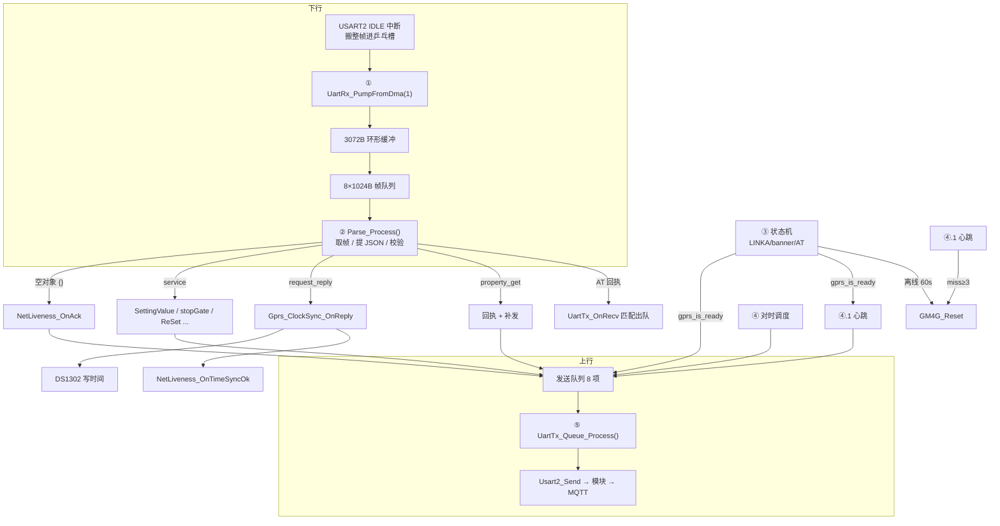

# Gprs_Process() 代码解读

> **源码位置**：`qibiji/HARDWARE/GPRS/gprs_JSON.c` L357–L398
> **配套文件**：`gprs_AT.c`、`uart_queue.c/.h`、`net_liveness.c/.h`、`property_report.c/.h`、`event_pub.c`、`gprs.h`、`USER/main.c`
> **文档性质**：代码解读笔记，**未修改任何源码**。行号基于 2026-11-05 的工作副本。
> **姊妹文档**：`docs/ADC1_Read_filter_explained.md`、`docs/Dcmotor_Process_explained.md`、`docs/Lcd_Process_explained.md`

---

## 0. 一句话总览

`Gprs_Process()` 只有 41 行，是**整条 4G 上云通道在主循环里的唯一驱动点**——它自己不解析报文、不发一个字节，只按固定顺序把七个"轮子"转一遍：

```
收 → 解 → 连 → 报 → 活 → 发 → 复位
```

**关键认知：这不是一个函数，而是一条流水线。** 每一轮主循环都从头到尾走一遍，所有跨轮状态都藏在各子模块的 `static` 变量里。函数体里没有 `while(1)`、没有阻塞等待（除了 `GM4G_Reset()` 的 1~1.5s），因此它天然是**非阻塞的轮询调度器**。

第二个关键认知：**接收和发送是两个完全独立的队列**。下行帧从 DMA 进环形缓冲进帧队列（`UartTx_OnRecv` 只负责"匹配并出队"），上行帧从业务层进发送队列，由第 5 步统一发出。中间的 `Parse_Process()` 是唯一把两边联系起来的地方。

---

## 1. 调用上下文

### 1.1 主循环位置（`main.c` L58–L84）

```c
while (1)
{
    IWDG_Feed();                  // 看门狗（3180ms）
    sbf20_poll();                 // 蓝牙
    if (uart3_at_sequence_main_loop_tick()) continue;   // ← 注意这里
    KEY_Process();
    AD_Process();                 // 含堵转判定
    Dcmotor_Process();
    Lcd_Process();
    PropertyReport_Process();     // ← 属性上报在 Gprs_Process 之前
    Gprs_Process();               // ← 本文主角
    Eeprom_Wpara();
    manage485();
}
```

三个要点：

1. **无节拍门控**：`Gprs_Process()` 每个主循环都跑，频率取决于其他任务耗时（典型几百 µs 到几 ms 一轮）。所有"定时"都靠内部的 `sys_ms` 差值判断。
2. **`PropertyReport_Process()` 在前**：属性 JSON 先入发送队列，随后第 5 步同轮发出，属性上报延迟 < 1 轮。
3. **蓝牙 AT 配置会整体跳过**：`uart3_at_sequence_main_loop_tick()` 返回 1 时 `continue`，整个 `Gprs_Process()` 不执行。此时 UART2 被 `uart3_at_sequence.c` 独占（`usart2.c` L154 用 `!uart3_at_sequence_should_run()` 关掉了暂存槽），所以不冲突，但**这期间 4G 上下行全停**，最长可达数秒。

### 1.2 内部分步与时间尺度

| 步 | 调用 | 作用 | 典型耗时 | 何时真正做事 |
|---|---|---|---|---|
| 1 | `gprs_rx_datas()` | 从 DMA 暂存槽搬帧进环形缓冲/帧队列 | µs 级 | 有帧时 |
| 2 | `Parse_Process()` | 取帧、解析、分发、执行命令、入队回执 | 数十 µs ~ 数 ms | 队列非空 |
| 3 | `gprs_state_machine()` | 六态链路状态机 | µs 级 | 每轮 |
| 4 | `Gprs_PeriodicPush_Process()` | 对时（`sys.timeSync`）调度 | µs 级 | 每轮 |
| 4.1 | `NetLiveness_Process()` | 心跳探活 + 模块自愈 | µs 级 | 每轮（仅 NORMAL） |
| 5 | `UartTx_Queue_Process()` | 发送队列状态机 | µs 级（`Usart2_Send` 为 DMA 启动） | 每轮 |
| 5.1 | `Gprs_ClockSync_Process()` | 对时超时重发/放弃 | µs 级 | 每轮 |
| 6 | `Gprs_Reset_Process()` | 延迟复位 | µs 级（触发时 `NVIC_SystemReset`） | 有待复位 |
| 7 | 内联 | 丢包计数变化打印 | µs 级 | 计数变化时 |

---

## 2. 七步逐条拆解

### 2.1 ① 接收：`gprs_rx_datas()`（L401–L423）

```c
UartRx_PumpFromDma(1);          // 从 USART2 暂存槽搬帧
if (g_uart2_banner_seen) {      // 见过模块启动 banner
    g_uart2_banner_seen = 0;
    atflag_online = 1;          // ← 映射为"模块已就绪"
}
Usart2_Rec_Cnt = 0;             // 清给 AT 序列用的旧标志
UART2_RX_Complete = 0;
```

**它做三件事，缺一不可：**

- **搬帧**：`UartRx_PumpFromDma(1)` 一次最多取 4 帧，取槽 + `memcpy` 期间短关中断（`uart_queue.c` L587），保证中断不会在拷贝中途改写同一槽。随后 `UartRx_Extract()` 把 3072 字节环形缓冲切成 ≤1023 字节的块压进 8 项帧队列。
- **banner 映射**（L410–415）：中断里只记录"看到过 `WH-LTE-7S1` 这行字符串"（`g_uart2_banner_seen`，`volatile`），在这里才提升为状态机可用的 `atflag_online`。**分层原因**：驱动层不懂状态机语义，中断也不能打日志。
- **清旧标志**：`Usart2_Rec_Cnt` / `UART2_RX_Complete` 是给 `uart3_at_sequence.c` 那套"直接读 DMA"的老逻辑用的，正常路径消费完必须清掉，否则 AT 序列会读到过期内容。

**这一步同时是"长阻塞期间的保险"**：`AT24CXX_Write()` 在每写 8 字节时也调 `UartRx_PumpFromDma(0)`（`24cxx.c` L198），所以 BLE 一次 128 字节写入（≈1.28s）期间下行帧仍会被搬进环形缓冲，不会被下一次 DMA 覆盖。

**补充（本轮对话）：banner 证据的业务价值与四层证据。** `g_uart2_banner_seen` 之所以要存在，是因为 `link_state`（LINKA 引脚）只证明「模块跟基站注册上了」，**模块串口可能还没启动完**；此时若 MCU 一看见 LINKA 就压三条 AT（`+ICCID` / `+MQTTCID` / `+CSQ`），模块答不了 → AT 全部超时 → 重试耗尽 → 进 `GPRS_AT_INIT_BACKOFF_MS = 30 分钟` 长退避，现场表现是「上电半小时不上线」。banner（模块上电/复位后主动吐的 `WH-LTE-7S1` 启动信息）是 MCU 能拿到的**唯一一个「模块端已就绪」的主动证据**，放行条件在 `gprs_AT.c:177`：`if (link_state && (atflag_online || link_down_occurred))`。掉线恢复时模块不会再吐一次 banner，所以 `gprs_AT.c:135-136` 用 `link_down_occurred` 那半边放行。四层证据别混：

| 层 | 变量 | 证明什么 |
|---|---|---|
| 蜂窝注册 | `link_state`（LINKA GPIO） | 模块跟基站连上了 |
| 串口可对话 | `atflag_online`（banner） | 模块启动完、UART 能收发 AT |
| 业务总闸 | `gprs_is_ready()`（NORMAL） | 三条 AT 都过，可发业务 JSON |
| 平台可达 | 心跳回执 | 云端真的收到并回应了 |

另外 §2.1 里被清掉的 `UART2_RX_Complete` 只服务 `uart3_at_sequence.c` 那条直接读 DMA 的**旁路**，正常链路看的是 `rxStageFull[]`；中断里用带长度的 `Uart2_BufContains()` 扫 banner（因为裸字节无 `'\0'`），等帧被 `UartRx_Pop()` 补成 C 字符串进了主循环才用得起 `strstr`。接收链与乒乓暂存槽的实现见 `usart2.c` / `uart_queue.c`，分层用意是中断侧只记长度与槽满标志、耗时的字符串解析统一留给主循环。

### 2.2 ② 解析：`Parse_Process()`（L426–L653）

`while (!UartRx_IsEmpty())` 逐帧处理。每条帧先做**JSON 提取**（`extract_json_from_string`，括号配对），`json_len != 0` 走 JSON 分支，否则整帧交给 `UartTx_OnRecv(frame, len, 1)` 当 AT 回执。

#### 2.2.1 JSON 分支的判定顺序（这段顺序本身就是设计）

```
cJSON_Parse
  ├─ ① NetLiveness_IsAck(root)?   → 空对象 {}，心跳回执，清 miss 后 continue
  ├─ ② validate_server_reply_json → 失败则丢弃
  ├─ ③ 暂存信封 id/type 到 g_json_msg_hdr
  ├─ ④ Gprs_ClockSync_OnDownlinkOk()   "收到合法下行 = 通道双向可用"
  └─ ⑤ 按 type 分发
```

**① 必须排在 ② 之前**（L469–479）：平台对极简心跳只回 `{}`，它没有 `id`/`productKey`/`deviceKey`，过不了严格信封校验。代码注释写得很清楚："先于严格信封校验识别"。

**③ 在 ④ 之前**（L489–512）：因为对时逻辑要判断"这一帧是不是我在途请求的回执"，必须先有 `id` 才能比对。

#### 2.2.2 五类 `type` 的分发

| type | 处理 | 关键点 |
|---|---|---|
| `service` | 8 个 `serviceCode` 分支 | 见下表 |
| `config` | `Gprs_HandleDeviceConfig()` | 三个 `configCode`，写 EEPROM 并回读校验，失败则回滚旧值 |
| `request_reply` | `Gprs_ClockSync_OnReply()` | 只有 `id` 与在途对时一致才接受，否则打印 `stale reply ignored` |
| `property_get` | 回执 + 补发双帧 | 平台不把回执 output 落点位，必须再补一条 `up/property/post` |
| 其他 | 校验阶段就被拒 | 合法 type 只有上面五种 + `property` |

`service` 的 8 个分支（L536–L610）：

| serviceCode | 动作 | 回执 |
|---|---|---|
| `setValue` | `SettingValue(value)` 改开度目标 | 函数内 `replyServices(0,"success","{}")` |
| `stopGate` | `dcmotor_request_stop(EMERGENCY_STOP)` | 300ms 短驻留回执 |
| `getFirmware` | `FirmwareVer()` | 函数内回执 |
| `ReSet` | **先回执、登记待复位** | 300ms 回执 + `Gprs_Reset_Request()` |
| `setUpdateValue` | `OTAupdateFlag(true/false)` | 内回执（含 EEPROM 失败分支） |
| `getConfig` | `Gprs_ReplyDeviceConfig()` | 三个配置项全量输出 |
| （无匹配） | 什么都不做 | **没有回执** ← 平台会等到超时 |

`ReSet` 的设计是这套代码里最值得学的一处（L570–581）：**回执和复位解耦**。原因是发送状态机（第 5 步）在 `Parse_Process()` 之后才跑，如果这里直接 `NVIC_SystemReset()`，回执还压在队列里没发出去，平台只会记一条"控制命令执行超时"。所以这里只登记 `s_reset_pending`，由第 6 步在"回执已出队 + 静默 1s"后再复位。

#### 2.2.3 为什么要把字段"抄"进全局变量

`g_json_msg_hdr`（`id`/`type`）和 `g_json_msg_service`（`commandNo`/`serviceCode`）都是**全局信箱**，不是解析中间产物：

- `cJSON` 的 `valuestring` 指向解析树内部内存，树一 `cJSON_Delete` 就全部失效；
- 回执（`ReplyServices_Push`）要**原样带回平台的 `id` 和 `serviceCode`**，而回执可能在几轮之后才真正发出。

所以统一模式是：**收到一帧合法下行 → 把回信要用的字段抄进全局 → 立刻释放整棵树**。

### 2.3 ③ 状态机：`gprs_state_machine()`（`gprs_AT.c` L113–L316）

前面几轮已经单独讲过，这里只放它与本函数的接口关系。

```
State1 离线 ──link_state && (atflag_online || link_down_occurred)──▶ State2 压三条 AT
State2 ──▶ State3 等队列空 + 三标志全 1 ──▶ State4 NORMAL
State3 失败 ──▶ State5 等 10s 重发 ──▶ State2
State3 失败 3 次 ──▶ State6 退避 30min ──▶ State2
任意态 ──LINKA 低 2s──▶ State1
```

**它对 `Gprs_Process()` 的影响只有一处，但非常关键**：`gprs_is_ready()`（L319）返回 `gprs_state == NORMAL`，而它是一堆东西的总闸：

| 被它拦住的 | 位置 |
|---|---|
| 业务 JSON 入队 | `UartTx_Push_JSON` L148 |
| 事件上报 | `EventPost*` / `EventPostSimple` |
| 属性上报 | `PropertyReport_*` |
| 心跳 | `NetLiveness_Process` L253 |
| 对时 | `Gprs_PeriodicPush_Process` L286 |

也就是说：**不在 NORMAL，上行全部静默丢弃，不缓存、不重发**。这是设计取舍（NOR Flash 上没地方存历史事件），代价是掉线期间发生的一切在云端永久缺失。

另外注意 L122–L146：确认掉线的那一刻会 `UartTx_Queue_Init()` **清空发送队列**。这和第 2 步的顺序组合出一个真实缺陷，见 §5 的 F2。

### 2.4 ④ 对时调度：`Gprs_PeriodicPush_Process()`（L284–L354）

> **命名陷阱**：函数名叫 `PeriodicPush`，`gprs.h` 里还定义了 `GPRS_PERIODIC_PUSH_INTERVAL_MS`（24h），但**这个函数里一行属性上报代码都没有**，全部是对时（`sys.timeSync`）调度。宏和 `gprs_periodic_last_tick`（L42）都是死代码。详见 §5 的 F3。

逻辑分三段：

**A. 非 NORMAL**（L286–292）：置 `clock_just_entered = 1`（下次进 NORMAL 要发首轮对时），清热身标记，直接返回。

**B. 进 NORMAL 后的首轮热身**（L294–L316）

```c
if (s_clock_warmup_pending) {
    if (过了 < 2000ms) return;         // 热身
    ...
    Send_cjson_clock(); 或 进入等通道
}
```

为什么必须热身 2s（L56–L61 注释）：三条 AT 只是**模块本地命令**，不代表 MQTT 会话/订阅已建好（TCP + CONNECT + 5 条 SUBSCRIBE 还要 1~3s），而模块开了 `AT+CACHEN=OFF` 不缓存上行——发早了这帧直接被模块丢掉，等不到回执。

**C. 稳态与掉线恢复**（L318–L353）：`clock_just_entered` 或 24h 周期到 → 视情况发送。

**"等通道"是这里最精妙的设计**（L339–L351）：掉线恢复后，不立刻发对时，而是等**任意一帧合法下行**证明通道双向可用。等不到就每 60s 发一帧**单帧探测**（不重试）。注释给了原因：服务器宕机期间持续灌请求，恢复后会被模块成批重放。

### 2.5 ④.1 心跳：`NetLiveness_Process()`（`net_liveness.c` L251–L261）

**解决的问题**：`gprs_is_ready()` 只证明"模块回 AT 正常"，不证明"平台收得到"。MQTT 会话早就断了，模块照样正常回 AT，两端都不认为自己掉线——文件头称之为"假连接"。

**机制**：

| 参数 | 值 | 含义 |
|---|---|---|
| 帧内容 | `"2,{}"` | 主题槽位 2 + 空对象，**共 4 字节**，无信封、无 id |
| 周期 | 120s | 与平台 360s 判离线配合，容忍连续 3 次丢失 |
| 判失联 | 连续 3 次没回执 | 累计约 360s |
| 自愈 | 硬复位 4G 模块 | 最小间隔 15min，与状态机共用 `s_last_reset_ms` 时间线 |
| 首帧门槛 | 必须 `sys.timeSync ok` | 保证"3 条 AT → 校时 → 心跳"顺序 |

**首帧门槛为什么存在**（`net_liveness.c` L159–L206）：心跳一旦通了 `s_miss` 就清零，会**掩盖校时失败**。而校时失败会让之后所有上报带着错时间戳，比"晚几分钟上线"糟糕得多。所以顺序被硬性固定。

**等待期自愈**：如果模块会话坏了，`timeSync` 永远拿不到 → 首帧心跳永远被压住 → `s_miss` 永远是 0 → 自愈永不触发，设备永久卡死。所以另设一条：`s_ts_fail >= 3` 就硬复位模块（L177–L204）。这就是 `NetLiveness_IsTimeSyncFast()` 的用途——等待期把对时节奏从 60s 收紧到 5s，几分钟内就能自己发现并复位。

### 2.6 ⑤ 发送：`UartTx_Queue_Process()`（`uart_queue.c` L427–L508）

**严格的"一发一收"**：队首发出后 `state = WAITING`，此状态下只处理超时，绝不发下一条。

| 项类型 | 等待时长 | 出队条件 | 重试 |
|---|---|---|---|
| AT | 1000ms | 收到 `resp_key` **且**后面有 `OK`（`UartTx_OnRecv` L198） | 2 次（单条最长 ~3s） |
| JSON（有回调） | 5000ms | 帧内含 `random` 关键字 | 2 次 |
| JSON（无回调） | **300ms** | 时间到即出队 | 不重试 |

**300ms 这个"短驻留"是全项目回执/上报的默认行为**：`replyServices()` 传 `timeout_ms=0` → 落到 `UART_TX_JSON_FIRE_AND_FORGET_GAP_MS`。含义是"只要保证这一帧完整交给模块，不等平台应答"。好处是不占用队列 5 秒；代价是**平台侧丢失就永久丢失**，设备不知道。

**队列只有 8 项**，满了 `UartTx_Push_JSON` 返回 0。上层大多不检查返回值（见 F8）。

### 2.7 ⑤.1 对时重发：`Gprs_ClockSync_Process()`（L1052–L1141）

一轮对时 = 最多 3 次尝试，每次用**新的时间戳 id**（不原样重发同一 id，避免平台去重把重发吃掉）：

| 尝试 | 等待 | 失败后 |
|---|---|---|
| 第 1 次 | 15s | 换新 id 重发 |
| 第 2 次 | 30s | 换新 id 重发 |
| 第 3 次 | 60s | 放弃，若在等首帧心跳则 60s 后自动重起一轮 |

等待首帧心跳期间，这套节奏被压到 5s（`fast` 分支 L1062–L1066）。

### 2.8 ⑥ 待复位：`Gprs_Reset_Process()`（L264–L282）

```c
if (!s_reset_pending) return;
elapsed = sys_ms - s_reset_req_tick;
if (!(elapsed >= 1000 && (UartTx_IsEmpty() || elapsed >= 6000))) return;
IWDG_Feed();
NVIC_SystemReset();
```

三个数字各有理由：1000ms 是留给模块 publish 的时间；`UartTx_IsEmpty()` 是"回执真的发出去了"的判据；6000ms 兜底防止队列卡死导致永不复位。

### 2.9 ⑦ 可观测：丢包计数（L385–L397）

```c
static u32 last_drop; static u16 last_overwrite;
if (g_uartRx_dropped_bytes != last_drop || g_uart2_rx_overwrite != last_overwrite)
    MY4G_printf("[GPRS] rx drop=%u overwrite=%u\n", ...);
```

两个计数含义不同：

- `g_uartRx_dropped_bytes`：**环形缓冲满**被截断的字节数（3072 字节都装不下）；
- `g_uart2_rx_overwrite`：**乒乓暂存槽两槽都满**，旧帧被覆盖的次数。

正常应为 0/0。任一非 0 说明主循环被长时间阻塞（典型是 Flash 擦写或大量 printf）。

---

## 3. 数据流总图



同一轮内的因果链值得单独记住：

> **下行命令 → 执行 → 回执入队 → 同一轮第 5 步发出**，中间最多隔几微秒。

这也是为什么 `ReSet` 反而要**故意延后**复位——它必须等队列真的空掉。

---

## 4. 设计取舍（读代码时容易误解的地方）

**① 为什么不给每个模块开独立任务？**
裸机超循环，没有 RTOS。所有模块共享一个上下文，好处是没有互斥、没有栈开销；代价是任一函数阻塞都会拖慢全部（`GM4G_Reset()` 阻塞 1~1.5s、`AT24CXX_Write()` 阻塞数百 ms）。整套"乒乓暂存槽 + 环形缓冲 + 每 8 字节搬帧"的设计就是为了对抗这个代价。

**② 为什么事件/属性不入 Flash 缓存？**
写 Flash 会阻塞、会磨损、还要处理掉电半写。代价是掉线期间事件永久丢失（只有恢复后的属性上报能反映"当前"状态）。这是明确取舍，不是疏漏。

**③ 为什么回执用 300ms 短驻留？**
队列只有 8 项，一条 JSON 若按 5s 等待平台应答，连续几条上报就把队列堵死。所以"fire and forget"是主流，只有真正需要应答的（OTA 下载）才用回调。

**④ 为什么 `property_get` 要发两条？**
平台不把 `service_reply.output` 落点位，属性值只能靠 `up/property/post` 刷新。所以先回执（满足命令语义）、再补发（刷新点位），两条缺一不可。

---

## 5. 静态阅读发现的问题

> 以下均为**仅记录、未修改**。按影响排序，标注判断依据；涉及现场行为的需实测确认。

### F1（高）平台返回 timeSync 业务失败时，心跳被锁死最长 24 小时

链路：`Gprs_ClockSync_OnReply()`（L1184）在调用 `reply_cjson_clock()` **之前**就把 `s_clock_pending = 0`。而 `reply_cjson_clock()` 在 `body.code != 0` 时（L1331–L1336）**直接 return**：

- 不调用 `NetLiveness_OnTimeSyncOk()` → `s_wait_timesync` 保持 1 → 首帧心跳永远发不出去；
- 不调用 `NetLiveness_OnTimeSyncFail()` → `s_ts_fail` 不增加 → 等待期自愈（3 次失败硬复位）也不会触发；
- `s_clock_retry_pending` 只在**超时放弃**时置位 → 收到失败回执不重试。

结果：设备要等到下一次 24h 周期对时才可能恢复。期间平台收不到心跳，很可能判设备离线；属性上报仍会发，但 RTC 未校时，时间戳是错的。

**建议方向**：`code != 0` 时也清 `s_wait_timesync`（或至少 `NetLiveness_OnTimeSyncFail()`），并把这次尝试算作失败以便重试。

### F2（高）命令已执行但回执被清空——同一轮内的顺序缺陷

一轮内的顺序是：`Parse_Process()`（第 2 步）执行命令并 `replyServices()` 入队 → `gprs_state_machine()`（第 3 步）确认掉线 → `UartTx_Queue_Init()`（`gprs_AT.c` L143）**清空整个发送队列**。

于是 `stopGate` 这类命令：**电机已经停了，回执却永远发不出去**，平台只能记"执行超时"。同理适用于 `setValue`、`ReSet`（后者更糟：复位的回执没了，设备照样重启）。

触发窗口很窄（必须正好在掉线确认那一轮收到命令），但现场"偶发命令超时"很可能来自这里。

### F3（中）属性没有周期兜底，`PeriodicPush` 名不副实

- `Gprs_PeriodicPush_Process()` 名字与代码注释（L370 "定时 JSON 推送（gateproperty）"）都指向属性上报，实际实现**只有对时**；
- `GPRS_PERIODIC_PUSH_INTERVAL_MS`（`gprs.h` L76）与 `gprs_periodic_last_tick`（L42）**从未被读取**，是死代码。

后果：属性只在**开度变化 ≥2%** 或**停机强制**时上报。闸门长期不动（例如整个冬季）时，平台除了心跳拿不到任何属性/电压/电流，无法做趋势和健康度判断。

### F4（中）非 NORMAL 时上行静默丢弃，且无告警

`UartTx_Push_JSON()` L148 直接 `return 0`；`EventPost*` / `PropertyReport_*` 在入口就用 `gprs_is_ready()` 挡掉。**丢弃不打印、不计数**。现场排查"为什么这段没有数据"时，只能靠 `[GPRS] State1/3/5/6` 日志反推。

### F5（中）`setValue` 无条件回 success，且开度值无范围校验

`SettingValue()`（L676–L697）：

- `rxparagate = (u8)value`：平台下发 150 会静默变成 150（`u8` 内），下发 300 会变成 44，下发 -1 会变成 255，**均不报错**；
- `autoFlag == 1`（自动校准中）或限位已到位时，函数**不改变电机状态**，但仍然 `replyServices(0,"success","{}")` → 平台认为"已执行"，实际没动。

### F6（低）校验失败 `return` 而非 `continue`

L482–L487：一帧坏 JSON 会让 `Parse_Process()` **提前退出整个 `while`**，同轮剩余帧被推迟到下一轮。不会丢帧（帧还在队列里），只是延迟，且会打一行 `s->c JSON validation failed`。

### F7（低）`property_get` 复用全局信箱，`commandNo` 会残留

L623–L643 只改了 `g_json_msg_service.serviceCode = "property.get"`，**没有先 `memset`**（对比 `service` 分支 L523）。`commandNo` 会保留上一条 service 命令的值。目前 `ReplyServices_Push()` 只读 `serviceCode`，所以无害；但任何未来用到 `commandNo` 的逻辑都会被这个残留坑到。

### F8（低）推送失败返回值被忽略

`replyServices()` / `Send_property()` / `event_push_json()` 都直接丢掉 `UartTx_Push_JSON()` 的 0/1。队列满（8 项）时回执静默丢失，平台超时，设备毫无感知。日志里只有 `UartTx_Queue_Process` 侧的发送记录，看不到"入队失败"。

### F9（低）心跳回执判据只认"空对象"

`NetLiveness_IsAck()` 只检查 `cJSON_IsObject && size == 0`。理论上任何空对象下行（例如某条业务回执恰好是 `{}`）都会在 `s_pending == 1` 时被当成心跳确认，清零 `s_miss`。实际上下行里空对象几乎只有心跳回执，且 `OnAck()` 要求 `s_pending`，风险很低。

### F10（低）`UartTx_OnRecv()` 缺 `return`

`uart_queue.c` L184–L222：声明返回 `u8`，JSON 分支不匹配时**掉出函数末尾**（UB，实际返回寄存器残值）。当前调用方不看返回值，所以未暴露；换编译器或开高警告会报。

---

## 6. 现场排查指南（看日志的顺序）

| 现象 | 先看 | 判据 |
|---|---|---|
| 完全不上线 | `[GPRS] State1: Offline, waiting (link_state=? atflag=? down_flag=?)` | 三个值分别定位：LINKA 没起来 / 没收到 banner / 掉线未恢复 |
| 反复重启模块 | `[GPRS] State1: Offline ?s, hard reset` 与 `[LIVE] recovery: hard reset` | 两条路径共用节流，都不该短于 5/15min |
| AT 初始化失败 | `[GPRS] State3->5` / `State3->6` | 检查 SIM 卡（ICCID）、模块 MQTT 配置（MQTTCID） |
| 平台看不到在线 | `[LIVE] first heartbeat held` | 卡在等校时，见 F1 |
| 命令无响应 | `s->c JSON service` 有没有打印 | 有打印 = 命令已到设备；没回执则查 F2/F8 |
| 上报延迟/丢数据 | `[GPRS] rx drop=? overwrite=?` | 非 0 说明主循环被长阻塞 |
| 时间戳不对 | `timeSync ok: ...` 是否出现 | 没出现说明 RTC 从未校准（DS1302 掉电后从头计） |

---

## 7. 函数索引

| 函数 | 位置 | 职责 |
|---|---|---|
| `Gprs_Process()` | `gprs_JSON.c` L357 | 七步流水线总入口 |
| `gprs_rx_datas()` | 同 L401 | DMA→环形缓冲→帧队列；banner→`atflag_online` |
| `Parse_Process()` | 同 L426 | 取帧、JSON/AT 分流、type 分发、命令执行 |
| `Gprs_PeriodicPush_Process()` | 同 L284 | 对时调度（热身/等通道/24h） |
| `Gprs_Reset_Process()` | 同 L264 | 延迟复位（等回执出队） |
| `Gprs_ClockSync_Process()` | 同 L1052 | 对时超时重发/放弃 |
| `Send_cjson_clock()` | 同 L1039 | 开启一轮对时 |
| `Gprs_ClockSync_OnReply()` | 同 L1184 | 按 id 匹配回执 |
| `reply_cjson_clock()` | 同 L1308 | 解析 serverTime，写 DS1302，解锁心跳 |
| `ReplyServices_Push()` | 同 L821 | 组装 `service_reply` 入队 |
| `SettingValue()` | 同 L676 | 远程开度 → 电机状态 |
| `Gprs_HandleDeviceConfig()` | 同 L155 | 三个 configCode 写 EEPROM |
| `validate_server_reply_json()` | 同 L1498 | 信封校验（id/productKey/deviceKey/type） |
| `NetLiveness_Process()` | `net_liveness.c` L251 | 心跳 + 自愈 |
| `NetLiveness_IsAck()` | 同 L42 | 空对象判定 |
| `UartTx_Queue_Process()` | `uart_queue.c` L427 | 发送状态机（一发一收） |
| `UartTx_OnRecv()` | 同 L184 | 回执匹配出队 |
| `UartRx_PumpFromDma()` | 同 L570 | 暂存槽→环形缓冲 |
| `gprs_state_machine()` | `gprs_AT.c` L113 | 六态链路状态机 |
| `gprs_is_ready()` | 同 L319 | 总闸 |
| `PropertyReport_Process()` | `property_report.c` L149 | 属性上报（开度变化/停机强制） |

---

## 8. 参数速查

| 参数 | 值 | 英文变量 / 宏名 | 定义处 |
|---|---|---|---|
| 发送队列深度 | 8 | `UART_TX_QUEUE_SIZE` | `uart_queue.h` L19 |
| 单条 JSON 上限 | 1024 B | `UART_TX_JSON_LEN` | 同 L24 |
| AT 超时 / 重试 | 1000 ms / 2 | `UART_TX_AT_TIMEOUT_MS` / `UART_TX_AT_MAX_RETRY` | 同 L22–23 |
| JSON 有回调超时 | 5000 ms | `UART_TX_JSON_TIMEOUT_MS` | 同 L28 |
| JSON 无回调驻留 | 300 ms | `UART_TX_JSON_FIRE_AND_FORGET_GAP_MS` | 同 L27 |
| 环形缓冲 / 帧队列 | 3072 B / 8×1024 B | `UART_RX_RING_SIZE` / `UART_RX_QUEUE_SIZE` / `UART_RX_ITEM_MAX` | 同 L31–33 |
| 心跳周期 / 判失联 | 120 s / 3 次 | `NET_LIVENESS_INTERVAL_MS` / `NET_LIVENESS_MISS_THRESHOLD` | `net_liveness.h` L22–25 |
| 探活复位最小间隔 | 15 min | `NET_LIVENESS_L1_MIN_INTERVAL_MS` | 同 L29 |
| 等待期对时失败阈值 | 3 次 | `NET_LIVENESS_TSFAIL_THRESHOLD` | 同 L32 |
| 对时周期 | 24 h | `GPRS_CLOCK_PERIOD_MS` | `gprs_JSON.c` L18 |
| 对时热身 | 2000 ms | `GPRS_CLOCK_WARMUP_AFTER_NORMAL_MS` | 同 L62 |
| 对时尝试 | 15 / 30 / 60 s，共 3 次 | `s_clock_wait_ms[]` / `GPRS_CLOCK_MAX_ATTEMPTS` | 同 L32 / L20 |
| 对时通道探测 | 60 s（等待期 5 s） | `GPRS_CLOCK_PROBE_INTERVAL_MS` / `GPRS_CLOCK_WAIT_FAST_MS` | 同 L35 / L28 |
| ReSet 回执驻留 / 最早复位 / 兜底 | 300 / 1000 / 6000 ms | `GPRS_RESET_REPLY_TIMEOUT_MS` / `GPRS_RESET_MIN_DELAY_MS` / `GPRS_RESET_MAX_WAIT_MS` | 同 L86–88 |
| LINKA 去抖 | 高 500 ms / 低 2000 ms | `GPRS_LINK_UP_DEBOUNCE_MS` / `GPRS_LINK_DOWN_DEBOUNCE_MS` | `gprs_AT.c` L44–45 |
| 离线硬复位 / 复位节流 | 60 s / 5 min | `GPRS_OFFLINE_HARD_RESET_MS` / `GPRS_RESET_MIN_INTERVAL_MS` | 同 L46–47 |
| AT 失败间隔 / 退避 | 10 s / 30 min | `GPRS_AT_INIT_RETRY_MS` / `GPRS_AT_INIT_BACKOFF_MS` | 同 L39–40 |
| CSQ 周期 | 10 min | `GPRS_CSQ_PERIOD_MS` | 同 L41 |
| 开度上报阈值 / 节流 | 2% / 1000 ms | `PROP_OPENING_THRESHOLD` / `PROP_REPORT_MIN_INTERVAL_MS` | `property_report.h` L12–15 |
