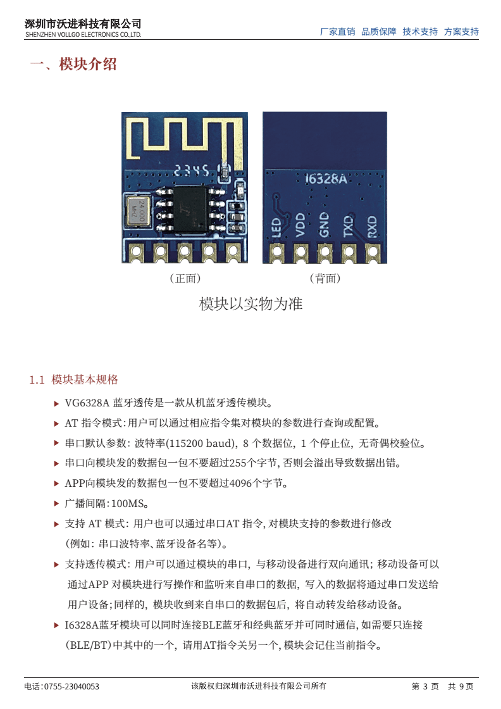
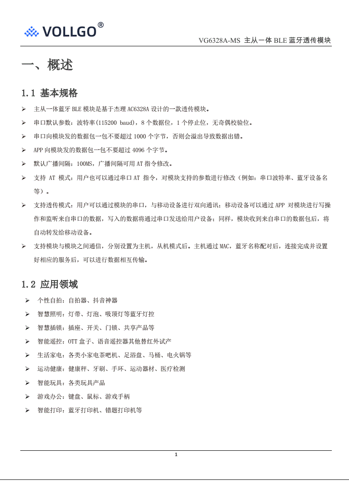

# DX-BT24 与 VG6328A 透传传输字节差异对比

技术对比说明 · 2026-10-10

## 一、结论

两者都是"串口 ↔ 蓝牙"透传模块，但 DX-BT24 只走 BLE（GATT），VG6328A 是 BLE + 经典蓝牙双模。因此同一段数据在链路上被切分的"包"并不相同，差异集中在四个方面：单包上限、透传通道类型、串口默认参数、超限行为。

## 二、参数对比

| 对比项 | DX-BT24（深圳大夏龙雀） | VG6328A（深圳沃进 Vollgo） |
|---|---|---|
| 蓝牙类型 | 单模 BLE 5.1（GATT/ATT/GAP，芯片 DA14531） | 双模：BLE + BR/EDR，BLE 与经典蓝牙可同时连接并通信；VG6328A-MS 为主从一体 BLE（基于杰理 AC6328A） |
| 空中单包大小 | 由 MTU 决定：规格书标称 MTU 最大 253 字节，单包有效载荷最大 250 字节；未协商时按 BLE 标准 23→20 字节/包 | 规格书不按 MTU 描述，直接给上限：APP → 模块 一包不超过 4096 字节 |
| 串口 → 模块 单包上限 | 文档未规定上限，仅给出吞吐测试值（串口侧 320 字节/包） | 不超过 255 字节（双模 VG6328A）；VG6328A-MS 为不超过 1000 字节 |
| 超限行为 | 未描述，依赖流控兜底 | 明确说明"否则会溢出导致数据出错" |
| 串口默认参数 | 9600 8N1，可设 2400~115200，支持 RTS/CTS 硬件流控与 AT+FLOW 软件流控 | 115200 8N1 |
| 官方实测吞吐 | Android↔模块：APP 侧 230 字节/包、串口侧 320 字节/包（间隔 20 ms），约 10.1 / 10.6 KB/s（115200、连接间隔 15 ms） | 未给出 |
| 透传 UUID | Service FFE0，Notify/Write FFE1，Write FFE2 | 规格书未列出（需查阅 AT 指令集） |
| 广播间隔 | 功耗测试按 540 ms | 默认 100 ms |

## 三、实际使用中最容易"字节对不上"的三点

- DX-BT24 是纯 BLE，天然按 MTU 分包。手机不主动请求大 MTU 时，串口发送 100 字节会被拆成 5 个 20 字节的 notification；只有协商到 247/253，单包才能携带 244/250 字节。VG6328A 走经典蓝牙 SPP 时不受 20 字节限制，单包可达 4096 字节，字节流更"整"。
- 两者都不保证包边界。串口写一次不等于对端收一次，粘包与拆包都可能发生。应用层必须自行增加帧头 + 长度（或分隔符）来切分数据，不能依赖模块的分包行为。
- 串口侧上限不对称。VG6328A 明确单包 255 字节（双模）/ 1000 字节（-MS），超限会出错丢字节；DX-BT24 未写上限，但建议打开 AT+FLOW 软件流控或接入 RTS/CTS，否则高波特率连续写入同样会丢数据。此外默认波特率 9600 与 115200 的差别，是"数据看着不对"最常见的原因。

## 四、规格书原文证据

图 1  VG6328A（双模）规格书第 3 页：串口 ≤255 字节、APP ≤4096 字节

图 2  VG6328A-MS（主从一体）规格书第 1 页：串口 ≤1000 字节、APP ≤4096 字节

## 五、DX-BT24 数据来源

- 《DX-BT24 蓝牙模块技术手册》：MTU 值 253 字节、UART 最大 115200 baud、RTS/CTS 硬件流控。
- 《DX-BT24&BT24-S&BT27 蓝牙模块 串口 UART 应用指导》：默认 9600 8N1、数据吞吐量表格、AT+FLOW 软件流控、透传 UUID（FFE0/FFE1/FFE2）。
- 《DX-BT24 系列蓝牙模块 主模式应用指导》：主从模块间透传吞吐量表格（115200、连接间隔 15 ms）。
