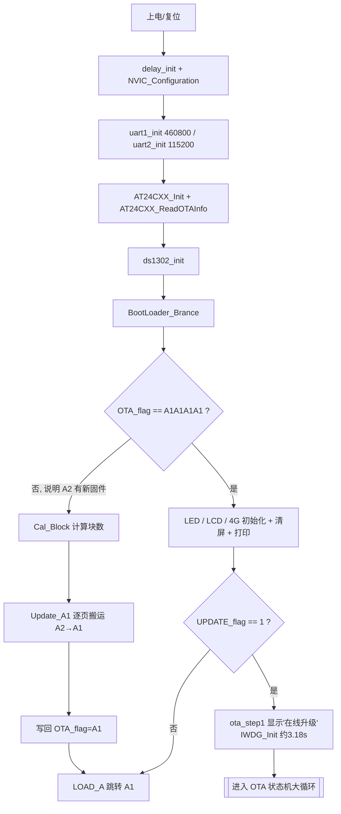
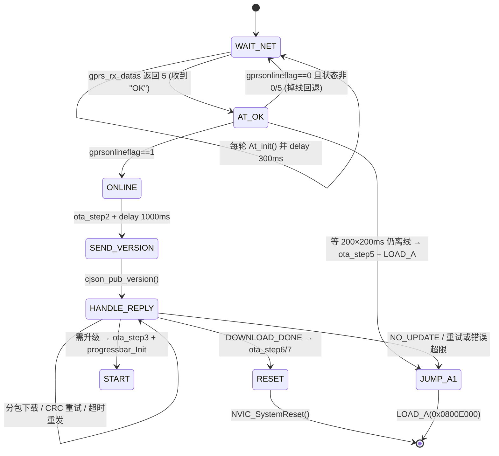
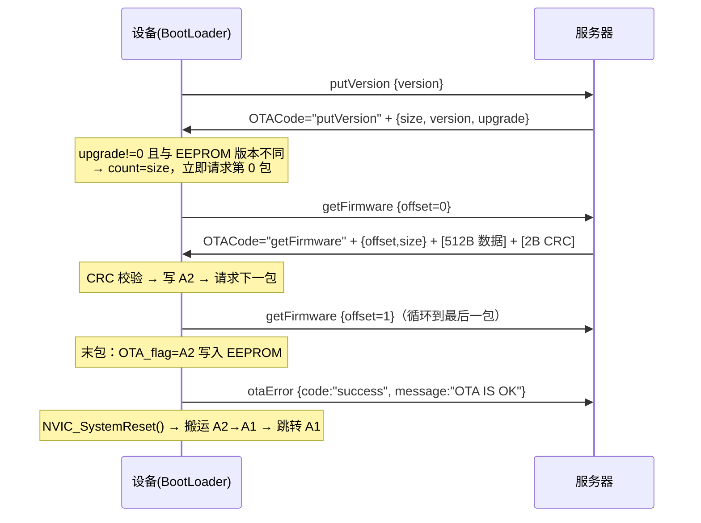

# BootLoader 项目分析总纲（STM32F103VET6 · 4G OTA）

> **文档定位**：面向接手本项目的工程师，描述“当前代码实际在做什么”，并在末尾给出分级风险清单与待业务确认事项。
> **本文只做分析**，不包含代码补丁，也不改动任何源文件。
>
> **分析基线**：2026-09-16，当前工作副本 `D:\huanghe\qibiji_boot`。
> **行号说明**：文中的行号以该副本为基线，后续改动会使行号漂移；引用时请优先看“文件 + 函数 + 代码特征”，行号仅作辅助。
> **编码说明**：绝大多数源文件是 UTF-8（含中文注释），仅 `HARDWARE/CRC16/crc16.c/h`、`HARDWARE/MALLOC/malloc.c/h` 为 GBK。若用 GBK 方式打开 UTF-8 文件，会把换行当作双字节字符的第二字节“吃掉”，导致注释与下一行代码串行、行号整体错位——阅读本项目代码时请务必先确认编码。

---

## 摘要

### 工程定位

这是一个 **“引导程序 + 联网升级器 + 跳转器”三合一的 STM32 BootLoader**：

1. 上电后读 EEPROM 判断固件标志位；
2. 若上次升级已把新固件下载到备份区 A2，则本次上电把它搬运到运行区 A1 并跳转；
3. 若需要联网升级，则通过 4G 模块向服务器请求版本比对、分包下载到 A2，复位后再由第 2 步生效；
4. 无需升级时直接跳转到 A1 运行应用。

它不包含业务功能（阀门/电机等业务代码在 A1 的应用工程里），本身只负责“升级 + 跳转”。

### 环境基线

| 项 | 值 | 证据来源 |
|---|---|---|
| MCU | STM32F103VET6（Flash 512KB / SRAM 64KB，Cortex-M3） | `USER/BOOTV10.uvprojx` 的 `<Device>` / `<Cpu>` |
| 工具链 | Keil µVision V5.24.2 + ARMCC V5.06 update 5（build 528） | `OBJ/boot.build_log.htm` |
| C 优化等级 | Level 0（`<Optim>1</Optim>`，未优化） | `USER/BOOTV10.uvprojx` |
| 运行库 | MicroLIB（`--library_type=microlib`） | `OBJ/boot.lnp` |
| 栈 / 堆 | `Stack_Size=0x400`（1KB） / `Heap_Size=0x1000`（4KB） | `CORE/startup_stm32f10x_hd.s:35,45` |
| 编译占用 | `Code=36336`、`RO-data=1624`、`RW-data=388`、`ZI-data=21908` | `OBJ/boot.build_log.htm:71` |
| 最终产物 | `HEXBIN/boot.bin` = 38172 字节 | 文件属性 |
| 版本控制 | 无（目录下无 `.git`，当前环境也未安装 git） | — |
| `gprs_rx.c` 行数 | 805 行（LF 结尾） | — |

### 三条最重要的结论

1. **升级链路是完整的，但“最后一公里”依赖约定**：每次上电都会调用 `BootLoader_Brance()`（`USER/main.c:51`），它判断 `OTA_flag`；只有标志不为 `A1A1A1A1`（即 A2 中存有新固件）时才执行 A2→A1 搬运并跳转 A1。但跳转时**没有重定位中断向量表、也没有关闭看门狗**，这些责任被隐式推给了 A1 应用（见 P0-4）。
2. **栈不够用**：链接脚本只给了 1KB 栈，而 `OBJ/boot.htm` 实测最大栈用量 **2992 字节**，热点正是 OTA 下载路径，其中三个栈上大缓冲合计就占 2560 字节（见 3.3.2、P0-1）。这是当前工程最确定的越界缺陷；溢出量目前落在正下方那块未被使用的 MicroLIB 堆里，所以现场未必立刻崩溃，但已无缓冲余量。
3. **下载流程缺少服务端侧的合法性约束**：镜像总大小、分块序号、包长、A2 剩余容量都没有校验，一旦服务端行为与代码假设不一致，会出现“显示下载完成、镜像却不可用”（见 P0-2、P0-3）。

---

## 1. 项目概览与运行环境

### 1.1 运行形态

- 裸机（无 OS / 无 RTOS）；`SYSTEM_SUPPORT_UCOS=0`（`SYSTEM/sys/sys.h`）。
- `SysTick` 仅被 `SYSTEM/delay/delay.c` 用作忙等延时（`delay_us`/`delay_ms`），`USER/stm32f10x_it.c` 的 `SysTick_Handler` 为空。
- 调试输出通过 `printf` 重定向到 **USART1**（`HARDWARE/USART/usart1.c:20` 的 `fputc`），波特率 460800，且 `ENABLE_PRINTF=1`（`HARDWARE/USART/usart.h`）全量开启。
- 看门狗为独立看门狗 IWDG，`IWDG_Init(4, 1990)` → 分频 64、重装 1990 → 约 **3.18 秒**（`USER/main.c:78`，`HARDWARE/WDG/wdg.c:9`）。
- 主循环形态是“大循环 + 软件状态机”，没有中断里做业务，4G 数据接收靠 **USART2 空闲中断 + DMA1_CH6**（`HARDWARE/USART/usart2.c`）。

### 1.2 构建与产出

编译后由 Keil 的 After-Build 用户命令调用 `USER/HEXBIN.bat`，用 `fromelf` 把 `OBJ/boot.axf` 转成 `HEXBIN/boot.bin` 与 `.hex`。**OTA 下发给设备的就是这个 bin**（`USER/BOOTV10.uvprojx` 的 `<AfterMake>` + `USER/HEXBIN.bat`）。

目录 `HEXBIN/` 中还留有另外两个镜像：`PWM.bin`（5932 字节）与 `test-251230.bin`（43628 字节），后者疑似应用镜像样例，可用于推测服务器下发的固件规模。

### 1.3 Flash 预算现状（重要）

| 项 | 字节数 | 说明 |
|---|---|---|
| 引导区 B 容量 | 57344（56KB） | `ST32_B_PAGE_NUM(28) × 2048`（2026-10-15 由 20 页扩到 28 页） |
| 当前 `boot.bin` | 40504 | 实际需要烧写到 0x08000000 的数据量 |
| 载入区 `LR_IROM1` | 40688（`0x9EF0`） | `Code(38440)+RO(1852)+RW(396)`；链接上限 = B 区 56KB（`0xE000`） |
| **B 区剩余** | **约 16656 字节**（`0x4110`） | 余量充足；新增功能仍需 ≤ 该值 |

链接区域在 **2026-10-15** 与 B 区扩容同步收紧为 **56KB**：`USER/BOOTV10.uvprojx` 的 IROM1 `Size` 由 `0x80000`（整片 512KB）先收紧到 `0xA000`（40KB），B 区扩到 28 页后改为 **`0xE000`**；`OBJ/boot.map` 显示 `Load Region LR_IROM1 (... Max: 0x0000e000)`。引导程序一旦超过 56KB，**链接期直接报 `L6406E/L6407E: No space in execution regions`**，不会再静默压到 A1 区起始地址（现为 0x0800E000）导致应用被覆盖。该保护做过负向验证（上限设为 `0x9000`/把 A2 页数改到越片尾时均链接/编译失败）。

---

## 2. 目录与模块清单

### 2.1 参与编译的模块（来自 `USER/BOOTV10.uvprojx` 与 `OBJ/boot.lnp`）

| 分组 | 文件 | 职责 |
|---|---|---|
| USER | `main.c` | 初始化 + OTA 主状态机 + 异常重试/放弃策略 |
| USER | `stm32f10x_it.c` | 异常处理（`HardFault/MemManage/BusFault/UsageFault` 全部 `while(1)` 死循环） |
| USER | `system_stm32f10x.c` | 系统时钟（外部晶振 + PLL 到 72MHz） |
| HARDWARE | `BOOT/boot.c` | 搬运 A2→A1、写标志位、设置 MSP、跳转 A1 |
| HARDWARE | `GPRS/gprs_rx.c` | 帧解析、JSON 解析、CRC 校验、写 A2、写 EEPROM、上报报文 |
| HARDWARE | `GPRS/gprs_tx.c` | 组包与发送（AT、版本上报、分包请求、错误上报）、超时重发缓存 |
| HARDWARE | `4G/4G.c` | 4G 复位时序、LINKA 边沿中断维护 `gprsonlineflag` |
| HARDWARE | `USART/usart1.c` | USART1 初始化 + `fputc` 重定向 + DMA1_CH5 接收 + 把收到的数据转发给 USART2 |
| HARDWARE | `USART/usart2.c` | USART2 初始化 + DMA1_CH6 接收 + 空闲中断计算帧长 + 阻塞式发送 |
| HARDWARE | `STMFLASH/stmflash.c` | Flash 按扇区擦写（读-改-擦-写）与半字读写 |
| HARDWARE | `REG/reg.c` | 从 24C02 读取 OTA 信息；写出厂默认参数 |
| HARDWARE | `24CXX/24cxx.c` `IIC/myiic.c` | 软件 I2C 驱动 AT24C02（带 ACK 返回值） |
| HARDWARE | `DS1302/ds1302.c` | 外部 RTC 读写（当前仅初始化，未参与 OTA） |
| HARDWARE | `Lcd12864/Dispaly.c` `DispalyPara.c` `Lcd12864.C` `ProgressBar.c` | 12864 液晶：升级文案 `ota_step1~7`、进度条、字符串显示 |
| HARDWARE | `LED/led.c` | 4 个指示灯 IO 初始化 |
| HARDWARE | `WDG/wdg.c` | IWDG 初始化与喂狗 |
| HARDWARE | `DC_MOTOR/dc_motor.c` | 仅初始化继电器相关 IO（无业务动作实现） |
| HARDWARE | `cJSON/cJSON.c` | cJSON 1.7.19，且内存分配被改接到 `mymalloc`（见 3.3） |
| HARDWARE | `MALLOC/malloc.c` | 10KB 自建内存池 + 位图分配表 |
| HARDWARE | `CRC16/crc16.c` | `CRC16_CCITT_FALSE` 分包校验 |
| SYSTEM | `delay/delay.c` `sys/sys.c` | 延时与位带 IO 宏、`NVIC_Configuration()` |
| CORE | `core_cm3.c` `startup_stm32f10x_hd.s` | CMSIS 内核访问与启动文件（含栈/堆尺寸定义） |
| FWLib | `misc/gpio/rcc/tim/usart/dma/adc/iwdg/spi/exti/flash/fsmc` | 标准外设库 |

### 2.2 未参与编译的模块（历史残留，容易误读）

| 文件 | 情况 |
|---|---|
| `HARDWARE/GPRS/gprs_AT.c` | 引用了本工程不存在的符号 `flag10ms/flag1s/xinhao/ccid/order`，且其写入的 `CParas.clientid` 在当前 `CJsonPara` 结构体中已不存在 → 属于上一代“应用工程”的残留，加入编译会直接报错 |
| `HARDWARE/USART/usart3.c` `usart4.c` `usart5.c` | 未被工程引用 |
| `SYSTEM/usart/usart.c` | 未被工程引用；其 `fputc` 重定向到 **USART3**，与 `usart1.c` 的重定向冲突，不能同时编译 |
| `HARDWARE/Lcd12864/ProgressBar_Example.c` | 示例文件，未加入工程 |
| `CORE/startup_stm32f10x_md.s` | 中容量启动文件，本工程用的是 `_hd` 版本 |
| `OBJ/` 目录 | 混有上一代工程的中间产物（`485.o`、`adc.o`、`key.o`、`mqtt.o`、`rly.o`、`switch.o`、`timer.o`、`gprs_rxtx.o`、`exit.o`、`lcd.o`、`usart.o` 等），清理时容易误判 |

---

## 3. 硬件接口与资源占用

### 3.1 外设与引脚

| 外设 | 引脚 | 参数 | 用途 |
|---|---|---|---|
| USART1 | PA9(TX) / PA10(RX) | 460800 8N1，空闲中断 + DMA1_CH5 | 调试串口，`printf` 输出；收到的数据会被转发给 USART2（`usart1.c:120`） |
| USART2 | PA2(TX) / PA3(RX) | 115200 8N1，空闲中断 + DMA1_CH6 | 与 4G 模块通信（AT 指令 + JSON + 固件数据） |
| AT24C02 | PB10(SCL) / PB11(SDA) | 软件 I2C，地址 0xA0/0xA1 | 存储 OTA 标志、版本、大小；末地址 250 存检测标志 `0x55` |
| DS1302 | PC6(RST) / PC7(DAT) / PC8(CLK) | 三线 | 外部 RTC（当前未参与 OTA 流程） |
| LCD12864 | PE3(CS) / PE4(SID) / PE5(SCLK)，背光 PA0 | ST7920 串行 | 升级过程文案与进度条 |
| LED | PD11 / PD12 / PD13 / PD14 | 推挽输出 | 实际只用到 PD13（`LED_LINE`，在线指示） |
| 继电器 | PD1 / PD3 | 推挽输出 | 上电全部关闭；无后续业务动作 |
| 485 方向/复位 | PD4 / PD5 | 推挽输出 | 初始化时置 1；`RS485_CE4`(PD6) 宏存在但无调用 |
| 4G 复位 | PA1 | 推挽输出 | `GM4G_Init()` 内拉高 500ms 再拉低 |
| 4G LINKA | PC5 | 输入（下拉）+ EXTI9_5 双沿 | 维护 `gprsonlineflag`（在线=1） |
| 4G LINKB | PC4 | 输入（下拉） | 已初始化但从未读取 |

### 3.2 中断与优先级

`NVIC_Configuration()` 使用优先级分组 2（2 位抢占 / 2 位响应）。已使能的中断：

| 中断 | 抢占/响应 | 作用 |
|---|---|---|
| `USART1_IRQn` | 1 / 2 | 空闲中断：统计长度并把 USART1 收到的数据转发给 USART2 |
| `USART2_IRQn` | 1 / 1 | 空闲中断：计算 `Usart2_Rec_Cnt` 并重置 DMA |
| `EXTI9_5_IRQn` | 2 / 3 | PC5 双沿：更新 `gprsonlineflag` 与在线指示灯 |

注意：`USART2_IRQHandler` 只记录长度，**不会**在中断里搬运数据；真正的搬运与解析在主循环的 `gprs_rx_datas()` 里（关中断拷贝，`gprs_rx.c:60-74`）。

### 3.3 RAM 占用概览（ZI 合计 21908 字节）

| 占用项 | 大小 | 位置 |
|---|---|---|
| 自建内存池 `mem1base` | 10240 | `HARDWARE/MALLOC/malloc.c`（`MEM1_MAX_SIZE=10*1024`） |
| 内存池位图表 `mem1mapbase` | 640 | 同上（320 × u16） |
| MicroLIB 堆 | 4096 | 启动文件 `Heap_Size` |
| 栈 | 1024 | 启动文件 `Stack_Size`（**不足，见 P0-1**） |
| `STMFLASH_BUF` | 2048 | `stmflash.c`（按扇区读改写缓冲） |
| `DMA_Rece_Buf1` + `DMA_Rece_Buf2` | 256 + 1024 | `usart1.c` / `usart2.c` |
| 其余全局/静态（LCD 字模、JSON 结构体、`OTA_Info` 等） | 余量 | — |

值得注意：`cJSON.c` 的内存分配被改接到自建内存池（`cJSON.c:166-235` 中 `internal_malloc = mymalloc`），因此 `cJSON_Parse` 消耗的是那 10KB 池而不是标准堆；`mem_malloc` 会在首次分配时自动调用 `mem_init()`，所以不初始化也不会立刻失败。

#### 3.3.1 实际地址布局（符号地址取自 `USER/boot.map`）

```text
0x20005718  __initial_sp            ← 栈顶（Cortex-M3 满递减栈，向低地址增长）
0x20005318  __heap_limit / 栈底       ┐ 栈区 1024 字节（Stack_Size = 0x400）
0x20004B68                          │ ← 实测最大栈需求 2992 字节时的触底位置
0x20004318  __heap_base             ┘ MicroLIB 堆 4096 字节（Heap_Size = 0x1000）
0x20004098  mem1mapbase（640B）       ← 自建内存池位图表
0x20001898  mem1base（10240B）        ← cJSON 实际使用的内存池
0x20001708  CParas（192B） / 0x200016B8 OtaParas（76B）
0x20000EB4  STMFLASH_BUF（2048B）
0x200006B0  UpDataA（2052B） / 0x20000684 OTA_Info（44B）
```

栈区上方就是 RAM 顶端（0x20010000），下方紧邻的是 MicroLIB 堆——这决定了栈溢出的落点（见 P0-1）。

#### 3.3.2 栈上的三个大缓冲（合计 2560 字节）

| 缓冲 | 声明位置 | 存储类别 | 大小 | 初始化 | 边界检查 |
|---|---|---|---|---|---|
| `UART_RX2_BUF` | `gprs_rx.c:46` | 局部（栈） | 1024 | 每次调用 `= {0}` 全清零 | 拷贝前钳位到 1024（`:62-63`） |
| `cjsonStr` | `gprs_rx.c:49` | 局部（栈） | 1024 | 每次调用 `= {'\0'}` 全清零 | `cjson_len >= sizeof()` 有检查（`:144`） |
| `json_str` | `gprs_tx.c:28` | 局部（栈） | 512 | 每次调用 `= {'\0'}` 全清零 | **无**（`sprintf` 无长度上限） |

补充说明：

- `UART_RX2_BUF` 是 USART2 接收帧的“快照”：在关中断区间内从全局 `DMA_Rece_Buf2` 拷贝 `u2rxcnt` 字节（`gprs_rx.c:60-74`）。之所以要复制，是因为 IDLE 中断里会立即重新武装 DMA，不复制就会有边收边解析的竞态；这是合理设计，代价是 1KB 栈。
- `cjsonStr` 唯一的作用是提供 NUL 结尾的字符串给 `cJSON_Parse`（原始缓冲里 JSON 后面紧跟二进制数据）。本工程所用的 cJSON 1.7.19 已提供 `cJSON_ParseWithLength()`（`cJSON.h:155`），因此这个副本可以整体去掉。
- `json_str` 的长度现状：`getFirmware` 请求当前 160 字节（字段取满 247），`otaError` 上报当前 184 字节（字段取满 292），512 尚有余量但没有任何保护。同一函数内 `test`、`LastTime`、`num` 为未使用变量。

---

## 4. Flash 分区、启动与跳转

### 4.1 分区表（`HARDWARE/BOOT/boot.h`）

| 区域 | 起始地址 | 页数 | 大小 | 用途 |
|---|---|---|---|---|
| B（引导区） | 0x08000000 | 28 | 56KB | 本 BootLoader 自身（0x08000000~0x0800E000） |
| A1（运行区） | 0x0800E000 | 100 | 200KB | 当前运行的应用固件（0x0800E000~0x08040000） |
| A2（备份区） | 0x08040000 | 100 | 200KB | OTA 下载目标；复位后搬运到 A1（0x08040000~0x08072000） |
| 未分配 | 0x08072000 ~ 0x08080000 | 28 | 56KB | 目前无用途 |

> **2026-10-15 分区变更**：B 区 20→28 页，A1/A2 整体后移 16KB；`boot.h` 中 A1/A2 地址已改为**按页数计算**（`ST32_A1_SADDR = FLASH_SADDR + ST32_A1_START_PAGE*PAGE_SIZE` 等），并新增编译期断言（A1 紧接 B、A2 紧接 A1、A2 末不越片尾、A1/A2 各 200KB、B 区 56KB、EEPROM 计数地址不越界）。**A1 起始位移意味着所有现场 A1 应用固件必须按 0x0800E000 重新链接与重新安装**（Keil IROM1 起始 = 0x0800E000、`VECT_TAB_OFFSET = 0x0E000`）。

关键事实：**A1 起始 + 100 页 × 2KB 正好等于 A2 起始**，因此 A1 区一旦被写超过 200KB，就会直接覆盖 A2（见 P0-2）。

### 4.2 EEPROM（AT24C02）布局

| 地址 | 内容 | 说明 |
|---|---|---|
| 200（`OTA_ADDR`） | `OTA_InfoCB` 结构体，`sizeof = 44` 字节 | 因结构体对齐，实际占 200~243 |
| 244（`OTA_RETRY_ADDR`） | 自愈重搬重试计数（1 字节） | **2026-10-15 新增**：安装/自愈成功清零；连续失败达 `OTA_RETRY_MAX(3)` 后不再重搬（保护 A1 Flash 寿命） |
| 250（`EE_ADDR`） | `0x55` | EEPROM 存在性检测标志 |

> 空闲段说明：`0..63` 未使用（预留给 APP）；`64..191` 为 APP 侧 MQTT 参数（ProductKey/DeviceKey/DeviceSecret/MQTT 地址）；`192..199`、`244..249` 空闲。`boot.h` 里的编译期断言保证 `OTA_RETRY_ADDR` 不与 OTA 结构体、`EE_ADDR` 冲突。

`OTA_InfoCB` 字段（`boot.h:28-34`）：

| 字段 | 类型 | 含义 |
|---|---|---|
| `OTA_flag` | u32 | `0xA1A1A1A1` 表示 A1 为当前固件；`0xA2A2A2A2` 表示 A2 有等待搬运的新固件 |
| `OTA_ver[32]` | u8[32] | 版本号字符串 |
| `OTA_size` | u32 | 固件字节数（用于搬运时计算块数） |
| `UPDATE_flag` | u8 | **升级标志**：0 = 关闭（上电直接跳 A1，不联网）；1 = 开启（走联网 OTA 流程）。**2026-10-15 起：安装成功后由引导程序自动置 0（关闭升级标志）**（"已最新，不再联网核查"）；再次升级需由平台经 A1 应用把它置回 1（开启升级标志） |

### 4.3 上电流程



补充说明（容易踩坑的点）：

- `BootLoader_Brance()`（`main.c:51`）在 `LED_Init/Lcd_Gpio_Init/GM4G_Init` **之前**执行；若它成功跳转 A1，后面的初始化都不会执行（这正是设计意图：搬运路径尽量短）。
- `IWDG_Init()` 在 `UPDATE_flag` 分支**之后**（`main.c:78`）。若 `UPDATE_flag!=1`，则先调用 `LOAD_A(A1)`；**只有当跳转失败（例如 A1 区是空片 0xFFFF，栈顶校验不通过）时，才会继续往下执行到 IWDG 初始化并进入 OTA 状态机**。也就是说，“空片 + 未初始化 EEPROM”这种情况最终会走到联网升级路径，这是一个可用的恢复入口。
- `BootLoader_Clear()` 在 `LOAD_A` 内部调用（`boot.c:81`），负责 `USART_DeInit(USART1/USART2)` 与关闭 LCD 扩展指令；`main.c:74` 处还有一处注释掉的调用。

### 4.4 `LOAD_A()` 跳转细节（`HARDWARE/BOOT/boot.c:69-88`）

1. 读取目标地址处的第 1 个字作为栈顶，校验范围 `0x20000000 ~ 0x2000FFFF`（仅此一项合法性检查）；不合法则打印 `load progarm A is fail` 并**直接返回**（调用处继续往下执行）。
2. 读取 `SCB->VTOR`，**只打印，不修改**（`boot.c:75`）。
3. `MSR_MSP(*(uint32_t*)addr)` 设置主栈指针（`boot.c:59` 的汇编函数）。
4. 取 `addr+4` 作为复位向量，赋值给函数指针 `load_A`。
5. `BootLoader_Clear()` 释放 BootLoader 占用的串口/LCD 资源。
6. 调用 `load_A()`，PC 跳到应用复位向量。

---

## 5. OTA 通信协议（按当前代码逆向整理）

> 本章描述的是**代码实现所假设的协议**。其中若干假设无法从本仓库单独确认，已集中列在第 8 章。

### 5.1 帧格式

接收帧（4G → 设备）：

```
[2 字节前缀]  +  {JSON 字符串}  +  [N 字节固件数据]  +  [CRC 低字节][CRC 高字节]
     ↑                ↑                   ↑                    ↑
  UART_RX2_BUF[0]  [2] = '{'          pos + 1             message[Size], [Size+1]
```

- 代码用 `UART_RX2_BUF[2] != '{'` 硬编码判断“前缀恰好 2 字节”（`gprs_rx.c:135`）。
- JSON 结束位置由括号深度匹配得到（`find_json_end_by_bracket_matching`，`gprs_rx.c:744`），返回指向最后一个 `}` 的指针 `pos`。
- 固件数据指针 = `pos + 1`（`gprs_rx.c:209`），长度 = `u2rxcnt - ((pos+1) - UART_RX2_BUF)`（`gprs_rx.c:208`），即“固件数据 + 2 字节 CRC”。

发送帧（设备 → 4G）：形如 `7,{...}`，前缀同样是 2 字节（`gprs_tx.c` 中各分支的 `"%d,{"` 格式串，实参固定为 `7`）。

### 5.2 上行报文（设备 → 服务器）

由 `gprs_tx.c:gprs_send_datas()` 用 `sprintf` 拼接，三种业务共用同一外层结构：

| 业务 | `sta` | `body.OTACode` | `body.paras` |
|---|---|---|---|
| 上报版本 | `SVERSION` | `putVersion` | `{"version":"<当前版本>"}` |
| 请求固件分包 | `UPGRADE` | `getFirmware` | `{"offset":<包序号>}` |
| 上报结果 | `PUTERROR` | `otaError` | `{"code":"<码>","message":"<描述>"}` |

外层字段固定为：`id`、`ver`、`ts`、`productKey`、`deviceKey`、`type="OTA"`、`body.{OTACode,paras}`。

当前这些字段的取值**全部硬编码**（`gprs_rx.c:463-534`）：

```json
7,{"id":"test-001","ver":"v1.0","ts":1779771714791,"productKey":"pk001","deviceKey":"dev001",
   "type":"OTA","body":{"OTACode":"putVersion","paras":{"version":"v1.0"}}}
```

### 5.3 下行回执（服务器 → 设备）

代码**不解析** `type` / `back` / `CmdName` / `random` / `cliendid` 等字段（这些字段的校验函数 `validate_server_reply_json()` 已被整体注释，`gprs_rx.c:162-169`），它只看 `body.OTACode` 的值来决定分支（`gprs_rx.c:179-224`）：

| `body.OTACode` | 分支 | 读取字段 | 返回值 |
|---|---|---|---|
| `putVersion` | 版本协商 | `body.paras.{size, version, upgrade}` | `1`=需升级、`0`=无需升级、负值=错误 |
| `getFirmware` | 分包下载 | `body.paras.{offset, size}` + 尾部二进制 | `1`=整体完成、`0`=本包成功、负值=错误 |

代码注释里保留了两条历史报文样例（`gprs_rx.c:170-174`），其结构与当前实现（用 `body.paras` 而不是顶层 `para`）并不一致，参考价值有限：

```json
1,{"type":"cmd","back":"true","cliendid":"74000000004","CmdName":"version","para":{"version":"v1.0.5"},"random":"200001010000801000"}
{"type":"back","back":"false","Cliendid":"74000000004","CmdName":"version","para":{"version":"v1.0.5","size":49476,"upgrade":0},"random":"201001018400801000"}
```

### 5.4 CRC 规则

- 算法：`CRC16_CCITT_FALSE`（`HARDWARE/CRC16/crc16.c`）。
- 计算范围：本包固件数据的 `Size` 个字节。
- 传输顺序：**低字节在前**，即 `message[Size]` 是低字节、`message[Size+1]` 是高字节（`gprs_rx.c:379-382`）。
- 失败处理：同一 `Offset` 最多重试 5 次（`gprs_rx.c:382-400`），超限返回 `-19`。

### 5.5 返回码表（`HARDWARE/GPRS/gprs.h:47-63`）

| 宏 | 值 | 含义 | 主流程处理 |
|---|---|---|---|
| `GPRS_RX_RET_PARSE_FAILED` | 0 | 解析失败/未知报文 | ⚠️ 被当作“正常”（见 P1-1） |
| `GPRS_RX_RET_NO_UPDATE` | 1 | 无需升级 | `ota_step4()` → 跳转 A1 |
| `GPRS_RX_RET_START_UPDATE` | 2 | 开始升级 | `ota_step3()` + 初始化进度条 |
| `GPRS_RX_RET_DOWNLOAD_DONE` | 3 | 整体下载完成 | `ota_step6/7()` → `NVIC_SystemReset()` |
| `GPRS_RX_RET_DOWNLOAD_CONTINUE` | 4 | 本包写入成功 | 清零 CRC 失败计数 |
| `GPRS_RX_RET_AT_OK` | 5 | 收到 AT 的 OK | WAIT_NET → AT_OK |
| `GPRS_RX_RET_MQTTCID_OK` | 6 | 收到 MQTTCID | 当前流程已不使用 |
| `GPRS_RX_RET_NET_ONLINE` | 10 | 网络在线 | 当前流程已不使用 |
| `GPRS_RX_RET_NO_DATA` | -100 | 本周期没有数据 | 触发超时计数与重发 |
| `GPRS_RX_ERR_CRC_RETRY_EXCEEDED` | -19 | CRC 重试超限 | 计入 CRC 失败次数，5 次后放弃升级 |
| `GPRS_RX_ERR_EEPROM_WRITE` | -20 | 写 EEPROM 失败 | 计入一般错误次数 |
| `GPRS_RX_ERR_JSON_MIN/MAX` | -41 / -21 | JSON 校验错误区间 | 当前未产生 |
| `GPRS_RX_ERR_PACKET_SHORT` | -42 | 包长不足 | 计入一般错误次数 |

---

## 6. 运行时状态机与数据流

### 6.1 状态定义（`USER/main.h`）

| 状态 | 值 | 含义 |
|---|---|---|
| `OTA_STATE_WAIT_NET` | 0 | 等待模块回应 AT |
| `OTA_STATE_ONLINE` | 1 | 已联网，准备发版本询问 |
| `OTA_STATE_SEND_VERSION` | 2 | 发送版本上报 |
| `OTA_STATE_HANDLE_REPLY` | 3 | 处理服务器回执（下载主战场） |
| `OTA_STATE_REBOOT` | 4 | 复位（当前仅由 `NVIC_SystemReset` 分支使用） |
| `OTA_STATE_AT_OK` | 5 | 收到 AT OK，等待网络上线 |
| `OTA_STATE_MQTTCID_OK` | 6 | 历史遗留，已不使用 |

### 6.2 状态机



关键行为补充：

- **掉线回退**（`main.c:86-93`）：只要 `gprsonlineflag==0` 且状态不在 `WAIT_NET/AT_OK`，立刻回到 `WAIT_NET` 并清零超时、重试、错误计数（**不保留下载进度**，但 A2 中已写入的数据仍在，`s_dl_addr` 等下载上下文也不清零）。
- **等待上线**（`main.c:117-140`）：仅靠 `gprsonlineflag`，200 次 × 200ms ≈ 40s 后放弃升级并跳转 A1。
- **超时重发**（`main.c:155-183`）：`gprs_return == -100` 时累计 `req_timeout_tick`，达到 50 次后调用 `gprs_resend_last_request()` 重发缓存的上一次请求（缓存由 `gprs_tx.c` 的 `g_last_sta/g_last_para/g_last_valid` 维护），重发累计 5 次后 `LOAD_A(A1)` 放弃。
- **CRC 失败**（`main.c:189-203`）：累计 5 次后放弃升级并跳转 A1；每成功一包清零（`main.c:204-208`）。
- **一般负错误**（`main.c:209-227`）：包含包长不足、EEPROM 写入失败等，累计 5 次后放弃；`>= 0` 一律清零计数（这里把解析失败 0 也算作正常，见 P1-1）。
- **完成**（`main.c:242-250`）：`ota_step6()` → `delay 1000ms` → `ota_step7()` → `delay 500ms` → `NVIC_SystemReset()`。

### 6.3 数据流与缓冲区尺寸链

```mermaid
flowchart LR
    A[USART2 空闲中断] --> B[DMA_Rece_Buf2 1024B<br/>Usart2_Rec_Cnt 记录长度]
    B --> C[gprs_rx_datas: 关中断拷贝到<br/>栈上 UART_RX2_BUF 1024B]
    C --> D{缓冲区[2] == '{' ?}
    D -- 否 --> E[返回 0 解析失败]
    D -- 是 --> F[括号匹配定位 JSON 结尾 pos]
    F --> G[memcpy 到栈上 cjsonStr 1024B]
    G --> H[cJSON_Parse 用 10KB 自建内存池]
    H --> I{body.OTACode}
    I -- putVersion --> J[cjson_upgrade 版本协商]
    I -- getFirmware --> K[cjson_download_reply]
    K --> L[CRC16 校验]
    L --> M[STMFLASH_Write 写 A2<br/>512B/包]
    M --> N[组下一包请求 JSON<br/>gprs_tx json_str 512B]
    N --> O[Usart2_Send 阻塞发送]
```

| 缓冲/参数 | 大小 | 位置 |
|---|---|---|
| `DMA_Rec2_Len`（DMA 接收缓冲） | 1024 | `HARDWARE/USART/usart.h` |
| `UART_RX2_BUF`（栈上帧缓冲） | 1024 | `gprs_rx.c:46` |
| `cjsonStr`（栈上 JSON 缓冲） | 1024 | `gprs_rx.c:49` |
| 单包固件数据 `BYTESIZE` | 512 | `gprs.h:31` |
| 发送组包缓冲 `json_str` | 512 | `gprs_tx.c` |
| Flash 扇区缓冲 `STMFLASH_BUF` | 2048 | `stmflash.c` |

### 6.4 下载过程关键代码路径（联调时按这个顺序看串口日志）

| 阶段 | 串口输出（USART1） | 代码位置 |
|---|---|---|
| 启动 | `bootloader is running!` / `OTA is running!` / `jump to a1!` | `main.c:63-73` |
| 搬运 | `loading progarm file A1` / `write progarm file success` | `boot.c:36-47` |
| 握手 | `Sending AT command` / `Received AT OK` / `GPRS is online!` | `gprs_tx.c:9`、`gprs_rx.c:81`、`main.c:138` |
| 收到回执 | `rx json: {...}` | `gprs_rx.c:175` |
| 版本协商 | `cjson_upgrade: size=.., version=.., upgrade=..` | `gprs_rx.c:293` |
| 请求包 | `Offset = ..,size = ..` / `request next data --` | `gprs_rx.c:373,427` |
| 写 Flash | `write A2 zone-- <offset> --` | `gprs_rx.c:409` |
| 完成 | `update is ok --` / `OTA_size = ..` | `gprs_rx.c:440-451` |
| 异常 | `download data error ..` / `crc failed, retry=..` / `request timeout, resend last request` | `gprs_rx.c:398`、`main.c:164,193` |

### 6.5 OTA 文件传输链路（谁先发、每包怎么校验、失败怎么退）

> 6.3 讲的是“数据在哪些缓冲区之间流动”，本节把“固件文件如何从服务器传到设备并最终生效”这条主线单独串起来。行号基线同全文（2026-09-20 P0-1 修复后的工作副本）。

#### 6.5.1 参与方与帧边界

| 环节 | 说明 |
|---|---|
| 设备 ↔ 4G 模块 | USART2 115200，DMA1_CH6 + 空闲中断；设备只处理字节流，看不到 MQTT 报文头与 topic |
| 4G 模块 ↔ 服务器 | MQTT 会话由模块内部维护 |
| 帧边界 | 一次下行 MQTT 消息 = 一个 UART 帧，由 `USART2_IRQHandler` 的空闲中断切分（`usart2.c`）；**不做重组、不处理粘包** |
| 方向约定 | 只有设备主动请求、服务器才应答；服务器不能主动推送（`gprs_rx.c` 中“固件升级中，只有客户端主动发送请求……”的注释也说明了这一点） |

#### 6.5.2 全链路时序



#### 6.5.3 阶段 A：版本上报与升级决策

| 步骤 | 内容 | 代码 |
|---|---|---|
| 触发 | 网络上线后 `ONLINE → ota_step2()`（显示“连接成功/申请最新固件”）→ `delay 1000ms` → `SEND_VERSION` | `main.c:144-151` |
| 上报 | `cjson_pub_version()` 组包并发送 | `gprs_rx.c:463`、`gprs_tx.c` 的 `SVERSION` 分支 |
| 回执分发 | 按 `body.OTACode` 分流：`putVersion` → `cjson_upgrade()`；`getFirmware` → `cjson_download_reply()` | `gprs_rx.c:179-224` |
| 升级判据 | `upgrade != 0` 且 `strcmp(OTA_Info.OTA_ver, 服务器version) != 0` | `gprs_rx.c:296` |
| 判定要升级 | 保存 `OtaParas.size`/`OtaParas.ver` → `OtaParas.count = OtaParas.size` → `process = count` → **立即请求第 0 包** → 返回 1 | `gprs_rx.c:298`、`:316`、`:325` |
| 判定不升级 | 返回 0 → `NO_UPDATE` → `ota_step4()`（无新版本）→ `delay 1000ms` → `LOAD_A(A1)` | `main.c:228-233` |

上报报文（当前取值全部硬编码）：

```json
7,{"id":"test-001","ver":"v1.0","ts":1779771714791,"productKey":"pk001","deviceKey":"dev001",
   "type":"OTA","body":{"OTACode":"putVersion","paras":{"version":"v1.0"}}}
```

⚠️ 注意：这里上报的 `version` 是**硬编码的 "v1.0"**，而升级判据里比较的是 **EEPROM 中的 `OTA_Info.OTA_ver`**——两者是不同来源，排查“版本对不上”时要分清。

#### 6.5.4 阶段 B：分包下载（文件传输主体）

**请求**（`cjson_pub_getbin()`，`gprs_rx.c:485`）：

```json
7,{"...","body":{"OTACode":"getFirmware","paras":{"offset":N}}}
```

**回执帧 = JSON 与二进制拼在同一帧**（本协议最需要注意的地方）：

```text
┌────────┬───────────────────┬──────────────────┬─────────┬─────────┐
│ 2 字节 │ JSON 文本          │ 512 字节固件数据  │ CRC 低   │ CRC 高   │
│ "7,"   │ {...}             │ (末包可能更短)    │         │         │
└────────┴───────────────────┴──────────────────┴─────────┴─────────┘
          ↑                   ↑                  ↑         ↑
       BUF[2]=='{'          pos+1            pos+1+Size    +1
```

取值链路（`gprs_rx.c`）：

1. `UART_RX2_BUF[2] != '{'` → 非法帧（前缀固定 2 字节，`:135`）
2. 括号深度匹配定位 JSON 结尾 `pos`（`find_json_end_by_bracket_matching`，`:744`）
3. JSON 长度 `cjson_len` 检查后 `memcpy` 到 `cjsonStr` 并补 `'\0'`（`:148`、`:153-154`）
4. 二进制起点 = **`pos + 1`**，长度 = `u2rxcnt - ((pos+1) - UART_RX2_BUF)`（`:208-209`）

> 早期那几份旧文档写的是 `pos + 2`，当前代码是 `pos + 1`；也就是说代码**隐含“JSON 的 `}` 后没有分隔符”这一假设**。若服务端真的加了换行，每包 CRC 都会算歪并全部触发重试。

校验与落盘（`cjson_download_reply()`）：

| 步骤 | 行为 | 代码 |
|---|---|---|
| 取参数 | `paras.offset` / `paras.size` → `u16 Offset` / `u16 Size` | `:365-366` |
| 长度闸门 | `Size + 2 > message_len` → 返回 `-42`，本包丢弃 | `:367-371` |
| CRC 计算 | `CRC16_CCITT_FALSE(message, Size)` | `:379` |
| CRC 比对 | 与 `message[Size]`（低字节）、`message[Size+1]`（高字节）比 → **小端** | `:379-382` |
| CRC 失败 | 同一 offset 最多重试 5 次（重新请求同一包），超限返回 `-19` | `:382-400` |
| 单位换算 | 字节数 → 半字数（`STMFLASH_Write` 以半字计数） | `:403-406` |
| 写 A2 | `s_dl_addr += Size*2; STMFLASH_Write(s_dl_lastaddr, …); s_dl_lastaddr = s_dl_addr;` | `:410-414` |
| 请求下一包 | `cjson_pub_getbin(Offset + 1)` + 进度条 + `delay 200ms` | `:422-427` |

写 Flash 走 `STMFLASH_Write` 的“读整扇区 → 判断是否需要擦 → 擦 → 改写整扇区”流程；**A2 在下载前不做整区预擦除**。

#### 6.5.5 阶段 C：收尾、上报与生效

末包分支（`Offset == OtaParas.count - 1`，`gprs_rx.c:429-455`）依次做六件事：

1. `gprs_download_context_reset()` 复位下载上下文
2. `OTA_Info.OTA_ver ← OtaParas.ver`、`OTA_Info.OTA_size ← OtaParas.size`（`:435-439`）
3. `OTA_Info.OTA_flag = OTA_A2_FLAG`（`:442`）
4. `AT24CXX_Write(200, &OTA_Info, 44)` 落盘 EEPROM（`:444`）
5. `cjson_pub_putError()` 上报结果（`:450`，内容硬编码 `success` / `OTA IS OK`）
6. `ProgressBar_Update(100)` 后返回 1 → 主流程 `DOWNLOAD_DONE`

生效链路：`main.c:242-250`（`ota_step6` → `delay 1000` → `ota_step7` → `delay 500` → `NVIC_SystemReset()`）→ 复位后 `AT24CXX_ReadOTAInfo()` → `BootLoader_Brance()` 判 `OTA_flag != OTA_A1_FLAG` → `Cal_Block()` → `Update_A1()`（按 2KB 页搬运 A2→A1）→ 写回 `OTA_flag = A1A1A1A1`（4 字节）→ `LOAD_A(A1)`（`boot.c:34-44`）。

#### 6.5.6 重发、超时与恢复能力

| 机制 | 实现 | 触发与上限 |
|---|---|---|
| 请求缓存重发 | `gprs_tx.c:33-38` 只缓存 `SVERSION`/`UPGRADE` 两种请求；`gprs_resend_last_request()` 原样重发 | `main.c:162` |
| 请求超时 | `main.c:155-183`，连续收到 `-100` 累计 50 次（注释称 5s，实为循环计数）→ 重发上次请求 | 重发累计 5 次 → 放弃升级，`LOAD_A(A1)` |
| CRC 重试 | `gprs_rx.c:382-400`，同 offset 重试 5 次 | 超限返回 `-19`；主流程累计 5 次 → 放弃 |
| 一般错误 | 包长不足、EEPROM 写失败等累计 5 次 | `main.c:209-227` → 放弃升级 |
| 掉线 | `gprsonlineflag==0` 且状态非 `WAIT_NET/AT_OK` → 回 `WAIT_NET` 并清零超时/重试计数 | `main.c:86-93`（下载上下文 `s_dl_*` 不清零） |
| **断点续传** | **不存在**：进度不落盘，`OTA_ver` 只在末包才更新，所以中途复位后服务器仍判定“可升级”，一切从 offset 0 重来 | — |

#### 6.5.7 链路级风险速查

| 环节 | 风险 | 详见 |
|---|---|---|
| 请求序号与完成条件 | `count` 被赋成字节数、完成条件按包序号判、写地址不看 `Offset` → 丢包/乱序静默错位、完成条件可能永不成立 | P0-3 |
| 写入范围 | A2 只够 400 包（200KB），无累计上限；越过 `0x08080000` 的写入被静默丢弃 | P0-3、P0-2 |
| 单帧容量 | 1024 字节帧上限，扣掉前缀 2 + 数据 512 + CRC 2，JSON 最多约 506 字节（当前约 160~300） | P1-3 |
| 结果上报 | 仅成功路径上报，且 `otaError` 报文缺逗号 → 服务器解析不了“上传”结果 | P1-9 |
| 重试语义 | CRC 失败时重发同 offset 请求，但重试计数在 offset 变化时被清零，实际语义依赖服务端回同一个 offset | P1-1、P0-3 |
| 二进制起点 | 代码按 `pos+1` 取数，隐含“JSON 后无分隔符”假设，未在协议中固化 | 第 8 章第 4 项 |

---

## 7. 风险清单

> 每条给出：现象 → 证据（文件:行）→ 影响 → 建议方向。优先级按“是否会导致设备不可用/镜像损坏”划分。

### P0（会导致功能失效或镜像损坏）

#### P0-1 栈严重不足（1KB 栈 vs 实测 2992 字节需求）

> **状态（2026-09-20）**：已按“最小修改”实施修复——三个栈上大缓冲改为 `static`，并补上等价的帧尾结束符。重链后实测 **Maximum Stack Usage 2992 → 432 字节**，1KB 栈下余量 592 字节。以下分析保留**修复前**的基线数据（§1.3、§3.3 的体积数字同样为修复前基线），修复细节见文末修订记录。

- **现象**：进入 OTA 下载路径后，函数调用链 `main → gprs_rx_datas → cjson_download_reply → cjson_pub_getbin → gprs_send_datas → __2sprintf` 需要 **2992 字节**栈，而链接脚本只提供 **1024 字节**。
- **证据**：`CORE/startup_stm32f10x_hd.s:35`（`Stack_Size EQU 0x00000400`）；`OBJ/boot.htm:8`（`Maximum Stack Usage = 2992 bytes`）与 `:144`（上述调用链）。
- **栈账（逐函数，取自 `OBJ/boot.htm`）**：

| 调用链上的函数 | 自身栈帧 | 主要构成 |
|---|---|---|
| `gprs_rx_datas` | **2096** | `UART_RX2_BUF[1024]` + `cjsonStr[1024]` + 其它局部约 48 |
| `cjson_download_reply` | 72 | 参数与局部 |
| `cjson_pub_getbin` | **192** | 按值传递 `CJsonPara`（192 字节）产生的副本 |
| `gprs_send_datas` | **608** | `json_str[512]` + `LastTime[20]` + 其它 |
| `__2sprintf` | 24 | 库函数尾 |
| **合计** | **2992** | 与静态分析给出的最大值完全一致 |

其中栈上三个大缓冲（`gprs_rx.c:46,49`、`gprs_tx.c:28`）合计 **2560 字节，占整条链的 85%**（详见 3.3.2）。

- **溢出去向（关键）**：栈区为 `0x20005318 ~ 0x20005718`，其正下方就是 MicroLIB 堆（`0x20004318 ~ 0x20005318`，4096 字节）。2992 字节栈需求触底于 `0x20004B68`，即**溢出约 1968 字节，且全部落在这块堆区内**，尚未触及 `mem1mapbase`（`0x20004098`）。而该堆在当前代码路径下基本无人使用——cJSON 的分配器已改接到自建池（`cJSON.c:179-181`：`internal_malloc = mymalloc`、`internal_free = myfree`），编译范围内也没有其它 `malloc/free/calloc` 调用点。这解释了“事实上每一包都在越界、现场却未必立刻崩溃”的现象。
- **何时会显性化**：栈总需求一旦超过 **5120 字节**（1024 栈 + 4096 堆）就会打进 `mem1mapbase` / `mem1base`——而 cJSON 正是用 `mem1base` 分配 JSON 节点，届时的表现是“JSON 解析随机失败、内存池位图错乱、指针越界”这类极难定位的故障。此外 `internal_realloc` 仍指向标准 `realloc`（`cJSON.c:181`），一旦有人启用 `cJSON_Print*` 之类的调试代码，堆与栈的冲突会立刻显性化。当前编译为 `-O0`，栈消耗未经过优化。
- **建议方向**：把 `UART_RX2_BUF`、`cjsonStr`、`json_str` 改为静态（这三个函数都只在主循环内调用，裸机单线程下不可重入无实际影响）；`cjsonStr` 可进一步改用 `cJSON_ParseWithLength()`（`cJSON.h:155`）就地解析而彻底删除，再省 1KB 并少一次拷贝；`json_str` 的 `sprintf` 换成 `snprintf` 并检查返回值；`Stack_Size` 提到 ≥4KB（RAM 尚余约 43KB）；开启 `-O1/-O2` 后重新核对 `boot.htm` 的 Maximum Stack Usage。

#### P0-2 镜像大小无校验 → 越界搬运破坏 A2 备份，异常值触发索引下溢

> **状态（2026-10-15）：已修复。** `BootLoader_Brance()` 增加两道护栏（`OTA_size` 必须落在 `0 < size ≤ 200KB`；A2 镜像头必须 SP 合法且复位向量落在 A1 区），`Cal_Block/Update_A1` 各自增加零值/边界兜底（`BlockNB=0` 直接跳过，杜绝下溢），搬运后新增 `memcmp` 内容校验，只有校验通过才写 `OTA_flag=A1`。详见 §10。

- **现象**：搬运函数按 EEPROM 里的 `OTA_size` 计算页数并逐页写 A1，而该值来自服务端下发的 `size` 字段（落盘于 `gprs_rx.c:439`），从头到尾没有任何范围校验。
- **证据**：A1 起始 + 100 页 × 2KB = A2 起始（`boot.h:17,21`）；页数计算在 `boot.c:102`（`Cal_Block`），搬运循环在 `boot.c:127-150`（`Update_A1`）；`OTA_size` 的赋值分别来自 `gprs_rx.c:298`（协商阶段）与 `gprs_rx.c:439`（最后一包落盘）。
- **影响**：
  - 若 `OTA_size > 204800` 字节，`Update_A1` 会从第 100 页起向 A2 区域写入。读源（A2 第 100 页起）位于被覆盖区**之后**，因此**不会出现“读到自己刚写的数据”**，但结果是：A1 中超出 200KB 的部分是垃圾、**A2 前 25 页（50KB）备份被覆盖**；此时 `OTA_flag` 已被置为 `A1A1A1A1`，下次上电直接跳进这个残缺的 A1，且**失去回滚路径**。
  - 若 `OTA_flag = 0xA2A2A2A2` 且 `OTA_size == 0` **同时成立**（来源：EEPROM 写入半途掉电、内容损坏、产线或人工置位），`Cal_Block` 得 `BlockNB=0`，`Update_A1` 中 `i = UpDataA.BlockNB - 1` 使 `u16 i` 下溢为 65535，读地址算出 `0x08040000 + 65535×2048 = 0x1007B000`（未映射区，`STMFLASH_Read` 无地址校验）→ BusFault → 卡在 `HardFault_Handler` 的 `while(1)`（`stm32f10x_it.c`）→ 看门狗 3.18s 复位 → 复位后标志位仍是 `A2`（置位发生在搬运之后）→ **无限重启，需 SWD 重新烧写**。（该路径已由"护栏1 size 范围校验 + `Cal_Block`/`Update_A1` 兜底"堵住，见 §10）
  - 需要澄清：上述下溢路径**不是**“服务端下发 `size=0`”直接导致的——`size=0` 时 `OtaParas.count=0`，`gprs_rx.c:422` 与 `:425` 两个分支都不成立，流程只会超时退出，走不到写 EEPROM 那一步。
  - 另外 `BlockNB` 是 `u8`（上限 255 页），若 EEPROM 中 `OTA_size` 是 `0xFFFFFFFF` 这类异常值，截断后仍会触发 255 页的越界搬运。
- **建议方向**：在接受升级前校验 `0 < OTA_size ≤ 204800`；`Cal_Block/Update_A1` 增加零值与边界保护；搬运完成后回读校验。

#### P0-3 分块序号与总数语义自相矛盾，A2 也无容量保护

- **现象**：`OtaParas.count` 被直接赋值为**字节数**（原本“按 512 分块计算包数”的代码被注释掉）；而完成条件用的是“包序号 == count-1”，每包的序号又是自增请求的。
- **证据**：`gprs_rx.c:305-316`（注释掉的 512 分块算法 + `OtaParas.count=OtaParas.size;`）；`gprs_rx.c:422-429`（`Offset < count-1` 请求下一包、`Offset == count-1` 判定为最后一包）；`gprs_rx.c:424`（请求 `Offset+1`）；`gprs_rx.c:410-414`（写地址只按包内长度累加，与 `Offset` 无关）。
- **影响**：
  - 若 `count` 真是字节数（例如 43628），完成条件要求累计 43628 个 512 字节包 ≈ 22MB，远超 A2 的 200KB（最多 400 包）；
  - 按 512 字节/包推算，前 400 包写满 A2（200KB），接下来约 144 包会写进未分配的 `0x08072000~0x08080000`（56KB），再往后地址 ≥ `0x08080000` 的写入会被 `STMFLASH_Write` 的地址判断**静默丢弃**（`stmflash.c:44` 直接 `return`）。若服务端持续应答直到 `offset` 追上 `count-1`，流程会走到“最后一帧”分支、把 `OTA_flag` 置为 `OTA_A2_FLAG` 并写入 EEPROM（`gprs_rx.c:442-455`），最终呈现“下载完成、镜像残缺”；若在时间上追不上，则由超时重发 5 次后放弃升级（`main.c:171-179`）。两种结局都伴随 A2 被写入大量垃圾数据；（已由"固件上限 200KB 校验 + 镜像头校验"堵住，见 §10）
  - 由于写地址不参考 `Offset`，任何丢包、重复包、乱序（或服务端主动重发）都会让镜像**静默错位**。
- **建议方向**：与服务端确认 `offset` 的真实语义（包序号 or 字节偏移）；统一用 `Offset` 推导写地址；校验序号连续、总包数 ≤400、累计长度 ≤200KB，越界立即报错退出（而不是继续跑到“完成”）。

#### P0-4 跳转时未重定位向量表、未关闭看门狗、外设未复位

- **现象**：`LOAD_A()` 只做“设 MSP + 跳复位向量”。
- **证据**：`boot.c:75`（`vtor = SCB->VTOR;` 仅用于 `printf`，从未写回）；`boot.c:77-81`（设 MSP、取复位向量、调用）；`boot.c:91-97`（`BootLoader_Clear` 只 `USART_DeInit(USART1/USART2)` 与关闭 LCD 扩展指令）；`main.c:78` 启动 IWDG 后到跳转前没有任何关闭动作（IWDG 一旦启动也无法关闭）。
- **影响**：
  - A1 应用若不自行执行 `SCB->VTOR = 0x0800E000`，其运行期任何中断都会跳到 **B 区（0x08000000）的向量表**——而那里是被 `USART_DeInit` 处理过的 BootLoader 环境，行为不可预期；
  - 应用必须在 3.18s 内完成初始化并开始喂狗，否则反复复位；
  - DMA1_CH5/CH6、EXTI9_5、SysTick、LCD 的 GPIO 均未复位，需应用自行接管（否则可能收到残留的 4G 数据或误触发中断）。
- **建议方向**：跳转前显式设置 `SCB->VTOR`；把“看门狗与外设归属”写成对应用工程的硬性接口约定（应用需在启动最早期喂狗、重定位向量表并重新初始化外设）。

### P1（会导致功能异常、难以定位，或与协议不一致）

#### P1-1 解析失败返回 0，被主流程当作“正常”

- **证据**：`gprs.h:48` 定义 `GPRS_RX_RET_PARSE_FAILED = 0`；`gprs_rx.c:54` 作为初值、`:133,140,147,155` 返回该值；`main.c:224-227` 把 `gprs_return >= 0` 视为正常并清零 `req_timeout_tick/req_retry_count`。
- **影响**：收到垃圾帧、半帧或非 JSON 数据时，超时与重试计数被不断清零 → 超时重发和 5 次重试保护形同虚设；只有“完全没收到数据”（-100）才计时。
- **建议方向**：给解析失败分配独立的负返回码，或在 `main` 中显式排除 0。

#### P1-2 回执字段缺失/类型错误时静默降级为 0

- **证据**：`validate_server_reply_json()` 的调用被注释（`gprs_rx.c:162-169`）；`cjson_download_reply` 只判断 `body/paras` 是否为空（`gprs_rx.c:358-361`），随后直接取值（`gprs_rx.c:365-366`）；cJSON 1.7.19 的 `cJSON_GetNumberValue()` 对非数字返回 `NAN`（`cJSON.c:110-118`，其中 `cJSON_IsNumber` 对 NULL 返回 false，所以**不会崩溃**）。
- **影响**：`offset`/`size` 缺失或类型不对时得到 `NAN`，赋给 `u16` 的结果未定义（通常为 0），于是被当成 `offset=0, size=0` 继续执行：写 Flash 长度为 0、进度条计算 `Offset*100/process` 可能除零（`gprs_rx.c:425`）。此外 `OtaParas` 的多数字段没有任何校验。
- **建议方向**：恢复字段级校验（存在性 + 类型 + 整数性 + 范围），并在取值后立即校验范围。

#### P1-3 单包长度无上限（应恒为 512 或明确末包长度）

- **证据**：`gprs_rx.c:367-371` 只校验 `Size + 2 <= message_len`，而 `message_len` 最大约 1022（受 1024 缓冲限制），`Size` 未做上限约束。
- **影响**：若服务端下发超过 512 字节的数据，`STMFLASH_Write` 会写入更多半字（受 1024 字节帧缓冲约束，理论上限约 1020 字节 / 510 个半字），越过预期的包边界，破坏后续包的镜像布局；而 CRC 依然会通过，问题到运行新固件时才暴露。
- **建议方向**：强制 `Size == BYTESIZE(512)`（末包单独定义并在协议中说明），或至少校验 `Size ≤ 512` 且与 `remaining` 一致。

#### P1-4 `STMFLASH_Write` 跨扇区写入地址错误

- **证据**：`stmflash.c:73` 的 `WriteAddr+=secremain;` —— `secremain` 的单位是**半字**，却按字节偏移递增（同一地址变量在别处都按字节使用）。
- **影响**：当一次写入跨越 2KB 扇区边界、且下一扇区是空白（全 `0xFFFF`）时，第二段数据会被写到**偏小 `secremain` 字节**的地址；A2 首次下载（全 0xFF）时每 4 个 512 字节包就有 1 个跨扇区，属于必现路径；分包 CRC 检测不到（CRC 只覆盖数据本身）→ 镜像静默损坏。
- **建议方向**：改为 `WriteAddr += secremain * 2;`，并补充跨扇区写入后的回读校验。

#### P1-5 超时与重试以“循环次数”计，不是真实时间

- **证据**：`main.c:30-35` 的注释声称 `2*100ms`、`50*100ms=5s`；但循环体内存在 `delay_ms(300)`（`main.c:103`）、`delay_ms(200)`（`:122`）、`delay_ms(1000)`（`:145`）、`delay_ms(100)`（`:181`），再加上帧处理与 Flash 擦写耗时；`at_tick/at_tick_max/cid_tick/cid_tick_max`（`main.c:28-31`）声明后**从未使用**。
- **影响**：实际超时远大于 5s 且随链路速率漂移；超时重发累计 5 次后直接 `LOAD_A(A1)` 放弃升级（`main.c:171-179`），现场表现为“偶发升级失败且无明确原因”。
- **建议方向**：改用真实时间基准（SysTick 计数或时间戳）做超时；清理未使用变量。

#### P1-6 EEPROM 异常时静默跳过 OTA，且内容无校验

- **证据**：`reg.c:6-20`，当 `AT24CXX_Check()` 非 0（I2C 无应答）时，直接 `memset` + `OTA_flag=A1A1A1A1` + `ver="1.0.0"`，`UPDATE_flag` 保持 0 且**不写回 EEPROM**；`AT24CXX_Read()` 逐字节读取，无校验和/CRC（`24cxx.c`）。
- **影响**：
  - EEPROM 接触不良或掉电写入中断时，本次上电会直接跳 A1（不联网、不上报，故障现场无痕迹）；
  - 若 EEPROM 内容被写坏（供电跌落导致写入半途），`OTA_flag/OTA_size` 会被读成随机值，进而触发 P0-2 的搬运异常。
- **建议方向**：结构体加入版本号与校验和；把“检测失败”与“内容非法”分开处理并上报。

#### P1-7 在线判断依赖边沿中断，上电时已在线则必然超时

- **证据**：`4G.c:9` 定义 `gprsonlineflag`（无初值，全局默认为 0）；`4G.c:56-77` 的 `EXTI9_5_IRQHandler` 只在 PC5 电平**跳变**时更新；`main.c:117-140` 在 AT_OK 后要求 `gprsonlineflag==1`，否则每 200ms 计数，200 次（约 40s）后 `ota_step5()` + `LOAD_A(A1)` 放弃升级。
- **影响**：若复位/上电时模块已注册在线且 PC5 无电平变化，标志永远为 0 → 40s 后放弃升级、跳转旧固件（现场表现为“升级偶发不执行”）。
- **建议方向**：上电时先读一次 PC5 电平作为初值，或周期性查询模块的 LINK 状态，并明确超时后的上报行为。

#### P1-8 版本比较与固件完整性校验强度不足

- **证据**：版本用 `strcmp` 直接比较（`gprs_rx.c:296`，`OTA_Info.OTA_ver` vs 服务端 `version`）；`OtaPara` 中的 `signMethod/dProtocol/streamId/remaining` 字段从未被赋值或使用（`gprs.h:67-75`）；下载只做分包 CRC（`gprs_rx.c:379`），无整包校验；A2→A1 搬运后也没有回读比对。
- **影响**：版本号书写差异（`"v1.0"` vs `"1.0"`）会导致重复升级或漏升级；分包都正确但整包错误（乱序、丢包、Flash 写入异常）无法被发现。
- **建议方向**：约定版本号格式并实现语义比较；引入整包校验（MD5/CRC32/签名）并持久化校验结果；搬运后回读校验。

#### P1-9 上报报文非法（JSON 缺逗号）

- **证据**：`gprs_tx.c:85-88`，`PUTERROR` 分支拼接为 `"paras":{"code":"%s""message":"%s"}` —— `code` 与 `message` 之间**缺少逗号**。
- **影响**：下载完成后的 `cjson_pub_putError()`（`gprs_rx.c:450`，实现于 `gprs_rx.c:510-534`）发出的 `{"code":"success""message":"OTA IS OK"}` 不是合法 JSON，服务端无法解析，导致服务端无法确认升级结果。
- **建议方向**：修正为 `"code":"%s","message":"%s"`，并用抓包/上位机复核一次。

### P2（工程卫生与可维护性）

1. **孤儿文件与残留产物**：`gprs_AT.c`（引用本工程不存在的 `flag10ms/flag1s/xinhao/ccid/order`，且 `CParas.clientid` 已不存在）、`usart3/4/5.c`、`SYSTEM/usart/usart.c`（`fputc` 指向 USART3，与 `usart1.c:20` 冲突）、`ProgressBar_Example.c`、`startup_stm32f10x_md.s`；`OBJ/` 下还混有上一代工程的 `.o/.crf`（`485、adc、key、mqtt、rly、switch、timer、gprs_rxtx、exit、lcd、usart`）。
2. **无效声明与未使用变量**：`boot.h:56-61` 声明 `BootLoader_Enter/BootLoader_Info/BootLoader_Event/Xmodem_CRC16/MSR_SP`（实现名为 `MSR_MSP`）均无实现；`gprs.h:105-124` 声明 `Gprs_Process/gprs_tx/handleMessage/cjson_enquiry/cjson_setting/cjson_version/cjson_sever_reply/cjson_cmd` 等在本工程无实现；`main.c:28-31` 的 `at_tick/cid_tick` 未使用；`main.c:18` 的 `pub_version_flag` 只写不读。
3. **调试串口数据会被转发给 4G 模块**：`usart1.c:120` 把 USART1 收到的原始数据直接 `Usart2_Send` 给模块，PC 侧误发数据会污染 4G 链路（也可能被误当成服务器回执）。
4. **命名与编码不统一**：`Dispaly.c`（拼写错误）、`Display.h`、`Lcd12864.C`（大小写混用）；`crc16.c/h`、`malloc.c/h` 为 GBK 编码，其余为 UTF-8。
5. **未使用的硬件资源**：`dc_motor.c` 只做继电器 IO 初始化，`dcmotor_up/down/stop` 等只有声明；`RS485_CE4`(PD6) 宏无调用；`LINKB`(PC4) 配置为输入但从不读取；`LED_UP/DN/ERR`(PD11/12/14) 从未写入（只有 PD13 在线指示）。
6. **时间开销**：`AT24CXX_WriteOneByte` 每字节固定 `delay_ms(10)`，写 44 字节 `OTA_Info` 约 440ms，期间不喂狗（尚在 3.18s 内，但会拉长升级时间）；`printf` 全量开启，下载过程中打印 JSON 与进度会额外占用 USART1 与时延。
7. **DMA 接收长度为临界值**：`DMA_Rec2_Len=1024` 且为 Normal 模式，单帧超过 1024 字节时 DMA 计数回绕会导致 `Usart2_Rec_Cnt` 计算出错误长度（表现为该帧被判为解析失败）。当前协议下单帧约 800+ 字节，接近上限，若 JSON 字段增多就会溢出。
8. **未使用的参数与字段**：`OtaPara.signMethod/dProtocol/streamId/remaining` 从未被赋值使用（`gprs.h:67-75`）；`Topic_Sub/Topic_Pub`（`gprs.h:28-29`）无引用；长度宏中 `bts`、`boffset` 未被使用（其余 `bid/bver/bproductKey/bdeviceKey/btype/bOTACode/bversion/bcode/bmessage` 用于 `snprintf` 限长，仍有效）。

---

## 8. 待业务确认清单

以下 10 项**无法仅凭本仓库代码判定**，需要与服务端/产品侧确认后才能定稿，也是上面若干风险条目的判定前提。

| # | 待确认项 | 为什么无法从代码判定 |
|---|---|---|
| 1 | `offset` 的真实语义：是“包序号”还是“字节偏移”？回执里的 `offset` 是服务端自己的进度还是回显请求值？ | 代码既按 `Offset+1` 递增请求，又按顺序累加写地址，还用它判定“最后一包”，三种用法互相矛盾（`gprs_rx.c:410-429`） |
| 2 | 固件总包数如何计算：`count` 应为 `ceil(size/512)` 吗？为什么当前被赋值为 `size`？ | 代码中正确的 512 分块算法已被注释（`gprs_rx.c:305-316`），无法判断是临时测试还是服务端约定 |
| 3 | 服务器单包 payload 是否恒为 512 字节？末包是否小于 512？ | `BYTESIZE=512` 只是宏，代码未校验（P1-3） |
| 4 | 帧首 2 字节前缀（发送端为 `7,`）的含义与稳定性：是 MQTT 包序号、Topic ID 还是通道号？ | 收发都硬编码 2 字节（`gprs_rx.c:135`、`gprs_tx.c` 的 `"%d,{"`），无协议文档 |
| 5 | CRC 字节序（低字节在前）与算法是否与服务端一致？是否需要整包校验（`signMethod` 字段含义）？ | 只有分包 CRC，`signMethod` 从未使用（`gprs.h:70`） |
| 6 | 是否还需要 `+MQTTCID` 握手与 `clientid`？ | 相关分支在 `main.c:106-116` 被注释、`gprs_rx.c` 中的解析被注释、`CJsonPara` 也删掉了 `clientid` 字段 |
| 7 | 设备身份字段（`id/ver/productKey/deviceKey/ts`）当前全部硬编码为 `test-001/v1.0/pk001/dev001/1779771714791`，量产是否要改成真实设备号？ | 代码里没有任何读取设备号/ICCID 的路径（原 `gprs_AT.c` 的 ICCID 解析已被排除出编译） |
| 8 | `UPDATE_flag` 由谁、何时置 1？出厂默认参数写入路径是什么？ | `paraToEeprom()`（`reg.c:23`）在 `main.c:49` 被注释，只保留“注释说明只能执行一次” |
| 9 | 跳转后 IWDG 与中断向量的归属约定：A1 应用是否自行设置 `SCB->VTOR=0x0800E000`、是否在 100ms 内喂狗？ | 引导程序不做这两件事（P0-4），取决于 A1 工程实现（已确认 A1 工程 `system_stm32f10x.c` 的 `VECT_TAB_OFFSET=0x0E000`） |
| 10 | 升级失败的期望行为与上报：当前失败一律 `LOAD_A(A1)` 或复位，且只有成功路径才上报（`putError` 内容还是 "OTA IS OK"），是否需要上报失败原因？ | 代码只在“最后一包成功”时调用上报（`gprs_rx.c:450`），错误分支没有任何上报 |

---

## 9. 现有文档索引与结论订正

仓库根目录已存在 5 份零散分析文档。它们对理解本项目仍有价值，但**均以旧版本代码为基线**（`gprs_rx.c` 旧版本约 732~795 行，当前为 805 行），行号已全部失效，部分结论已被后续修改推翻。

| 旧文档 | 仍然有效的内容 | 需要订正的内容 |
|---|---|---|
| `程序功能及流程文档.md` | 分区布局、启动流程骨架、注意事项 | ① `OTA_InfoCB` 结构体已新增 `UPDATE_flag` 字段（旧文档只有 3 个字段）；② 初始化顺序已变（现在为 `AT24CXX` → `ds1302_init` → `BootLoader_Brance` → LED/LCD → `GM4G_Init` → `IWDG_Init`）；③ “OTA 更新模式”的描述与实际状态机（`WAIT_NET→AT_OK→ONLINE→SEND_VERSION→HANDLE_REPLY`）不一致 |
| `OTA固件升级流程梳理.md` | 总体流程图、失败恢复策略的分类 | ① AT_OK 阶段**不再**发送 `CID_init()`（`main.c:106-116` 已整段注释）；② 超时不是 3s（`main.c:34` 实为 50 次循环计数，且循环周期并非 100ms）；③ `count` 不再按 512 计算（`gprs_rx.c:305-316`）；④ 二进制数据指针是 `pos+1` 而不是 `pos+2`；⑤ 掉线回退确实存在（`main.c:86-93`），但与旧文档描述的清零范围不同（下载上下文未清零） |
| `JSON与二进制数据分离逻辑分析.md` | 数据布局（JSON + bin + CRC）与分离思路 | ① `strncpy` 已改为 `memcpy` + 显式 `'\0'`（`gprs_rx.c:153-154`）；② 已补充 JSON 长度检查与 `Size+2` 边界检查（`gprs_rx.c:148,367`）；③ 全部行号失效；④ 新增了 `UART_RX2_BUF[2] != '{'` 的前缀校验（`gprs_rx.c:135`），旧文档未提及 |
| `变量pos作用分析.md` | `pos` 的定位作用与括号匹配思路 | ① **必须订正**：实际传参是 `pos + 1`（`gprs_rx.c:209`），不是 `pos + 2`；② 行号（21/43/51/110）失效；③ 变量 `pos1/pos2` 已从声明中删除；④ “潜在问题”中的边界检查部分已实现 |
| `gprs_rx_datas逻辑流程分析与漏洞检查.md` | 作为历史审计记录，描述了当时的风险分布 | ① 所列问题多数已修复或改写：`para` 空指针已加判空（现返回 -30）、CRC 越界已加 `Size+2` 检查、Flash 地址已改为顺序累加（但引入了与 `Offset` 无关的新问题，见 P0-3）、`OTA_flag` 已改为 `OTA_A2_FLAG`、`strncpy` 已改 `memcpy`；② 文中提到的 `OTA_AG1_FLA` 等符号在当前代码中不存在；③ `cjson_download_reply()` 的签名已变为 3 参数（增加 `message_len`），行号与函数签名描述全部失效；④ 新增的下载上下文（`s_dl_addr/s_dl_lastaddr/s_dl_last_offset/s_dl_crc_retry_cnt`，`gprs_rx.c:20-32`）在旧文档中不存在 |

---

## 10. 2026-10-15 OTA 健壮性加固（设备端变更）

> 本轮只改设备端（`qibiji_boot`），平台协议与平台代码未改。改动集中在 `HARDWARE/BOOT/boot.c`、`HARDWARE/BOOT/boot.h`、`USER/main.c`、`USER/BOOTV10.uvprojx`。

### 10.1 引导/安装链路（`BootLoader_Brance`）

| 变更 | 说明 |
|---|---|
| 护栏1：`OTA_size` 范围校验 | 必须 `0 < size ≤ 200KB`，否则不搬运，仅打印 `bad OTA_size=%u`、置回 `flag=A1`、清 `OTA_ver` 后尝试运行 A1 |
| 护栏2：A2 镜像头校验 | `SP` 必须落在 RAM 区（0x20000000~0x2000FFFF）、复位向量必须落在 A1 区（现为 0x0800E000~0x08040000）；拦掉 `.hex` 文本、截断包、脏标志等坏包，打印 `A2 hdr invalid` |
| **（重要）宏括号 bug 修复** | 原写法 `*(volatile u32 *)ST32_A2_SADDR` 因宏 `ST32_A2_SADDR = 0x08000000 + 0x3C000`（旧布局）无括号，被解析成"指针 + 0x3C000 个 u32"，实际读到 `0x080F0000`（越界）→ 会把**合法固件误判为坏包**。现统一为 `OtaImageValidAt(u32 base)`，并把地址宏整体加括号（`#define ST32_A1_SADDR (ST32_FLASH_SADDR + ST32_A1_START_PAGE * ST32_PAGE_SIZE)`），已用 `fromelf` 反汇编核对（现传参为 `0x08040000`/`0x0800E000`） |
| 搬运校验（防"搬了但没搬好"） | `Update_A1()` 后用 `memcmp(A2, A1, OTA_size)` 比对；仅一致时才写 `OTA_flag=A1`；不一致则保持 `A2` 待下次开机重搬 |
| 开机自愈 | 若 `flag=A1` 但 A1 镜像头非法（典型：用烧写工具整片擦除，EEPROM 未被擦）→ 若 A2 仍有合法镜像就重搬并校验；若 A2 也无效则**清 `OTA_ver`**，使版本闸失效以便下次联网重新下载 |
| 重试限流 | `A1/A2 都无效` 或搬运反复失败时，每次失败 `OTA_RETRY_ADDR(244) + 1`；达到 `OTA_RETRY_MAX(3)` 后打印 `recover limit` 并停止重搬（保护 A1 Flash 寿命）；成功即清零 |

### 10.2 升级标志语义变化（`UPDATE_flag`）

- **安装成功后引导程序自动把 `UPDATE_flag` 置 0**（`OtaCloseUpdateGate()`，写 `OTA_ADDR+OTA_OFF_UPDATE` 1 字节）。
- 之后每次上电直接 `JumpToApp()` 运行应用，**不再等 4G 联网协商**（启动更快，也不再被弱网拖慢）。
- **再次升级必须先开启升级标志**：由平台经 **A1 应用** 把 `UPDATE_flag` 置回 1（A1 镜像内已含 `SBF20` 参数协议与 `UPDATE_flag` 字段；本工程不实现该写入端）。⚠️ 这是业务流程上的硬约束：未验证"平台→应用开启升级标志"链路之前，不要在现场批量启用"关闭升级标志"版本。
- 护栏失败、`A1/A2 invalid` 等路径**不会**关闭升级标志（必须保留重新下载能力）。

### 10.6 「放弃升级」改为 关闭升级标志 + 真复位（2026-10-15 追加）

- 背景：原 6 处"重试超限"分支只做 `显示 → 3s → JumpToApp()`（不复位），B 区的 4G 会话/状态机状态残留；而直接改成 `NVIC_SystemReset()` 又会复位循环（复位后 `UPDATE_flag==1` → 再进 OTA 状态机）。
- 现方案（`USER/main.c` 的 `OtaGiveUpAndReboot(kind)`，替换原 `OtaReportErrorAndExit`），严格顺序：`ota_show_error(kind)` → **`OtaCloseUpdateGate()`（先关闭升级标志，写 EEPROM 240/1B=0）** → `delay_ms(1500)` → `IWDG_Feed()` → `delay_ms(1500)` → `NVIC_SystemReset()`（不返回）。
- 关键点：**先关闭升级标志再延时** —— 即使 3 秒内被看门狗复位，复位后已是"关闭升级标志"状态，`main` 直接 `JumpToApp()` 跑 A1 应用，不会反复重启；`OtaCloseUpdateGate()` 由 `static` 改为公开（`boot.h` 声明）供 `main.c` 复用。
- 复位时会执行 `GM4G_Init()`（内含 PA1 复位脉冲）→ 4G 模组一并硬复位；适用于 AT 无应答/掉线风暴/等待上线超时/请求超时/CRC 超限/接收错误超限 6 类场景，全部统一。
- 若复位后 A1 不可运行，`JumpToApp()` 失败会落回 `while(1)` OTA 状态机继续联网重试（自愈保留）；再次升级需平台经 A1 应用重新开启升级标志。本次不落盘错误码。
- 反汇编已核对：`ota_show_error → OtaCloseUpdateGate → delay_ms(1500) → IWDG_Feed → delay_ms(1500) → NVIC_SystemReset` 顺序正确；`OtaCloseUpdateGate` 写 `0xf0`(240)/长度 1 ✓。

### 10.3 上电等待超时（`USER/main.c`）

- `OTA_STATE_WAIT_NET` 原为**无限等待 AT 应答**：模组未插卡/天线断/模组坏时应用永远起不来。
- 现改为 **60s 超时**（`at_wait_max=200 × 300ms`）：超时打印 `AT timeout`、`ota_step5()`、`JumpToApp()`；若应用不可运行则约 **30s 后再试一次**（计数回退 100 并 `delay_ms(500)` 限速）。

### 10.4 编译期护栏与工程设置

| 项 | 内容 |
|---|---|
| 分区/容量断言 | `boot.h` 的 `ota_layout_check`（2026-10-15 随分区改为按页数自洽检查）：A1 紧接 B、A2 紧接 A1、`(A2末) ≤ 1024×STM32_FLASH_SIZE`、A1/A2 各 200KB、**B 区 = 56KB(0xE000) 必须与 Keil IROM1 Size 一致**、`OTA_RETRY_ADDR+1 ≤ EE_ADDR`。换 256KB 型号或改分区会**编译期报错** |
| EEPROM 偏移断言 | 既有 `ota_info_layout_check`（`offsetof` 校验 0/4/36/40）继续生效 |
| IROM1 上限 | `BOOTV10.uvprojx` IROM1 `Size: 0x80000 → 0xA000 → 0xE000`（随 B 区扩容同步为 56KB），越界变**链接期报错**（已负向验证） |
| 声明清理 | `boot.h` 中 `MSR_SP` 误名改为 `MSR_MSP`（与 `boot.c` 实现一致） |
| MicroLIB | 保持 `useUlib=1`（`printf/memcmp` 依赖）；优化等级仍为 **Level 1(-O0)**，本次未调整 |

### 10.5 当前约束与仍未处理项

- **固件上限 200KB**（A1 = A2 = 100 页 × 2KB）；当前应用 65,768 字节，尚有余量，但接近上限后没有回滚空间。
- **B 区余量约 16,656 字节**（56KB 上限 − 载入区 40,688）：扩容后已不紧张；新增功能仍需回头看 §1.3。
- **分区已变更**：A1 起始 = 0x0800E000，现场 A1 应用固件必须按新地址重新链接/重新安装（详见 §4.1 注与文末修订记录）。
- **bootloader 自身不能 OTA**：下载镜像只写 A1，B 区只能 SWD/串口烧写。
- **整包完整性校验仍未做**：目前只有逐包 CRC16 + 搬运 `memcmp`（只能证明 A1 与 A2 一致，不能证明 A2 内容本身正确）。建议后续由平台在 `putVersion` 下发整包校验值（CRC32/MD5，平台 `iot_ota_firmware.FileMd5` 字段现为空置可用落点），设备下载中增量校验后再安装。
- **未处理**：`LOAD_A` 跳转前未重定位 `SCB->VTOR`（P0-4）、MQTT 下行无签名、平台仍接受 `.hex` 上传（需平台侧拦截/转换）、打印日志无开关宏。

---

## 附：本文档的核对方式

- 代码行号与用法：逐行读取当前工作副本（UTF-8）确认。
- 构建数据：`OBJ/boot.build_log.htm`（编译/链接输出、占用统计）、`OBJ/boot.htm`（静态调用图、逐函数栈帧与最大栈用量）、`OBJ/boot.lnp`（链接输入与 MicroLIB）、`OBJ/boot.sct`（链接区域）。
- 符号地址与 RAM 布局：`USER/boot.map`（链接器 map 文件，含 `__initial_sp`、`__heap_base`、`mem1base`、`mem1mapbase` 等符号的实际地址；该文件由 `OBJ/boot.lnp` 中的 `--list` 选项生成到 USER 目录）。
- 工程配置：`USER/BOOTV10.uvprojx`（器件、优化等级、参与编译的文件清单、After-Build 命令）。
- 产物：`HEXBIN/boot.bin` 等文件大小。
- 全部分析过程为只读操作：未重新编译、未烧写、未修改任何源码。

**修订记录**

| 日期 | 修订内容 |
|---|---|
| 2026-09-16 | 初版：9 章 + 风险清单 + 待确认清单 + 旧文档订正表 |
| 2026-09-20 | 依据 `USER/boot.map` 的符号地址补充 3.3.1（RAM 地址布局）与 3.3.2（三个栈上大缓冲）；P0-1 增补逐函数栈账、溢出去向与 5120 字节显性化阈值；P0-2 修正 `BlockNB=0` 下溢路径的触发条件，并澄清“越界搬运不会自读自写、但会破坏 A2 备份” |
| 2026-09-20 | **P0-1 已修复（最小修改）**：`gprs_rx.c:46,49` 与 `gprs_tx.c:28` 三个缓冲加 `static`，并在 `gprs_rx.c:70-73` 补帧尾 `'\0'` 以保持原字符串边界语义。重新链接实测：`Maximum Stack Usage` **2992 → 432** 字节（`gprs_rx_datas` 自身帧 2096→48、`gprs_send_datas` 608→96）；`Total RW Size` 22296→24856（缓冲移入 .bss）、`Total ROM Size` 38172→38148；三个缓冲新地址 `0x20000AD8`/`0x20000ED8`/`0x20001398`，栈顶 `0x20005718`→`0x20006118`（1KB 栈下余量 592 字节）。`Stack_Size` 未改动 |
| 2026-09-20 | **新增 6.5 节「OTA 文件传输链路」**：全链路时序图、帧字节布局图、阶段 A/B/C 的步骤与代码位置、重发/超时/恢复机制表、链路级风险速查表 |
| 2026-09-20 | **全文行号校正**：因 P0-1 修改在 `gprs_rx.c` 第 70 行后插入 4 行，正文中所有 `gprs_rx.c` 的行号引用（≥70 的行）统一 +4（共 53 处），并逐条回读源码核对；`gprs_tx.c` 行号未变 |
| 2026-10-15 | **新增 §10 OTA 健壮性加固**：护栏1/护栏2（含宏括号 bug 修复）、搬运 `memcmp` 校验、开机自愈 + 重试限流(3)、安装后自动关闭升级标志、AT 等待 60s 超时、分区/EEPROM/结构体编译期断言、IROM1 收紧到 `0xA000`（负向验证通过）；同步更新 §1.3 Flash 预算、§4.2 EEPROM 布局与 `UPDATE_flag` 语义、P0-2 状态。当前 `boot.bin=40500`、载入区 `0x9EEC`、B 区余量约 276 字节 |
| 2026-10-15 | **B 区扩容 20 页(40KB) → 28 页(56KB)**：`ST32_B_PAGE_NUM=28`，A1/A2 整体后移 16KB（A1 0x0800E000、A2 0x08040000，未分配 0x08072000~0x08080000 56KB）；`boot.h` 的 A1/A2 地址改为按页数计算并重写断言（含"B 区必须等于 Keil IROM1 Size"）；`BOOTV10.uvprojx` IROM1 `0xA000 → 0xE000`；同步 `D:\huanghe\qibiji`（A1 应用）的 IROM 起始 0x0800E000、`VECT_TAB_OFFSET 0x0E000` 与 `D:\huanghe\qibiji_init` 的分区宏。重链后 `boot.bin=40504`、载入区 `0x9EF0`、B 区余量约 16,656 字节；A1 应用新镜像 65,768B、RV=0x080196F1（落在新 A1 区间内） |
