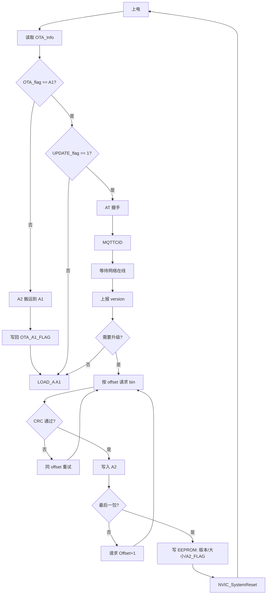

# bootV10 OTA 说明

本文说明本 BootLoader 工程的 OTA（空中升级）机制：分区布局、持久化标志、联网下载流程、生效方式与失败恢复。依据当前工程代码与 `docs` 下已有分析整理。

---

## 1. 概述

本工程运行于 STM32F10x（如 F103VET6 / VCT6），BootLoader 位于 Flash B 区。OTA 采用 **A1（运行区）+ A2（下载区）** 双区方案：

1. 4G/MQTT 从服务器分包下载新固件到 **A2**
2. 下载完成后将元信息写入 EEPROM，并置 `OTA_flag = OTA_A2_FLAG`
3. 复位后 BootLoader 将 **A2 整包搬运到 A1**，再把标志改回 `OTA_A1_FLAG` 并跳转新固件

是否进入联网 OTA 由 EEPROM 中的 `UPDATE_flag` 决定：`1` 走联网升级流程，`0` 直接跳转 A1。

---

## 2. Flash 分区

| 分区 | 起始地址 | 页数 | 约大小 | 用途 |
|------|----------|------|--------|------|
| B（Boot） | `0x08000000` | 20 | 40KB | BootLoader |
| A1 | `0x0800A000` | 100 | 200KB | 应用程序主区（运行） |
| A2 | `0x0803C000` | 100 | 200KB | 应用程序备份/下载区 |

相关宏（`HARDWARE/BOOT/boot.h`）：

- 页大小：`ST32_PAGE_SIZE = 2048`
- 运行标志：`OTA_A1_FLAG = 0xA1A1A1A1`，`OTA_A2_FLAG = 0xA2A2A2A2`
- 单包下载大小：`BYTESIZE = 512`（`HARDWARE/GPRS/gprs.h`）

---

## 3. 持久化 OTA 信息（EEPROM）

结构体 `OTA_InfoCB` 存放在 24C02，地址 `OTA_ADDR = 200`：

| 字段 | 含义 |
|------|------|
| `OTA_flag` | `OTA_A1_FLAG`：A1 为有效运行区；`OTA_A2_FLAG`：A2 有新固件，复位后需搬运 |
| `OTA_ver[32]` | 当前固件版本字符串 |
| `OTA_size` | 固件总字节数（搬运 A2→A1 时按此计算块数） |
| `UPDATE_flag` | `0` 不联网 OTA，直接跳 A1；`1` 进入联网 OTA 状态机 |

读取：`AT24CXX_ReadOTAInfo()`（`HARDWARE/REG/reg.c`）。  
默认写入逻辑在 `paraToEeprom()` 中（工程里通常注释掉，仅首次烧录参数时用）。

---

## 4. 涉及模块

| 模块 | 职责 |
|------|------|
| `docs/USER/main.c`（工程入口） | 启动、是否进 OTA、`SYS_state` 状态机、超时/错误重试与重启 |
| `HARDWARE/BOOT/boot.c` | `BootLoader_Brance`：A2→A1 搬运；`LOAD_A`：跳转应用 |
| `HARDWARE/GPRS/gprs_tx.c` | AT / MQTTCID / 版本查询 / 分包下载请求及超时重发缓存 |
| `HARDWARE/GPRS/gprs_rx.c` | 解析服务器回复、CRC 校验、写入 A2、下载完成写 EEPROM |
| `HARDWARE/STMFLASH/stmflash.c` | Flash 按页擦写 |
| `HARDWARE/CRC16/crc16.c` | 分包 `CRC16_CCITT_FALSE` 校验 |
| `HARDWARE/4G/4G.c` | `gprsonlineflag`（网络在线） |
| `HARDWARE/Lcd12864/Dispaly.c` | `ota_step1`～`ota_step7` 升级过程 UI |

---

## 5. 状态机

`SYS_state`（`main.h`）：

| 值 | 宏 | 含义 |
|----|-----|------|
| 0 | `OTA_STATE_WAIT_NET` | 发 AT，等模块 `OK` |
| 5 | `OTA_STATE_AT_OK` | 发 MQTTCID，等 `+MQTTCID:` |
| 6 | `OTA_STATE_MQTTCID_OK` | 等待 `gprsonlineflag==1` |
| 1 | `OTA_STATE_ONLINE` | 已上线，准备发版本 |
| 2 | `OTA_STATE_SEND_VERSION` | 发送 `CmdName=version` |
| 3 | `OTA_STATE_HANDLE_REPLY` | 处理版本/下载回复 |
| 4 | `OTA_STATE_REBOOT` | 清下载上下文并复位 |

`gprs_rx_datas()` 主要返回值：

| 返回值 | 含义 |
|--------|------|
| `GPRS_RX_RET_AT_OK` / `MQTTCID_OK` | 握手步进 |
| `GPRS_RX_RET_NO_UPDATE` | 无需升级，跳转 A1 |
| `GPRS_RX_RET_START_UPDATE` | 开始下载（已请求 offset=0） |
| `GPRS_RX_RET_DOWNLOAD_CONTINUE` | 当前包写入成功，继续下一包 |
| `GPRS_RX_RET_DOWNLOAD_DONE` | 全部下载完成，即将复位 |
| `GPRS_RX_ERR_CRC_RETRY_EXCEEDED` 等 | 校验/包长等错误 |

---

## 6. 端到端流程



### 6.1 上电与分支

1. `AT24CXX_ReadOTAInfo()` 读出 OTA 元信息。
2. `BootLoader_Brance()`：若 `OTA_flag != OTA_A1_FLAG`，则 `Cal_Block()` + `Update_A1()` 将 A2 拷到 A1，写回 `OTA_A1_FLAG`，再 `LOAD_A(ST32_A1_SADDR)`。
3. 若 `UPDATE_flag != 1`：直接 `LOAD_A` 进入应用。
4. 若 `UPDATE_flag == 1`：显示 OTA UI，进入联网状态机。

### 6.2 联网握手

1. `WAIT_NET`：周期 `At_init()`，收到 `OK` → `AT_OK`。
2. `AT_OK`：`CID_init()`，收到合法 `+MQTTCID:` → `MQTTCID_OK`。
3. `MQTTCID_OK`：等 `gprsonlineflag==1` → `ONLINE`；长时间不上线则放弃并跳转 A1。

### 6.3 版本协商

- 客户端 `cjson_pub_version()`：`CmdName=version`，携带本地 `OTA_Info.OTA_ver`。
- 服务器回复中：`para.upgrade == 1` 且 `version` 与本地字符串 **不相等**（`strcmp`）时判定需升级。
- 需升级时计算分包数 `OtaParas.count / remaining`，立即 `cjson_pub_getbin(0)`。
- 否则返回无需更新，主流程跳转 A1。

### 6.4 分包下载与写入 A2

下行帧格式（JSON 与二进制无额外分隔符）：

```text
{ JSON } + [Size 字节固件] + [2 字节 CRC]
```

- 用括号匹配找到 JSON 结束位置，其后为 bin + CRC。
- CRC：`CRC16_CCITT_FALSE(bin, Size)`，与尾部 2 字节比较。
- 同 offset CRC 失败最多重试 5 次；通过后 `STMFLASH_Write` 写入 A2。
- 非最后包：请求 `Offset+1`；最后包：更新 `OTA_ver` / `OTA_size` / `OTA_flag=OTA_A2_FLAG` 写入 EEPROM，返回下载完成。

接收缓冲约 1024 字节，服务端单帧（JSON + 最多 512 字节数据 + CRC）须落在该限制内。

### 6.5 生效

1. 主循环收到 `GPRS_RX_RET_DOWNLOAD_DONE` 后 `NVIC_SystemReset()`。
2. 再次上电走 `BootLoader_Brance()`：发现非 A1 标志 → A2→A1 搬运 → 写 A1 标志 → 跳转新固件。

---

## 7. 失败与恢复

| 场景 | 策略 |
|------|------|
| 请求超时 | 约 3s 无数据重发上次请求，累计 5 次后跳转 A1 |
| CRC 失败 | 同 offset 最多 5 次，超限后累计错误，多次后跳转 A1 |
| 其它解析/收包错误 | 累计 5 次后跳转 A1 |
| 升级过程掉线 | `SYS_state` 回退到 `WAIT_NET`，清空超时计数 |
| 久等不上线 | 超时后跳转 A1（保留旧固件可用） |

说明：部分失败路径注释掉了 `NVIC_SystemReset()`，实际以 `LOAD_A(A1)` 回到旧应用为主，避免卡在 Boot 区。

---

## 8. 业务侧注意点

1. **`UPDATE_flag` 由外部置位**  
   Boot 侧默认写入里多为 `0`；设备侧需在需要强制进联网升级时把该位置 `1` 并写入 EEPROM，否则上电直接进 A1。

2. **版本比较是字符串不等**  
   不支持语义化版本大小比较，服务端与设备约定同一版本字符串格式即可。

3. **仅有分包 CRC**  
   无整镜像 CRC/签名；包序与单包正确不保证整包语义正确，升级链路需服务端保证固件源可靠。

4. **A2 下载前无整区预擦除**  
   依赖 `STMFLASH_Write` 按页擦写；异常中断后再次下载时需注意残留页行为。

5. **跳转校验较弱**  
   `LOAD_A` 主要检查栈顶是否在 SRAM 合法范围，建议应用侧保证镜像完整。

---

## 9. 相关文档

| 文档 | 内容 |
|------|------|
| [程序功能及流程文档.md](./程序功能及流程文档.md) | Boot 总览、分区与主流程 |
| [OTA固件升级流程梳理.md](./OTA固件升级流程梳理.md) | 按代码的调用链与风险点 |
| [JSON与二进制数据分离逻辑分析.md](./JSON与二进制数据分离逻辑分析.md) | 下载帧 JSON/bin/CRC 拆分 |
| [gprs_rx_datas逻辑流程分析与漏洞检查.md](./gprs_rx_datas逻辑流程分析与漏洞检查.md) | 接收路径与边界检查 |

---

## 10. 小结

本项目 OTA = **EEPROM 标志驱动 + 4G MQTT 分包下载到 A2 + 复位后 A2 覆盖 A1 再运行**。联网路径只在 `UPDATE_flag==1` 时进入；升级成功以 `OTA_A2_FLAG` 落盘并复位为界，真正换区在下一次 `BootLoader_Brance()` 完成。
