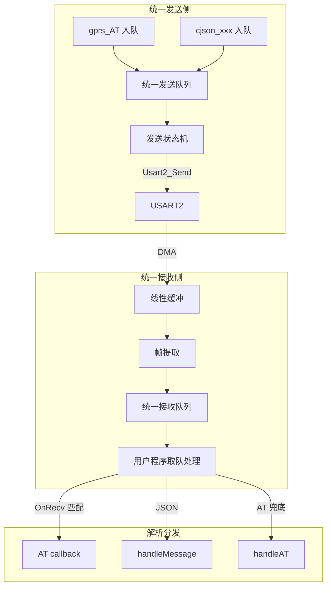
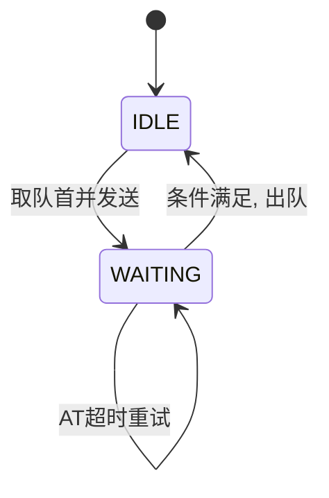

# 串口 AT/JSON 统一队列方案

## 一、需求

### 1.1 在串口的一侧是处理器，另一侧是4g模块，程序的编写只涉及到处理器侧的串口收发逻辑。

### 1.2 at命令由处理器侧发送给4g模块，然后接收到4g模块的响应结果。

### 1.3 json指令可由处理器或4g模块中的任意一侧发出，然后另一侧发送响应结果。

### 1.4 处理器端的发送由先进先出的队列控制，一个指令发送后，必须等待响应结果或响应超时，然后才能发送下一个指令；采用统一的等时（1秒）最大间隔。

### 1.5 处理器端的接收由先进先出的队列控制，接收到的命令或者是响应结果先放入队列，然后由用户程序处理。

### 1.6 串口的接收是dma模式，发送是先组装字符串命令，然后发送。

### 1.7 at命令与json命令应采用同一个接收队列，以及同一个发送队列。

### 1.8 at命令的回执可能会与服务器发送的json命令同时接收，这时需要将json指令的回执与at指令的回执区分开处理。

---

## 二、需求映射与设计要点

| 需求 | 设计映射 |
|------|----------|
| 1.4 发送队列 + 等待响应/超时 + 1秒最大间隔 | 统一发送队列，每项带类型（AT/JSON）；AT 等待 resp_key+OK 或超时；JSON 无显式 ACK，等待间隔；发送间隔采用统一等时最大 1 秒 |
| 1.5 接收队列 + 用户程序处理 | 统一接收队列，DMA 数据经线性缓冲、帧提取后入队；主循环 Parse_Process 取帧，按内容分发 |
| 1.7 同一发送/接收队列 | 单一 FIFO 发送队列、单一 FIFO 接收队列，AT 与 JSON 共用 |
| 1.8 AT/JSON 混收区分 | 帧提取按协议边界分别提取；Parse_Process 优先 UartTx_OnRecv（匹配发送侧等待的 AT），再按 `{` / `OK` 分发 handleMessage / handleAT |

---

## 三、实现状态

| 模块 | 状态 | 说明 |
|------|------|------|
| uart_queue.c/h | 已实现 | 统一发送/接收队列、帧提取、UartTx_OnRecv |
| gprs_rx.c | 已改造 | gprs_rx_datas、Parse_Process、Gprs_Process |
| gprs_tx.c | 已改造 | gprs_send_datas → UartTx_Push_JSON |
| gprs_AT.c | 已改造 | gprs_AT → UartTx_Push_AT |
| timer.c | 已改造 | sys_ms 毫秒计数 |

---

## 四、总体架构



**数据流：**
- **发送**：AT 入队 / JSON 入队 → 统一队列 → 状态机取队首 → 发送 → 等待响应/超时 → 出队 → 取下一条
- **接收**：DMA → 线性缓冲 → 帧提取（JSON/AT 定界符）→ 统一队列 → Parse_Process → UartTx_OnRecv / handleMessage / handleAT

---

## 五、统一发送队列设计

### 5.1 发送项类型

| 类型 | 发送后等待 | 超时/重试 | 间隔约束 |
|------|------------|-----------|----------|
| AT   | 等待 resp_key + OK | 超时重试（如 3s × 2 次） | 满足 1.4 时需≤1s |
| JSON | 无显式 ACK | 固定间隔（当前 80ms） | 满足 1.4 时统一≤1s |

### 5.2 核心数据结构

```c
/*==================== 发送项类型 ====================*/
typedef enum {
    TX_ITEM_AT,
    TX_ITEM_JSON,
} UartTxItemType;

/*==================== 配置宏 ====================*/
#define UART_TX_QUEUE_SIZE     8
#define UART_TX_AT_CMD_LEN     32
#define UART_TX_AT_RESP_LEN    16
#define UART_TX_JSON_LEN       512
#define UART_TX_JSON_GAP_MS    80   /* 满足 1.4 时可改为 1000 */
#define UART_TX_AT_TIMEOUT_MS  3000
#define UART_TX_AT_MAX_RETRY   2

/*==================== 统一发送项（按最大成员对齐） ====================*/
typedef struct {
    UartTxItemType type;
    
    union {
        struct {
            char cmd[UART_TX_AT_CMD_LEN];
            u8  cmd_len;
            char resp_key[UART_TX_AT_RESP_LEN];
            UartTx_AT_Callback callback;  /* void (*)(char *resp, u16 len) */
            u16 timeout_ms;
            u8  max_retry;
        } at;
        struct {
            char data[UART_TX_JSON_LEN];
            u16 len;
        } json;
    } u;
} UartTxItem;

/*==================== 统一发送队列 ====================*/
typedef struct {
    UartTxItem items[UART_TX_QUEUE_SIZE];
    u8         head, tail, count;
    
    u8         state;       // 0=IDLE, 1=WAITING（根据队首 type 区分 AT/JSON 等待逻辑）
    u32        send_tick;
    u8         at_retry_cnt; // AT 专用
} UartTxQueue;
```

### 5.3 发送状态机



**WAITING 状态行为（按队首 type 分支）：**

| 队首类型 | 等待条件 | 满足后出队 | 未满足时 |
|----------|----------|------------|----------|
| AT | OnRecv 匹配 resp_key+OK | 调 callback，出队 | 超时则重试或放弃 |
| JSON | 间隔 ≥ UART_TX_JSON_GAP_MS（默认 80ms，可配置为 1000ms 满足 1.4） | 出队 | 继续等待 |

### 5.4 发送 API

```c
void UartTx_Queue_Init(void);

// AT 入队（callback 签名：void fn(char *resp, u16 len)）
u8 UartTx_Push_AT(const char *cmd, u8 cmd_len,
                  const char *resp_key, UartTx_AT_Callback callback,
                  u16 timeout_ms, u8 max_retry);

// JSON 入队
u8 UartTx_Push_JSON(const char *data, u16 len);

// 主循环驱动
void UartTx_Queue_Process(u32 sys_tick_ms);

// 接收匹配时调用（AT 响应到达）
u8 UartTx_OnRecv(char *data, u16 len);
```

---

## 六、统一接收队列设计

### 6.1 分层结构

| 层级 | 作用 |
|------|------|
| 线性缓冲 | 累积 DMA 分包数据，提取后 memmove 前移 |
| 帧提取 | 按 AT 行（\r\n）或 JSON 边界（`{` + `"random":"` + `}`）提取完整帧 |
| 统一接收队列 | 存放完整帧，用户程序取队处理 |

### 6.2 核心数据结构

```c
#define UART_RX_RING_SIZE    1536
#define UART_RX_QUEUE_SIZE   8
#define UART_RX_ITEM_MAX     512

/* 接收缓冲：线性缓冲，提取后 memmove 前移 */
static char rxRingBuf[UART_RX_RING_SIZE];
static u16 rxRingLen;

typedef struct {
    char data[UART_RX_ITEM_MAX];
    u16 len;
} UartRxItem;

typedef struct {
    UartRxItem items[UART_RX_QUEUE_SIZE];
    u8 head, tail, count;
} UartRxQueue;
```

### 6.3 帧提取策略（满足 1.8 混收区分）

提取顺序：**JSON 优先 → AT 次之**，每次循环提取一帧后 memmove 前移。

| 帧类型 | 边界规则 | 提取逻辑 |
|--------|----------|----------|
| JSON | `{` + `"random":"` + `"}` | memchr 找 `{`，memmem 找 `"random":"` 与 `"\}"`，截取完整 JSON |
| AT | 含 `OK` 的块 | memmem 找 `OK`，从缓冲首到 `OK\r\n`（或 `OK\n`）为一帧 |

同一 DMA 包内若既有 AT 响应又有 JSON，会被拆成多帧分别入队，Parse_Process 按序处理。

### 6.4 接收 API

```c
void UartRx_Queue_Init(void);
void UartRx_Append(char *data, u16 len);
void UartRx_Extract(void);   // 提取 AT/JSON 帧入队
u8  UartRx_Pop(char *out, u16 max_len, u16 *out_len);
u8  UartRx_IsEmpty(void);
```

---

## 七、用户程序处理流程

### 7.1 主循环集成

```c
void Gprs_Process(void)
{
    // 1. 接收：DMA 数据追加、帧提取入队
    gprs_rx_datas();   // 内部：UartRx_Append + UartRx_Extract
    
    // 2. 用户程序：从统一接收队列取帧，按内容分发
    Parse_Process();
    
    // 3. 发送：AT 定时入队、JSON 业务入队
    gprs_AT();         // 改为 UartTx_Push_AT 入队
    
    // 4. 发送状态机驱动
    UartTx_Queue_Process(sys_ms);
}
```

### 7.2 解析分发（Parse_Process，满足 1.8）

处理顺序：**先尝试发送侧匹配 → 再按内容分发**

```c
void Parse_Process(void)
{
    char frame[UART_RX_ITEM_MAX];
    u16 len;
    char *pos;

    while (!UartRx_IsEmpty())
    {
        if (UartRx_Pop(frame, sizeof(frame), &len))
        {
            if (UartTx_OnRecv(frame, len) == 1)  /* 优先：匹配当前等待的 AT 响应 */
                continue;
            if ((pos = strstr(frame, "{")) != NULL)
                handleMessage(pos, len);        /* JSON */
            else if (strstr(frame, "OK") != NULL)
                handleAT(frame, len);           /* AT（未匹配 OnRecv 时兜底） */
        }
    }
}
```

**1.8 混收说明**：AT 回执与 JSON 同包到达时，帧提取拆成独立帧；UartTx_OnRecv 仅匹配“当前发送队列等待的 AT”的 resp_key+OK，匹配则出队并回调；未匹配的 AT 或 JSON 走 handleAT / handleMessage。

---

## 八、UartTx_Queue_Process 流程

主循环每次调用 `UartTx_Queue_Process(sys_ms)`，按状态分支：

```
┌─────────────────────────────────────────────────────────┐
│ state == WAITING && count > 0 ?                           │
└────────────────┬────────────────────────────────────────┘
        是 │                    │ 否
           ▼                    ▼
┌──────────────────────┐  ┌──────────────────────────────┐
│ 队首 AT：超时检查     │  │ state == IDLE && count > 0 ? │
│ - 超时→重试或放弃出队 │  └──────────────┬───────────────┘
│ 队首 JSON：80ms 到出队│          是 │       │ 否
└──────────────────────┘                 ▼               ▼
                              ┌─────────────────┐   return
                              │ 取队首，发送     │
                              │ send_tick=sys_ms│
                              │ state=WAITING   │
                              └─────────────────┘
```

**AT 响应结束**：由 `UartTx_OnRecv` 在 Parse_Process 中匹配 resp_key+OK，匹配则出队、state=IDLE。

---

## 九、1.4 统一等时 1 秒间隔配置

满足 1.4「采用统一的等时（1秒）最大间隔」时，需统一 AT 与 JSON 的发送间隔上界：

| 配置项 | 当前值 | 1.4 满足值 | 修改位置 |
|--------|--------|------------|----------|
| UART_TX_JSON_GAP_MS | 80 | 1000 | uart_queue.h |
| AT timeout_ms | 3000 | 若需≤1s 则改为 1000 | gprs_AT.c 入队参数 |

当前实现：JSON 用 80ms 间隔、AT 用 3s 超时。若需 strictly 满足 1s 最大间隔，将 `UART_TX_JSON_GAP_MS` 改为 1000，AT 超时按需调整。

---

## 十、sys_ms 时间基准

| 项目 | 说明 |
|------|------|
| 定义 | `timer.c`: `volatile u32 sys_ms = 0` |
| 更新 | TIM2 中断（5ms）：`sys_ms += 5` |
| 用途 | UartTx_Queue_Process 超时、间隔判断 |
| 溢出 | 约 49 天，对 3s/80ms 场景可忽略 |

---

## 十一、与现有代码的对接

### 11.1 发送侧

| 原调用 | 改造后 |
|--------|--------|
| `Usart2_Send(cmd, len)`（gprs_AT） | `UartTx_Push_AT(cmd, len, resp_key, callback, ...)` |
| `gprs_send_datas(sta, para)` | 内部构建 JSON 后 `UartTx_Push_JSON(json_str, len)` |

### 11.2 接收侧

| 原流程 | 改造后 |
|--------|--------|
| DMA → 拷贝 → strstr → handleAT/handleMessage | DMA → UartRx_Append → UartRx_Extract → 入队 → Parse_Process 取队分发 |

### 11.3 gprs_rx_datas 改造

```c
void gprs_rx_datas(void)
{
    u16 u2rxcnt;
    char tmp[1025];

    if (Usart2_Rec_Cnt == 0)
        return;

    u2rxcnt = Usart2_Rec_Cnt;
    if (u2rxcnt > 1024)
        u2rxcnt = 1024;
    memcpy(tmp, DMA_Rece_Buf2, u2rxcnt);
    tmp[u2rxcnt] = '\0';

    if (strstr(tmp, "WH-LTE-7S1") != NULL)
        atflag = 1;

    UartRx_Append(DMA_Rece_Buf2, u2rxcnt);
    Usart2_Rec_Cnt = 0;
    UartRx_Extract();
}
```

---

## 十二、文件结构

| 文件 | 职责 |
|------|------|
| `uart_queue.h` | 统一发送/接收队列结构、API 声明 |
| `uart_queue.c` | 统一队列实现、发送状态机、帧提取 |
| `gprs_rx.c` | 调用 UartRx_Append/Extract，实现 Parse_Process、Gprs_Process |
| `gprs_tx.c` | gprs_send_datas 改为 UartTx_Push_JSON |
| `gprs_AT.c` | gprs_AT 改为 UartTx_Push_AT 入队 |
| `timer.c` | 提供 sys_ms（TIM2 每 5ms += 5） |
| `main.c` | 调用 UartTx_Queue_Init、UartRx_Queue_Init |

---

## 十三、资源估算

| 资源 | 估算 |
|------|------|
| RAM | 发送队列 ~4.5KB（8×~540B）+ 接收线性缓冲 1.5KB + 接收队列 ~4KB ≈ 10KB |
| Flash | 队列逻辑 + 帧提取 ≈ 2KB |

若 RAM 紧张，可采用“指针+回调”方式减小发送项体积（参见 AT与JSON队列合并方案 方案 C）。

---

## 十四、实现顺序与初始化

1. 实现 `uart_queue.c/h`：统一发送队列、统一接收队列、帧提取
2. 修改 `gprs_rx.c`：接入 UartRx_Append、UartRx_Extract，实现 Parse_Process
3. 修改 `gprs_tx.c`：gprs_send_datas 改为 UartTx_Push_JSON
4. 修改 `gprs_AT.c`：gprs_AT 改为 UartTx_Push_AT
5. 在 Gprs_Process 中集成 UartTx_Queue_Process、Parse_Process
6. `main.c`：GM4G_Init 后调用 `UartTx_Queue_Init()`、`UartRx_Queue_Init()`
