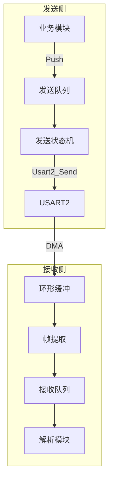
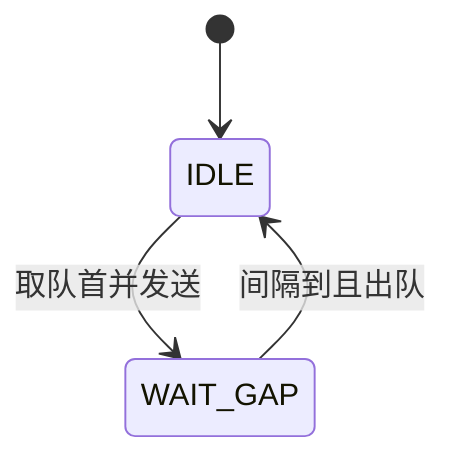

# 串口队列发送与接收方案

## 一、目标与约束

- **目标**：串口发送字符指令、接收数据，并以队列模式提供给解析模块
- **约束**：裸机系统（无 RTOS）、主循环轮询、DMA 接收、阻塞式发送（[usart2.c](d:\qibiji-arm\PCBV10-qinpeng-260211\HARDWARE\USART\usart2.c) 中 `Usart2_Send`）
- **现有通道**：USART2，DMA 接收至 `DMA_Rece_Buf2[1024]`，`Usart2_Rec_Cnt` 表示本次接收长度

---

## 二、总体架构




**数据流**：

- **发送**：业务 → 入队 → 状态机按序发送 → 串口
- **接收**：DMA → 环形缓冲 → 帧提取 → 入队 → 解析模块取队处理

---

## 三、发送队列设计

### 3.1 数据结构

```c
#define UART_TX_QUEUE_SIZE    8       // 队列容量
#define UART_TX_ITEM_MAX_LEN  256     // 单条指令最大长度
#define UART_TX_GAP_MS        50      // 发送间隔（可配置）

typedef struct {
    char data[UART_TX_ITEM_MAX_LEN];
    u16 len;
} UartTxItem;

typedef struct {
    UartTxItem items[UART_TX_QUEUE_SIZE];
    u8 head, tail, count;
    u8 state;           // 0=IDLE, 1=WAIT_GAP
    u32 send_tick;
} UartTxQueue;
```

### 3.2 状态机




- **IDLE**：队列非空时取队首，调用 `Usart2_Send()`，记录 `send_tick`，进入 WAIT_GAP
- **WAIT_GAP**：`sys_tick - send_tick >= UART_TX_GAP_MS` 时出队，回到 IDLE

### 3.3 API

```c
void UartTx_Queue_Init(void);
u8   UartTx_Queue_Push(const char *cmd, u16 len);  // 0=成功, 1=队列满
void UartTx_Queue_Process(u32 sys_tick_ms);
u8   UartTx_Queue_IsEmpty(void);
```

---

## 四、接收队列设计

### 4.1 分层结构


| 层级   | 作用                    |
| ---- | --------------------- |
| 环形缓冲 | 累积 DMA 分包数据，避免丢包      |
| 帧提取  | 按协议边界提取完整帧（行/定界符/长度等） |
| 接收队列 | 存放完整帧，供解析模块取用         |


### 4.2 数据结构

```c
#define UART_RX_RING_SIZE     1536    // 环形缓冲
#define UART_RX_QUEUE_SIZE    4       // 完整帧队列
#define UART_RX_ITEM_MAX      512     // 单帧最大长度

typedef struct {
    char buf[UART_RX_RING_SIZE];
    u16 wp, rp, data_len;
} UartRxRingBuf;

typedef struct {
    char data[UART_RX_ITEM_MAX];
    u16 len;
} UartRxItem;

typedef struct {
    UartRxItem items[UART_RX_QUEUE_SIZE];
    u8 head, tail, count;
} UartRxQueue;
```

### 4.3 帧提取策略（可配置）


| 模式   | 边界规则                           | 适用场景  |
| ---- | ------------------------------ | ----- |
| 行模式  | `\r` / `\n` 为结束                | AT 命令 |
| 定界符  | 如 `{` + `"random":"xxx"` 后 `}` | JSON  |
| 长度前缀 | 前 N 字节为长度                      | 二进制协议 |
| 原始块  | 每次 DMA 一包即入队                   | 简单场景  |


建议提供**回调式帧提取**，由上层协议注册提取函数，实现协议无关：

```c
// 帧提取回调：从 buf[rp..] 中找完整帧，返回帧长度，0 表示未找到
typedef u16 (*FrameExtractFn)(char *buf, u16 rp, u16 data_len);
```

### 4.4 API

```c
void UartRx_Queue_Init(void);
void UartRx_Append(char *data, u16 len);     // 追加 DMA 数据
u8   UartRx_Extract(FrameExtractFn extract); // 提取完整帧入队
u8   UartRx_Queue_Pop(char *out, u16 max_len, u16 *out_len); // 解析模块取帧
u8   UartRx_Queue_IsEmpty(void);
```

---

## 五、解析模块接口

解析模块从接收队列取数据，不关心 DMA 和环形缓冲细节。

### 5.1 拉取模式（推荐）

主循环中由解析模块主动取队：

```c
void Parse_Process(void)
{
    char frame[UART_RX_ITEM_MAX];
    u16 len;
    while (!UartRx_Queue_IsEmpty())
    {
        if (UartRx_Queue_Pop(frame, sizeof(frame), &len))
            handleMessage(frame, len);  // 现有 handleMessage / handleAT
    }
}
```

### 5.2 回调模式（可选）

若希望“有数据即解析”，可在 `UartRx_Extract` 入队时调用解析回调，但需注意主循环中调用顺序，避免在中断或嵌套过深时解析。

---

## 六、与现有代码的对接

### 6.1 发送侧

**原调用**（[gprs_tx.c](d:\qibiji-arm\PCBV10-qinpeng-260211\HARDWARE\GPRS\gprs_tx.c)）：

```c
Usart2_Send(json_str, length);
```

**改造后**：

```c
UartTx_Queue_Push(json_str, length);
```

`gprs_send_datas()` 内部改为调用 `UartTx_Queue_Push`，对外接口可保持不变。

### 6.2 接收侧

**原流程**（[gprs_rx.c](d:\qibiji-arm\PCBV10-qinpeng-260211\HARDWARE\GPRS\gprs_rx.c)）：

```c
// 单次读取 DMA，直接处理
for (i=0; i<u2rxcnt; i++) UART_RX2_BUF[i] = DMA_Rece_Buf2[i];
pos = strstr(UART_RX2_BUF, "{");  // 或 "usr.cn#"
handleMessage(pos, ...) / handleAT(...)
```

**改造后**：

```c
UartRx_Append(DMA_Rece_Buf2, u2rxcnt);
UartRx_Extract(JsonFrameExtract);  // 或 AtFrameExtract，按协议注册
// 解析在 Parse_Process 中完成
```

### 6.3 多协议共存（AT + JSON）

- **方案 A**：统一接收队列，在帧提取时根据前缀（`usr.cn#` / `{`）分流，入同一队列，解析时再分支
- **方案 B**：两套接收队列，`UartRx_Append` 后分别用不同提取函数入不同队列，解析时分别处理

推荐 **方案 A**，结构更简单，与现有 [JSON命令队列发送接收方案.md](d:\qibiji-arm\PCBV10-qinpeng-260211\JSON命令队列发送接收方案.md) 思路一致。

### 6.4 Gprs_Process 集成

```c
void Gprs_Process(void)
{
    gprs_rx_datas();           // 内部：UartRx_Append + UartRx_Extract
    Parse_Process();           // 从接收队列取帧 → handleAT / handleMessage
    gprs_AT();                 // AT 入队（若采用 AT 队列）
    UartTx_Queue_Process(tick);// 驱动发送队列
}
```

---

## 七、文件结构建议


| 文件             | 职责                                          |
| -------------- | ------------------------------------------- |
| `uart_queue.h` | 队列结构体、宏、API 声明                              |
| `uart_queue.c` | 发送/接收队列实现                                   |
| `gprs_rx.c`    | 调用 `UartRx_Append`、`UartRx_Extract`，实现帧提取回调 |
| `gprs_tx.c`    | 改为 `UartTx_Queue_Push`                      |
| `timer.c`      | 提供 `sys_ms`（若尚未存在）                          |


---

## 八、与现有方案的关系


| 文档                                                                         | 关系                       |
| -------------------------------------------------------------------------- | ------------------------ |
| [AT命令队列发送方案.md](d:\qibiji-arm\PCBV10-qinpeng-260211\AT命令队列发送方案.md)         | AT 命令可入本方案的发送队列，或继续用序列驱动 |
| [JSON命令队列发送接收方案.md](d:\qibiji-arm\PCBV10-qinpeng-260211\JSON命令队列发送接收方案.md) | 本方案是通用底层，JSON 方案可基于本方案实现 |


本方案提供**通用串口队列层**，AT/JSON 作为上层协议使用该层，实现发送队列化、接收队列化，并统一向解析模块提供数据。

---

## 九、资源估算


| 资源    | 估算                                            |
| ----- | --------------------------------------------- |
| RAM   | 发送队列 ~2KB + 接收环形缓冲 ~1.5KB + 接收队列 ~2KB ≈ 5.5KB |
| Flash | 队列逻辑 + 帧提取 ≈ 1–2KB                            |
| CPU   | 主循环中状态判断与超时比较，开销很小                            |


---

## 十、实现顺序建议

1. 实现 `uart_queue.c/h`：发送队列 + 接收环形缓冲 + 接收队列
2. 实现通用帧提取接口及 JSON/AT 的提取回调
3. 修改 `gprs_rx.c`：接入 `UartRx_Append`、`UartRx_Extract`，在 `Parse_Process` 中调用 `handleAT` / `handleMessage`
4. 修改 `gprs_tx.c`：`gprs_send_datas` 内部改为 `UartTx_Queue_Push`
5. 在 `Gprs_Process` 中调用 `UartTx_Queue_Process` 和 `Parse_Process`

