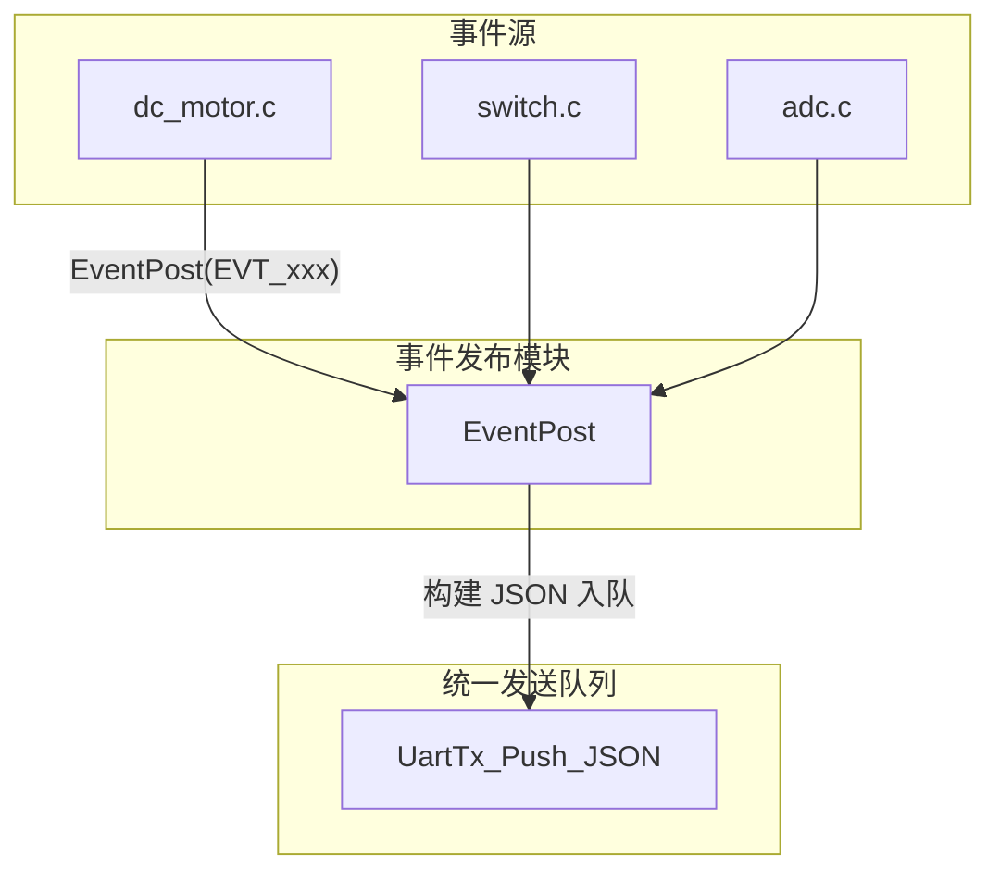

# 事件机制向服务器上报方案

## 一、现状与目标

**现有架构**：

- 主循环：`Dcmotor_Process` → `Gprs_Process` → `UartTx_Queue_Process`
- 发送路径：`UartTx_Push_JSON(data, len, random, ...)` 入队，由 `UartTx_Queue_Process` 驱动发送
- 当前上报多为**被动**：服务器下发 cmd 后，设备回执（enquiry/setting/version）

**目标**：支持**主动**事件上报，事件发生时立即入队发送。

---

## 二、事件类型定义


| 事件类型               | 触发时机                | 典型 para 内容                                     |
| ------------------ | ------------------- | ---------------------------------------------- |
| `EVT_MOTOR_START`  | 电机从 STOP 变为 UP/DOWN | `{"event":"motor_start","dir":"up"}`           |
| `EVT_MOTOR_STOP`   | 电机变为 STOP           | `{"event":"motor_stop","reason":"limit_open"}` |
| `EVT_LIMIT_OPEN`   | FLAG_OPENALL 从 0→1  | `{"event":"limit_open"}`                       |
| `EVT_LIMIT_CLOSE`  | FLAG_CLOSEALL 从 0→1 | `{"event":"limit_close"}`                      |
| `EVT_ALARM`        | 堵转/过流等              | `{"event":"alarm","code":"overcurrent"}`       |
| `EVT_REMOTE_REACH` | 远程控制到达目标开度          | `{"event":"remote_reach","opening":50}`        |


---

## 三、架构设计




**数据流**：

1. 事件源检测到条件满足（含边沿检测）
2. 调用 `EventPost(evt_type, ...)` 或 `EventPostEx(evt_type, para_json)`
3. `EventPost` 按事件类型构建 `JsonEnvelope`（type="status", para=事件内容）
4. 调用 `UartTx_Push_JSON` 入队
5. 由现有 `UartTx_Queue_Process` 按序发送

---

## 四、实现要点

### 4.1 新增文件

- [event_pub.h](HARDWARE/GPRS/event_pub.h)：事件类型枚举、`EventPost` 声明
- [event_pub.c](HARDWARE/GPRS/event_pub.c)：事件序列化、入队逻辑

### 4.2 事件类型枚举（event_pub.h）

```c
typedef enum {
    EVT_MOTOR_START,
    EVT_MOTOR_STOP,
    EVT_LIMIT_OPEN,
    EVT_LIMIT_CLOSE,
    EVT_ALARM,
    EVT_REMOTE_REACH,
    EVT_MAX
} EvtType;
```

### 4.3 核心 API

```c
// 按事件类型发布，内部构建 para
u8 EventPost(EvtType evt, ...);  // 可变参数传 opening、reason 等

// 或简化版：仅类型，para 由内部根据类型生成
u8 EventPostSimple(EvtType evt);
```

- 内部使用 `JsonEnvelope` + `json_envelope_to_string`（若已有）或直接 `snprintf` 构建 JSON
- `type` 使用 `"status"`，与 [gprs_tx.c](HARDWARE/GPRS/gprs_tx.c) 中 WARNING 一致
- `random` 用 `generate_random_string` 或时间戳生成
- `cliendid` 使用 `CParas.cliendid`（AT 初始化后已填充）

### 4.4 集成点


| 模块                                         | 位置                                     | 调用                                                   |
| ------------------------------------------ | -------------------------------------- | ---------------------------------------------------- |
| [dc_motor.c](HARDWARE/DC_MOTOR/dc_motor.c) | `dcmotor_ctrl` 中 `sys_moter_state` 变化处 | `EventPost(EVT_MOTOR_START/STOP)`，根据 t1~t4 区分 reason |
| [switch.c](HARDWARE/SWITCH/switch.c)       | `FLAG_OPENALL`/`FLAG_CLOSEALL` 置 1 处   | `EventPost(EVT_LIMIT_OPEN/CLOSE)`                    |
| [adc.c](HARDWARE/ADC/adc.c) 或 dc_motor     | 堵转/过流检测                                | `EventPost(EVT_ALARM, "overcurrent")`                |
| 远程到达目标                                     | `dcmotor_ctrl` 中 t3/t4 为真时             | `EventPost(EVT_REMOTE_REACH, armReg.gate_kaidu)`     |


### 4.5 边沿检测

- **限位**：在 `switch.c` 中，仅在 `FLAG_OPENALL`/`FLAG_CLOSEALL` 从 0→1 时调用 `EventPost`
- **电机**：在 `dc_motor.c` 中，`sys_moter_state_old != sys_moter_state` 时区分 START/STOP
- **远程到达**：仅在 t3 或 t4 首次为真导致 `sys_moter_state = MOTOR_STOP` 时调用

---

## 五、JSON 格式约定

与现有 WARNING 格式一致，使用 `type="status"`：

```json
{"type":"status","cliendid":"xxx","status":"event","para":{"event":"motor_stop","reason":"limit_open"},"random":"xxx"}
```

或简化 para 结构，由服务器按 `event` 字段解析。

---

## 六、文件改动清单


| 文件                              | 改动                                |
| ------------------------------- | --------------------------------- |
| `HARDWARE/GPRS/event_pub.h`     | 新建：EvtType、EventPost 声明           |
| `HARDWARE/GPRS/event_pub.c`     | 新建：EventPost 实现、JSON 构建           |
| `HARDWARE/DC_MOTOR/dc_motor.c`  | 在 `dcmotor_ctrl` 中增加 EventPost 调用 |
| `HARDWARE/SWITCH/switch.c`      | 在限位置 1 处增加 EventPost 调用           |
| `HARDWARE/ADC/adc.c` 或 dc_motor | 在报警逻辑处增加 EventPost 调用             |
| `USER/main.c` 或工程配置             | 将 `event_pub.c` 加入编译              |


---

## 七、扩展性

- 新增事件：在 `EvtType` 增加枚举，在 `EventPost` 中增加对应分支
- 新增 para 字段：在 `EventPost` 的 `snprintf` 中追加
- 若需优先级：可扩展 `UartTx_Push_JSON` 支持优先级队列，或单独实现高优先级事件队列

