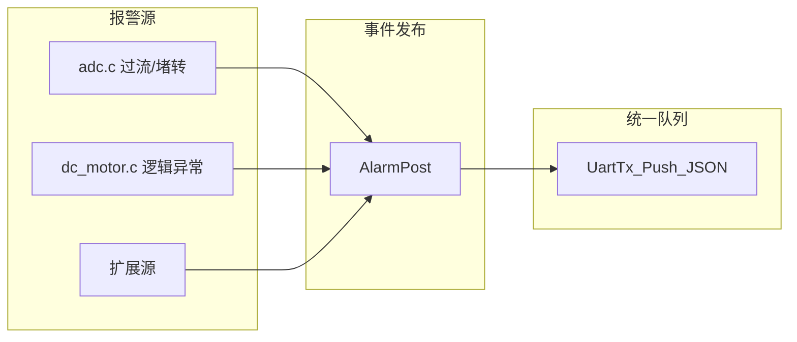

# 报警（错误）上报方案

> 基于事件机制，专门规范报警/错误类事件的定义、触发、上报格式及扩展方式。

---

## 一、与事件机制的关系

报警（错误）作为 `EVT_ALARM` 类型事件，复用事件机制的数据流：



---

## 二、报警代码定义

| 报警代码 | 英文常量 | 触发条件 | 当前检测位置 |
|----------|----------|----------|--------------|
| `overcurrent` | ALARM_OVERcurrent | 电机电流 > motor_warning_curr_upper | [adc.c](HARDWARE/ADC/adc.c) 约 207 行 / 317 行 |
| `stall` | ALARM_STALL | 电流超限连续 10 次（约 200ms） | [adc.c](HARDWARE/ADC/adc.c) 约 315-328 行 |
| `limit_up_err` | ALARM_LIMIT_UP_ERR | 上升限位异常（预留） | armReg.up_err_flag |
| `limit_down_err` | ALARM_LIMIT_DOWN_ERR | 下降限位异常（预留） | armReg.down_err_flag |
| `unknown` | ALARM_UNKNOWN | 未归类错误 | 兜底 |

---

## 三、枚举与结构体

### 3.1 报警代码枚举（alarm.h 或 event_pub.h）

```c
typedef enum {
    ALARM_OVERcurrent,
    ALARM_STALL,
    ALARM_LIMIT_UP_ERR,
    ALARM_LIMIT_DOWN_ERR,
    ALARM_UNKNOWN,
    ALARM_MAX
} AlarmCode;

/* 报警代码转字符串，供 JSON 序列化 */
const char* alarm_code_to_str(AlarmCode code);
```

### 3.2 报警 para 结构体（可选，便于扩展）

```c
typedef struct {
    const char *event;    /* 固定 "alarm" */
    AlarmCode  code;      /* 报警类型 */
    u16        current;   /* 触发时电流 ma，0 表示无 */
    u8        opening;   /* 触发时开度，0xff 表示无 */
} AlarmPara;
```

---

## 四、JSON 格式约定

报警使用 `type="status"`，与事件机制一致，`para` 中携带报警明细：

```json
{
  "type": "status",
  "cliendid": "xxx",
  "status": "alarm",
  "para": {
    "event": "alarm",
    "code": "overcurrent",
    "current": 4200,
    "opening": 50,
    "threshold": 3500
  },
  "random": "xxx"
}
```

**字段说明**：

| 字段 | 类型 | 说明 |
|------|------|------|
| `event` | string | 固定 `"alarm"` |
| `code` | string | 报警代码，如 `"overcurrent"`、`"stall"` |
| `current` | number | 触发时电流（mA），可选 |
| `opening` | number | 触发时闸门开度 0~100，可选 |
| `threshold` | number | 相关阈值（如堵转电流上限 mA），可选 |

---

## 五、触发与防抖

### 5.1 触发点

| 报警类型 | 文件 | 位置 | 调用示例 |
|----------|------|------|----------|
| 过流 | adc.c | `current > motor_warning_curr_upper*100` 后 dcmotor_stop() | `AlarmPost(ALARM_OVERcurrent, current, opening)` |
| 堵转 | adc.c | `stall_detect_count >= 10` 后 dcmotor_stop() | `AlarmPost(ALARM_STALL, current, opening)` |

### 5.2 防抖与去重

- **防抖**：堵转已通过 `stall_detect_count >= 10` 实现，过流为单次检测即停。
- **去重**：同一报警代码在恢复前（如电机已停止）不再重复上报，可用静态变量记录上次报警码与时刻，间隔不少于 N 秒（如 60s）才允许重发。

```c
/* 去重示例：同一 code 在 ALARM_REPOST_INTERVAL_MS 内不重复上报 */
#define ALARM_REPOST_INTERVAL_MS 60000
static AlarmCode last_alarm = ALARM_MAX;
static u32 last_alarm_tick = 0;
```

---

## 六、API 设计

### 6.1 核心接口

```c
/* 报警发布，立即入队 */
u8 AlarmPost(AlarmCode code, u16 current_ma, u8 opening);

/* 简化版：仅传 code */
u8 AlarmPostSimple(AlarmCode code);
```

### 6.2 与 EventPost 的关系

- 方案一：`AlarmPost` 内部调用 `EventPost(EVT_ALARM, code, ...)`，由 EventPost 统一构建 JSON。
- 方案二：`AlarmPost` 独立实现，直接构建报警专用 JSON 并调用 `UartTx_Push_JSON`。

建议采用方案一，与事件机制统一，便于维护。

---

## 七、集成改动清单

| 文件 | 改动 |
|------|------|
| `HARDWARE/GPRS/event_pub.h` | 增加 `AlarmCode`、`AlarmPost` 声明 |
| `HARDWARE/GPRS/event_pub.c` | 实现 `AlarmPost`、`alarm_code_to_str`，EVT_ALARM 分支细化 |
| `HARDWARE/ADC/adc.c` | 过流分支（约 207 行）增加 `AlarmPost(ALARM_OVERcurrent, ...)` |
| `HARDWARE/ADC/adc.c` | 堵转分支（约 322 行）增加 `AlarmPost(ALARM_STALL, ...)` |
| `HARDWARE/REG/reg.h` | 若需，可扩展 `armReg.warning` 位图映射报警类型 |

---

## 八、扩展性

- **新增报警类型**：在 `AlarmCode` 增加枚举，在 `alarm_code_to_str` 中补充映射。
- **新增 para 字段**：在 `AlarmPost` 的 JSON 构建中追加（如时间戳、持续时间等）。
- **恢复通知**：可定义 `EVT_ALARM_CLEAR`，在报警恢复时上报，供服务器区分报警产生与消除。
